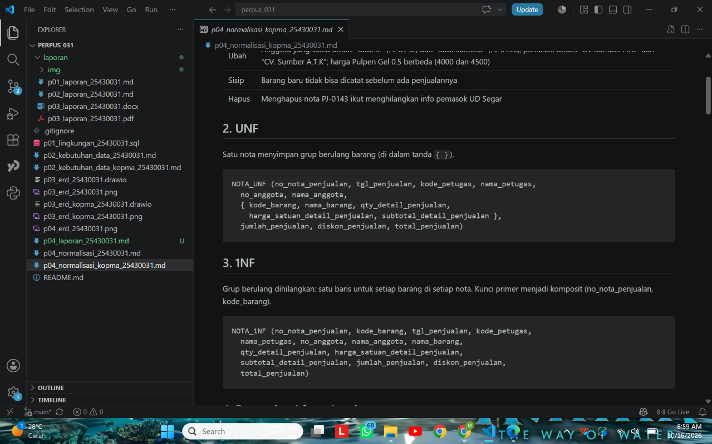
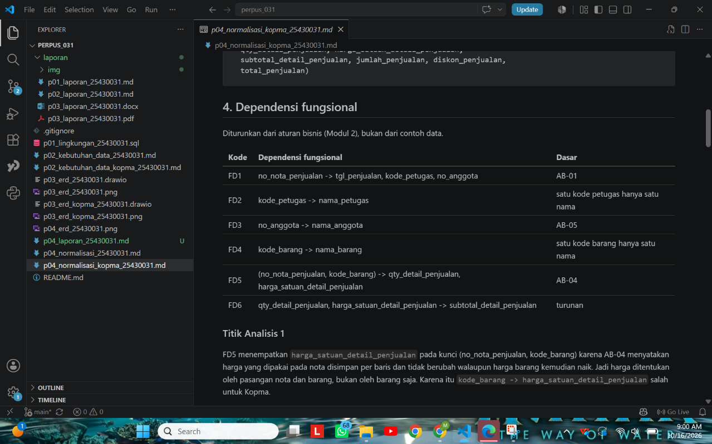
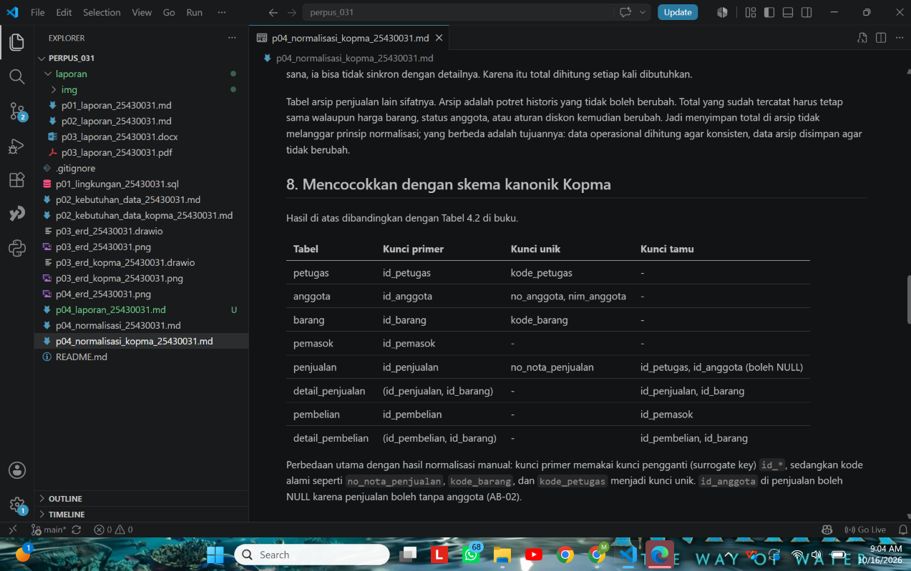
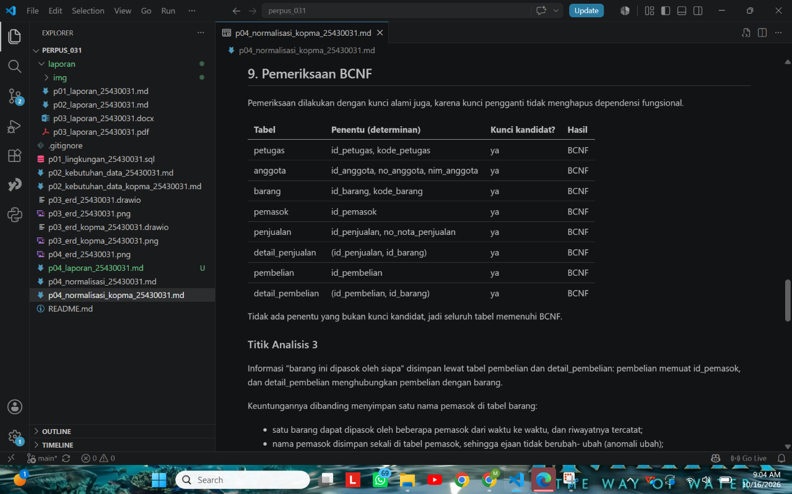
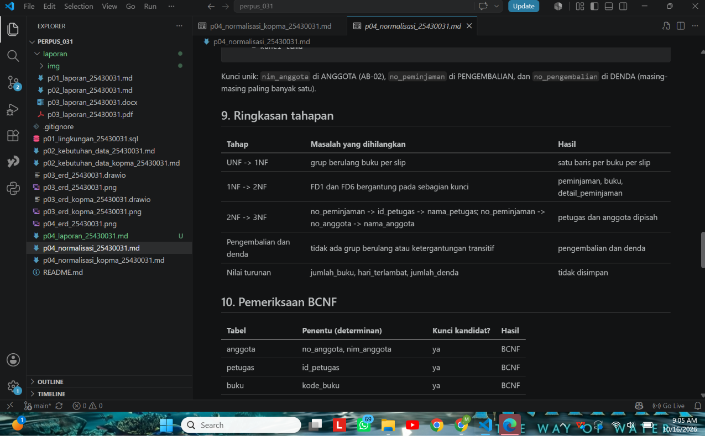
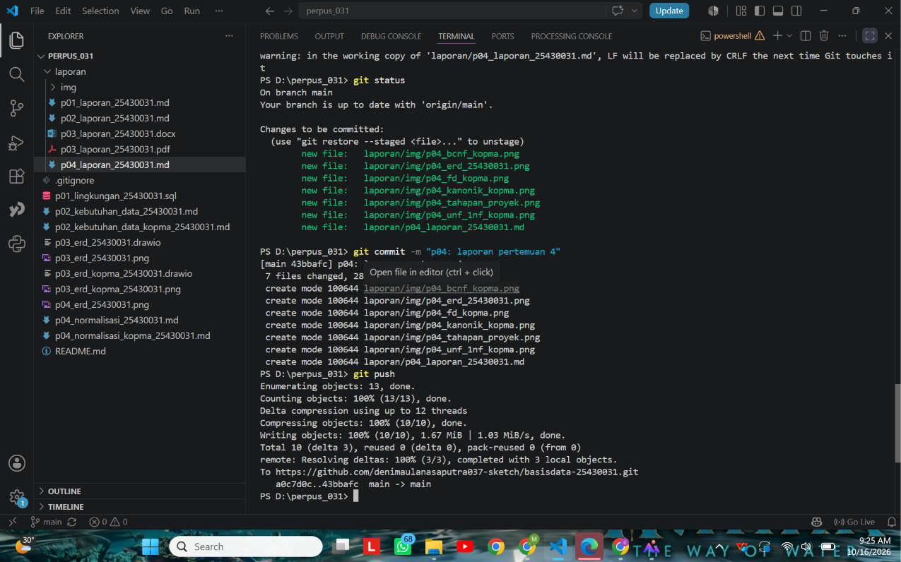

# Laporan Praktikum Basis Data - Pertemuan 04

- **Nama:** Deni Maulana Saputra
- **NIM:** 25430031
- **Kelas:** B
- **Pertemuan:** 1
- **Tanggal pelaksanaan:** 14-10-2026 
- **Asisten/Dosen:** Dedi Irawan, S.Kom., M.T.I.

## 1. Tujuan Praktikum 

Di pertemuan ini saya belajar empat hal. Pertama, mengenali anomali ubah, sisip, dan hapus pada data yang belum dinormalisasi. Kedua, menuliskan dependensi fungsional dari aturan bisnis. Ketiga, menormalisasi tabel sampai 3NF sambil mengecek BCNF. Keempat, memutuskan apakah sebuah nilai turunan sebaiknya disimpan atau dihitung saja.

| No | Yang dipelajari | Hasil yang ditunjukkan di laporan |
|---|---|---|
| 1 | Mengenali anomali ubah, sisip, hapus | Bagian 3 (kasus Kopma) |
| 2 | Menulis dependensi fungsional dari aturan bisnis | Bagian 3 dan 6 |
| 3 | Normalisasi sampai 3NF dan cek BCNF | Bagian 3 dan 6 |
| 4 | Memutuskan nilai turunan disimpan atau dihitung | Bagian 3, 4, dan 6 |

## 2. Ringkasan Dasar Teori

Kalau data yang sama ditulis berulang-ulang di satu tabel besar, nanti muncul masalah yang namanya anomali. Ada tiga jenisnya:

| Anomali | Artinya | Contoh gampangnya |
|---|---|---|
| Ubah | Satu fakta tertulis di banyak baris, jadi bisa tidak sama antar baris | Nama "Budi S." di satu nota dan "Budi Santoso" di nota lain |
| Sisip | Suatu fakta belum bisa dicatat sebelum ada fakta lain | Barang baru belum bisa dicatat sebelum ada yang membelinya |
| Hapus | Menghapus satu fakta ikut menghilangkan fakta lain | Menghapus satu nota membuat info pemasok ikut hilang |

Lalu ada dependensi fungsional. A -> B artinya setiap nilai A pasti menentukan satu nilai B. Yang perlu diingat, dependensi ini harus diturunkan dari aturan bisnis, bukan ditebak dari contoh data. Normalisasi sendiri dilakukan bertahap:

| Bentuk | Yang dihilangkan | Pertanyaan pengecek |
|---|---|---|
| 1NF | Grup berulang, semua nilai harus atomik | Ada sel yang isinya daftar atau kolom barang1, barang2? |
| 2NF | Ketergantungan pada sebagian kunci komposit | Ada atribut yang cukup ditentukan oleh sebagian kunci saja? |
| 3NF | Ketergantungan transitif (A -> B -> C) | Ada rantai A -> B -> C dalam satu tabel? |
| BCNF | Penentu yang bukan kunci kandidat | Ada penentu yang bukan kunci kandidat? |

Tujuan normalisasi itu menghilangkan anomali, bukan sekadar memperbanyak tabel.

## 3. Hasil Langkah Percobaan

Langkah percobaan saya kerjakan pada kasus Koperasi Mahasiswa (Kopma). Semua tahapnya ada di berkas `p04_normalisasi_kopma_25430031.md`.

**D.1 Dari UNF ke 1NF.** Nota penjualan awalnya berbentuk UNF, yaitu satu nota menyimpan daftar barang yang berulang. Saya ratakan jadi satu baris untuk setiap barang di setiap nota, dengan kunci gabungan (no_nota_penjualan, kode_barang).



*Keterangan: bagian UNF dan 1NF di berkas normalisasi Kopma.*

**D.2 Dependensi fungsional.** Saya menulis enam dependensi (FD1 sampai FD6) dari aturan bisnis, bukan dari contoh data.

| Kode | Dependensi fungsional | Dasar |
|---|---|---|
| FD1 | no_nota_penjualan -> tgl_penjualan, kode_petugas, no_anggota | AB-01 |
| FD2 | kode_petugas -> nama_petugas | satu kode petugas, satu nama |
| FD3 | no_anggota -> nama_anggota | AB-05 |
| FD4 | kode_barang -> nama_barang | satu kode barang, satu nama |
| FD5 | (no_nota_penjualan, kode_barang) -> qty, harga_satuan | AB-04 |
| FD6 | qty, harga_satuan -> subtotal | nilai turunan |



*Keterangan: tabel FD1 sampai FD6 di berkas normalisasi Kopma.*

**D.3 Menuju 2NF dan 3NF.** Tabel dipecah bertahap sampai jadi lima: penjualan, detail_penjualan, barang, petugas, dan anggota. Nilai turunan (subtotal, jumlah, total) tidak disimpan.

| Tahap | Masalah yang dihilangkan | Hasil |
|---|---|---|
| UNF -> 1NF | grup berulang barang per nota | satu baris per barang per nota |
| 1NF -> 2NF | FD1 dan FD4 hanya bergantung pada sebagian kunci | penjualan, barang, detail_penjualan |
| 2NF -> 3NF | rantai no_nota -> kode_petugas -> nama_petugas dan no_nota -> no_anggota -> nama_anggota | petugas dan anggota dipisah |
| Nilai turunan | subtotal, jumlah, total | tidak disimpan, dihitung saat dibutuhkan |

**D.4 Skema kanonik dan BCNF.** Hasilnya saya cocokkan dengan Tabel 4.2 di buku, yaitu 8 tabel yang memakai kunci pengganti `id_*`. Perbedaan utamanya, kunci primer pakai `id_*`, sedangkan kode alami seperti `no_nota_penjualan` jadi kunci unik.

| Tabel | Kunci primer | Kunci unik | Kunci tamu |
|---|---|---|---|
| petugas | id_petugas | kode_petugas | - |
| anggota | id_anggota | no_anggota, nim_anggota | - |
| barang | id_barang | kode_barang | - |
| pemasok | id_pemasok | - | - |
| penjualan | id_penjualan | no_nota_penjualan | id_petugas, id_anggota (boleh NULL) |
| detail_penjualan | (id_penjualan, id_barang) | - | id_penjualan, id_barang |
| pembelian | id_pembelian | - | id_pemasok |
| detail_pembelian | (id_pembelian, id_barang) | - | id_pembelian, id_barang |

Pengecekan BCNF dilakukan per tabel dengan memeriksa kunci alaminya juga. Hasilnya semua tabel lolos karena setiap penentu adalah kunci kandidat.



*Keterangan: tabel skema kanonik (8 tabel) di berkas normalisasi Kopma.*



*Keterangan: tabel hasil pemeriksaan BCNF di berkas normalisasi Kopma.*

## 4. Jawaban Titik Analisis

**Titik Analisis 1.** Kenapa harga satuan ditaruh di kunci (no_nota_penjualan, kode_barang), bukan di kode_barang saja?

Karena menurut AB-04, harga yang dipakai di nota disimpan per baris dan tidak ikut berubah walaupun harga barang naik. Jadi harga itu ditentukan oleh pasangan nota dan barang, bukan barangnya saja. Kalau harga dipindah ke tabel barang, setiap kenaikan harga akan mengubah harga di semua nota lama. Akibatnya laporan omzet tahun lalu ikut berubah dan angkanya tidak lagi sama dengan uang yang benar-benar diterima waktu itu.

**Titik Analisis 2.** Kenapa "total tidak disimpan" di tabel operasional, tapi di tabel arsip justru disimpan?

Di tabel operasional, total masih bisa berubah mengikuti data dasarnya (detail barang, status anggota, aturan diskon). Kalau total disimpan, risikonya tidak sinkron dengan datanya, jadi lebih aman dihitung. Tabel arsip lain ceritanya: arsip itu potret masa lalu yang tidak boleh berubah. Total yang sudah tercatat harus tetap sama walaupun harga atau aturan diskon berubah. Jadi keduanya tetap konsisten, hanya tujuannya yang beda.

**Titik Analisis 3.** Di mana info "barang ini dipasok oleh siapa" disimpan sekarang?

Lewat tabel pembelian (yang memuat id_pemasok) dan detail_pembelian (yang menghubungkan pembelian dengan barang).

| Keuntungan dibanding satu nama pemasok di tabel barang | Penjelasan singkat |
|---|---|
| Satu barang bisa punya beberapa pemasok | Riwayat pemasoknya tetap tercatat |
| Nama pemasok disimpan sekali | Ejaannya tidak berubah-ubah (mencegah anomali ubah) |
| Pemasok baru bisa dicatat lebih dulu | Tidak perlu menunggu ada barangnya (mencegah anomali sisip) |
| Menghapus barang atau nota | Data pemasok tidak ikut hilang (mencegah anomali hapus) |

## 5. Hasil Latihan dan Modifikasi

**E.1 Beberapa nomor telepon per pemasok.** Kalau satu sel menyimpan banyak nomor, itu melanggar 1NF. Solusinya, nomor telepon dipisah ke relasi baru:

```
PEMASOK_TELEPON (id_pemasok*, no_telepon_pemasok)
-- kunci primer: (id_pemasok, no_telepon_pemasok)
```

Jadi satu pemasok bisa punya nol atau banyak nomor telepon.

**E.2 Contoh pelanggaran 3NF dan anomali ubah.** Misalkan nama_anggota disimpan langsung di tabel penjualan (saya sebut `penjualan_buruk`):

| no_nota_penjualan | no_anggota | nama_anggota |
|---|---|---|
| PJ-2609-0142 | A-0457 | Budi S. |
| PJ-2609-0150 | A-0457 | Budi S. |

Di sini ada rantai no_nota_penjualan -> no_anggota -> nama_anggota, jadi melanggar 3NF. Kalau nama diubah lewat kueri ini:

```sql
UPDATE penjualan_buruk
SET nama_anggota = 'Budi Santoso'
WHERE no_nota_penjualan = 'PJ-2609-0150';
```

maka hanya satu nota yang berubah, dan anggota A-0457 jadi punya dua nama ("Budi S." dan "Budi Santoso"). Itulah anomali ubahnya, dan FD3 (no_anggota -> nama_anggota) jadi dilanggar.

## 6. Tugas Mandiri: Milestone Proyek 04

Proyek saya adalah Perpustakaan Happy Reading. Berkasnya `p04_normalisasi_25430031.md` dan `p04_erd_25430031.png`. Dokumen sumber yang saya pakai adalah slip peminjaman, karena satu slip bisa memuat beberapa buku sehingga ada grup berulang untuk UNF.

**Dependensi fungsional proyek (12 FD).**

| Kode | Dependensi fungsional | Dasar |
|---|---|---|
| FD1 | no_peminjaman -> tgl_peminjaman, tgl_jatuh_tempo, no_anggota, id_petugas | AB-04, AB-09, AB-12 |
| FD2 | id_petugas -> nama_petugas | kamus data |
| FD3 | no_anggota -> nim_anggota, nama_anggota, no_hp_anggota, status_anggota, tgl_daftar | AB-01, AB-02 |
| FD4 | nim_anggota -> no_anggota | AB-02 |
| FD5 | no_anggota -> id_petugas_daftar | formulir pendaftaran (PB-01) |
| FD6 | kode_buku -> judul_buku, pengarang, tahun_terbit, stok_buku | AB-10 |
| FD7 | (no_peminjaman, kode_buku) -> kondisi_keluar | AB-13 |
| FD8 | no_pengembalian -> tgl_pengembalian, no_peminjaman, id_petugas | AB-07, AB-09 |
| FD9 | id_denda -> no_pengembalian, tarif_denda_harian, status_bayar | AB-08 |
| FD10 | tgl_pengembalian, tgl_jatuh_tempo -> hari_terlambat | turunan (AB-08) |
| FD11 | hari_terlambat, tarif_denda_harian -> jumlah_denda | turunan (AB-08) |
| FD12 | no_peminjaman -> jumlah_buku | turunan (AB-05, AB-11) |

Satu catatan: saya sengaja tidak menulis tgl_peminjaman -> tgl_jatuh_tempo. Alasannya, AB-12 hanya membatasi lama peminjaman maksimal 7 hari, bukan tepat 7 hari, jadi tanggal jatuh tempo tidak bisa dipastikan hanya dari tanggal peminjaman.

**Tahapan normalisasi.**

| Tahap | Masalah yang dihilangkan | Hasil |
|---|---|---|
| UNF -> 1NF | grup berulang buku per slip | satu baris per buku per slip, kunci (no_peminjaman, kode_buku) |
| 1NF -> 2NF | FD1 dan FD6 hanya bergantung pada sebagian kunci | peminjaman, buku, detail_peminjaman |
| 2NF -> 3NF | rantai no_peminjaman -> id_petugas -> nama_petugas dan no_peminjaman -> no_anggota -> nama_anggota | petugas dan anggota dipisah |
| Pengembalian dan denda | tidak ada grup berulang atau ketergantungan transitif | pengembalian dan denda |
| Nilai turunan | jumlah_buku, hari_terlambat, jumlah_denda | tidak disimpan |



*Keterangan: tabel ringkasan tahapan normalisasi di berkas proyek.*

**Skema akhir 3NF dan hasil BCNF.** Hasilnya tujuh tabel dan semuanya lolos BCNF.

| Tabel | Kunci primer | Kunci unik | Kunci tamu | BCNF |
|---|---|---|---|---|
| anggota | no_anggota | nim_anggota | id_petugas_daftar | Lolos |
| petugas | id_petugas | - | - | Lolos |
| buku | kode_buku | - | - | Lolos |
| peminjaman | no_peminjaman | - | id_petugas, no_anggota | Lolos |
| detail_peminjaman | (no_peminjaman, kode_buku) | - | no_peminjaman, kode_buku | Lolos |
| pengembalian | no_pengembalian | no_peminjaman | no_peminjaman, id_petugas | Lolos |
| denda | id_denda | no_pengembalian | no_pengembalian | Lolos |

**Keputusan nilai turunan.**

| Nilai | Keputusan | Alasan |
|---|---|---|
| jumlah_buku | Dihitung | Sama dengan jumlah baris detail_peminjaman per peminjaman; batas 7 buku (AB-11) dijaga saat transaksi |
| hari_terlambat | Dihitung | Selisih tanggal pengembalian dan jatuh tempo; kalau disimpan bisa tidak cocok dengan tanggalnya |
| jumlah_denda | Dihitung | Hari terlambat x tarif harian (AB-08); kalau disimpan bisa tidak cocok dengan keterlambatan |
| tarif_denda_harian | Disimpan per denda | Jadi potret tarif saat denda terjadi, sehingga denda lama tidak ikut berubah kalau tarif naik |
| tgl_jatuh_tempo | Disimpan | AB-12 hanya membatasi maksimal 7 hari, jadi tidak bisa dihitung pasti dari tanggal peminjaman |

**Asumsi yang saya pakai.** Satu peminjaman dikembalikan sekaligus (jadi tidak ada detail pengembalian), dan satu pengembalian paling banyak punya satu denda.

**Perubahan ERD.**

| Perubahan | Alasan |
|---|---|
| Atribut turunan jumlah_buku, hari_terlambat, dan jumlah_denda dihapus dari ERD | Keputusan Modul 4 adalah menghitungnya, bukan menyimpannya |
| Kolom id_petugas di anggota dinamai id_petugas_daftar | Supaya tidak tertukar dengan id_petugas di peminjaman dan pengembalian |


*Keterangan: ERD hasil normalisasi 3NF Perpustakaan Happy Reading.*

## 7. Pembahasan dan Kendala

Selama mengerjakan, ada dua kendala yang saya temui:

| Kendala | Penyebab | Cara mengatasi |
|---|---|---|
| Berkas p04 belum ikut ter-commit | `git status` menampilkan berkas sebagai *Untracked files*, artinya belum dimasukkan ke Git | Jalankan `git add` untuk berkas itu, lalu `git commit` dan `git push` |
| Muncul galat `An empty pipe element is not allowed` di PowerShell | Teks tabel Markdown tidak sengaja ikut tertempel di terminal, dan tanda garis tegak dianggap operator pipa oleh PowerShell | Pastikan hanya perintah Git yang diketik di terminal, sedangkan isi berkas diedit di editor |

Pelajaran terpentingnya: dependensi fungsional harus diturunkan dari aturan bisnis, dan nilai turunan lebih aman dihitung daripada disimpan karena jadi tidak mungkin tidak cocok dengan data dasarnya.

## 8. Kesimpulan

Normalisasi membantu menghilangkan anomali ubah, sisip, dan hapus dengan memecah tabel berdasarkan dependensi fungsional, dari UNF sampai 3NF lalu dicek dengan BCNF. Dependensi harus berasal dari aturan bisnis, bukan dari contoh data. Nilai turunan sebaiknya dihitung di tabel operasional, sedangkan data arsip boleh menyimpan nilai sebagai potret masa lalu. Skema 3NF proyek perpustakaan ini nanti jadi dasar skrip DDL di Pertemuan 5.

## 9. Pernyataan Penggunaan AI

| Hal | Keterangan |
|---|---|
| Alat yang dipakai | Claude (Anthropic) |
| Dipakai untuk | Memahami konsep normalisasi (anomali, dependensi fungsional, 1NF sampai 3NF, BCNF), menyusun kerangka berkas dan laporan Markdown, membuat gambar ERD hasil normalisasi, dan memeriksa hasil pekerjaan |
| Bagian yang terbantu: Kopma (Langkah D, Titik Analisis 1-3, Latihan E) | Draf disusun dengan bantuan AI berdasarkan isi Modul 4, lalu saya baca dan sesuaikan |
| Bagian yang terbantu: Milestone Proyek 4 | Draf FD, tahapan 1NF sampai 3NF, BCNF, keputusan nilai turunan, dan gambar ERD disusun dengan bantuan AI dari dokumen `p02_kebutuhan_data_25430031.md` milik saya. Dokumen sumber dan aturan bisnis proyek berasal dari p02 yang saya buat sendiri |
| Dasar penggunaan | Sesuai arahan dosen pengampu: AI boleh dipakai dengan syarat disertai pernyataan ini |

## 10. Bukti Git

| Hal | Isi |
|---|---|
| Repositori | https://github.com/denimaulanasaputra037-sketch/basisdata-25430031 |
| Commit normalisasi Kopma | `1da3f26` (pesan: `p04: normalisasi kopma`) |
| Commit normalisasi proyek | `a0c7d0c` (pesan: `p04: normalisasi proyek perpustakaan`) |



*Keterangan: hasil `git push` yang berhasil.*

## Checklist

**Checklist khusus Pertemuan 4**

| | Jenis | Yang harus ada |
|---|---|---|
| ☑ | Berkas wajib | p04_normalisasi_25430031.md (proyek) |
| ☑ | Bukti tangkapan layar | Tabel tahapan UNF -> 1NF -> 2NF -> 3NF |
| ☑ | Analisis wajib | Daftar dependensi fungsional; keputusan menyimpan atau menghitung nilai turunan beserta alasannya |

**Checklist umum**

| | Butir | Status |
|---|---|---|
| ☑ | Identitas lengkap | Sudah diisi |
| ☑ | Tujuan dengan bahasa sendiri | Sudah |
| ☑ | Ringkasan teori | Sudah |
| ☐ | Tangkapan layar langkah D dengan keterangan | Gambar belum ditambahkan |
| ☑ | Titik Analisis dijawab dengan alasan | Sudah |
| ☑ | Latihan E | Sudah |
| ☑ | Tugas Mandiri (F) | Sudah |
| ☑ | Pembahasan dan kendala | Sudah |
| ☑ | Kesimpulan | Sudah |
| ☑ | Pernyataan Penggunaan AI | Sudah |
| ☑ | Bukti Git (hash commit) | Sudah |
| ☐ | Keaslian: tangkapan layar memperlihatkan akun ber-NIM dan jam sistem | Cek saat gambar sudah dipasang |