# Laporan Praktikum Basis Data - Pertemuan 05

| Data | Isi |
|---|---|
| Nama | Deni Maulana Saputra |
| NIM | 25430031 |
| Kelas | B |
| Pertemuan | 5 (DDL dan Constraint) |
| Tanggal pelaksanaan | 21-10-2026 |
| Asisten/Dosen | Dedi Irawan, S.Kom., M.T.I. |

## 1. Tujuan Praktikum

Di pertemuan ini saya belajar mengubah rancangan tabel (hasil normalisasi) menjadi tabel sungguhan di MariaDB lewat skrip DDL. Saya juga belajar menjaga aturan bisnis dengan constraint (kunci primer, kunci tamu, UNIQUE, CHECK, DEFAULT), lalu membuktikan bahwa constraint itu benar-benar menolak data yang salah.

| No | Yang dipelajari | Hasil yang ditunjukkan di laporan |
|---|---|---|
| 1 | Menulis skrip DDL yang bisa dijalankan ulang | Bagian 3 dan 6 |
| 2 | Memilih tipe data dan constraint dari aturan bisnis | Bagian 6 |
| 3 | Membuktikan constraint menolak data salah | Bagian 3 dan 6 |
| 4 | Mengubah struktur dengan ALTER TABLE | Bagian 3 dan 5 |

## 2. Ringkasan Dasar Teori

DDL (Data Definition Language) dipakai untuk membuat dan mengubah struktur tabel, misalnya `CREATE TABLE`, `ALTER TABLE`, dan `DROP TABLE`. Constraint ibarat satpam bagi tabel: ia menolak data yang melanggar aturan sebelum data itu tersimpan.

| Constraint | Tugasnya | Contoh |
|---|---|---|
| PRIMARY KEY | Identitas unik tiap baris | `id_barang` |
| UNIQUE | Nilai tidak boleh kembar | `kode_barang` |
| NOT NULL | Tidak boleh kosong | `nama_barang` |
| DEFAULT | Nilai otomatis jika tidak diisi | `stok_barang` = 0 |
| CHECK | Nilai harus memenuhi syarat | `stok_barang >= 0` |
| FOREIGN KEY | Hanya boleh merujuk data induk yang ada | nota harus punya petugas terdaftar |

Satu hal penting: tipe kolom kunci tamu harus sama persis dengan kolom induknya, dan tabel dibuat dari induk ke anak, sedangkan dihapus dari anak ke induk.

## 3. Hasil Langkah Percobaan

Langkah percobaan dikerjakan pada basis data Koperasi Mahasiswa (`kopma_031`) memakai akun `mhs_031`. Skripnya ada di `p05_ddl_kopma_25430031.sql`.

**D.1 Membangun 8 tabel.** Skrip diawali `DROP TABLE IF EXISTS` (urutan anak ke induk), lalu `CREATE TABLE` untuk petugas, anggota, barang, pemasok, penjualan, detail_penjualan, pembelian, dan detail_pembelian. Skrip sudah saya jalankan lebih dari sekali tanpa galat.

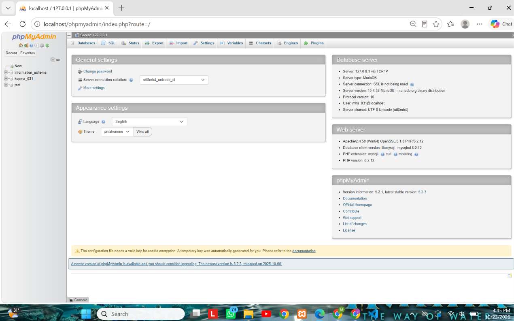

*Keterangan: halaman depan phpMyAdmin, terlihat akun `mhs_031@localhost`.*

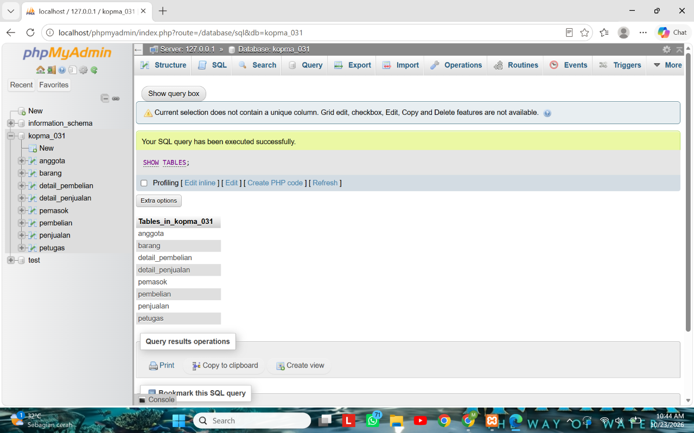

*Keterangan: hasil `SHOW TABLES` di `kopma_031` menampilkan 8 tabel.*

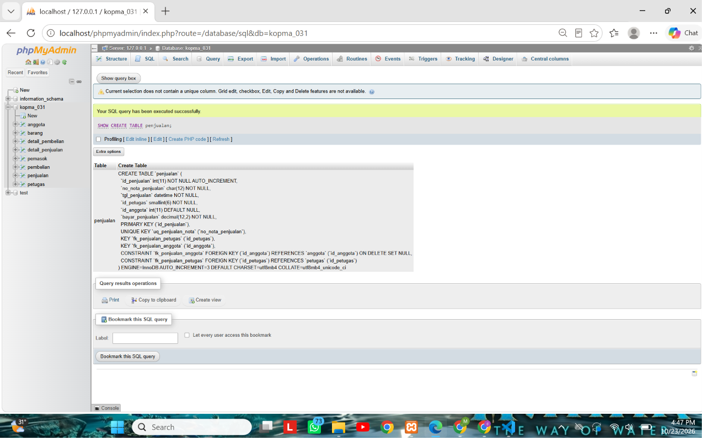

*Keterangan: struktur tabel `penjualan` lengkap dengan `PRIMARY KEY`, `UNIQUE KEY`, dan dua `FOREIGN KEY`.*

**D.2 Membuktikan constraint menolak data salah.** Setelah mengisi data induk (2 petugas dan 2 barang), saya menjalankan tiga perintah yang sengaja salah. Ketiganya ditolak server.

| Perintah yang salah | Kode galat | Constraint yang bekerja | Aturan yang dijaga |
|---|---|---|---|
| Nota dengan `id_petugas` 99 | #1452 | `fk_penjualan_petugas` | nota wajib punya petugas terdaftar |
| Stok diubah menjadi -1 | #4025 | `ck_barang_stok` | AB-03: stok tidak boleh negatif |
| Kode barang `ATK-001` kembar | #1062 | `uq_barang_kode` | kode barang unik |

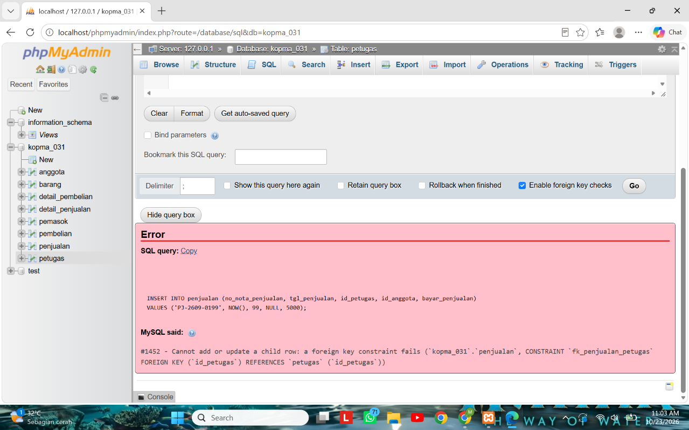

*Keterangan: galat #1452, kunci tamu menolak petugas yang tidak ada.*

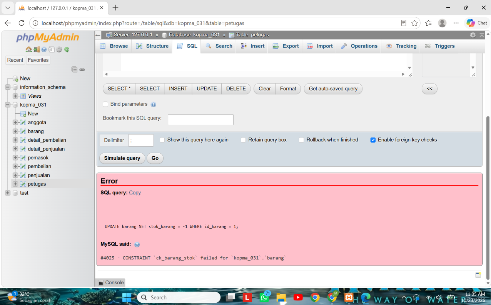

*Keterangan: galat #4025, CHECK menolak stok negatif.*

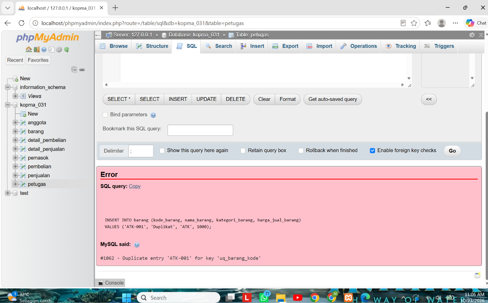

*Keterangan: galat #1062, UNIQUE menolak kode barang kembar.*

**D.3 Mengubah struktur dengan ALTER TABLE.** Saya menambah kolom `tgl_kedaluwarsa` pada tabel `barang`, membuktikannya dengan `SHOW COLUMNS`, lalu menghapusnya lagi.


*Keterangan: kolom `tgl_kedaluwarsa` (DATE, NULL) muncul setelah `stok_min_barang`.*

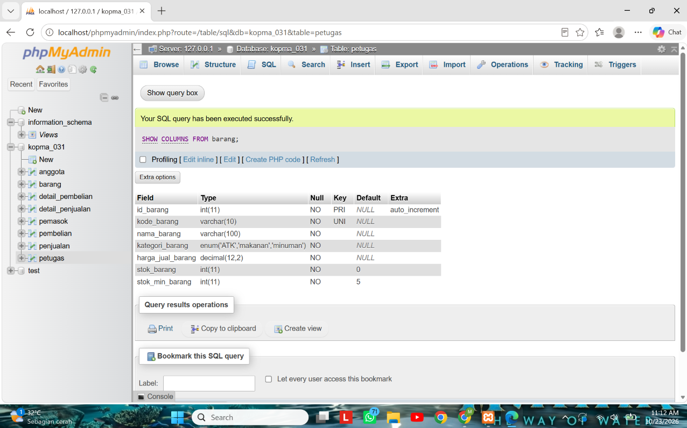

*Keterangan: setelah `DROP COLUMN`, kolom itu sudah hilang.*

**D.4 Membandingkan Designer dengan ERD.** Tabel disusun di fitur Designer phpMyAdmin.

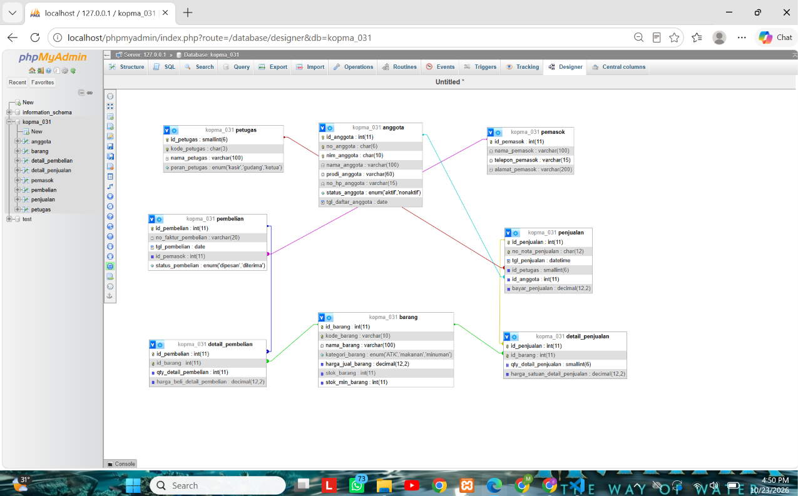

*Keterangan: Designer `kopma_031` dengan 8 tabel dan 7 garis kunci tamu.*

| Aspek | ERD Pertemuan 3 | Designer phpMyAdmin |
|---|---|---|
| Notasi kardinalitas | crow's foot (1, 0..N) dan kata kerja relasi | garis berwarna tanpa simbol kardinalitas |
| Tipe data | belum selalu lengkap | lengkap (`int(11)`, `decimal(12,2)`, dan seterusnya) |
| CHECK, UNIQUE, DEFAULT, ON DELETE | tidak ada | tidak terlihat |
| Fungsi | model rancangan | cermin kondisi database sebenarnya |

## 4. Jawaban Titik Analisis

**Titik Analisis 1.** `fk_detail_penjualan` memakai `ON DELETE CASCADE` karena detail adalah bagian dari nota: rincian barang tidak punya arti tanpa notanya, jadi kalau nota dibatalkan, rinciannya ikut terhapus dan tidak ada baris yatim. `fk_detail_barang` tidak memakainya karena barang adalah data master yang dirujuk banyak nota. Kalau barang boleh dihapus beserta seluruh detailnya, baris di nota lama ikut hilang, sehingga laporan penjualan lama dan omzetnya berubah. Karena itu server menolak penghapusan barang yang sudah pernah terjual.

**Titik Analisis 2.** Pemetaan kode galat ke aturan bisnis ada di tabel D.2 di atas. Aturan Kopma yang belum bisa dijaga constraint adalah bagian AB-01 "minimal satu barang per nota" dan bagian AB-03 "penjualan ditolak bila jumlah melebihi stok" (melibatkan banyak baris atau tabel), AB-02 diskon 5% hanya untuk anggota aktif (perlu logika), dan AB-06 pemesanan otomatis saat stok di bawah minimum. Semuanya diselesaikan lewat transaksi dan prosedur di pertemuan berikutnya.

**Titik Analisis 3.** `DROP TABLE IF EXISTS` harus dimulai dari tabel anak (`detail_pembelian` dan `detail_penjualan`) karena tabel anak memegang kunci tamu ke induk. Tabel induk tidak boleh dihapus selama masih ada anak yang merujuknya. Kalau urutannya dibalik, muncul **ERROR 1451**: *Cannot delete or update a parent row: a foreign key constraint fails*. Saya membuktikannya dengan menjalankan `DROP TABLE petugas;`, dan perintah itu ditolak karena `penjualan` masih merujuk `petugas`.

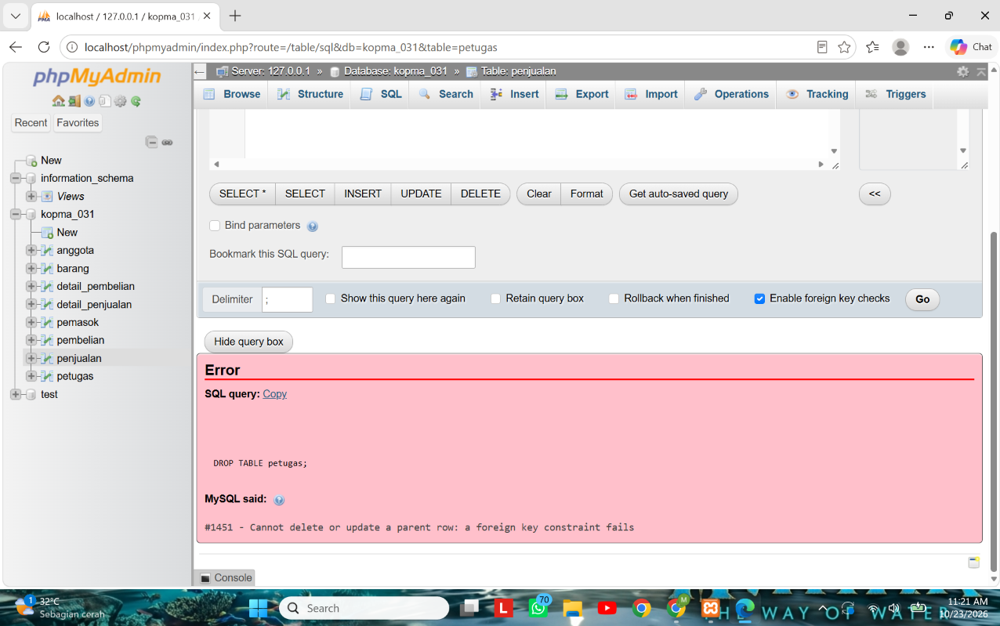

*Keterangan: galat #1451 saat mencoba menghapus tabel induk `petugas`.*

## 5. Hasil Latihan dan Modifikasi

**E.1 CHECK untuk stok minimum.** Saya menambah constraint agar `stok_min_barang` tidak negatif, lalu membuktikannya.

```sql
ALTER TABLE barang ADD CONSTRAINT ck_barang_stokmin CHECK (stok_min_barang >= 0);
UPDATE barang SET stok_min_barang = -1 WHERE id_barang = 1;   -- ditolak, galat #4025
```

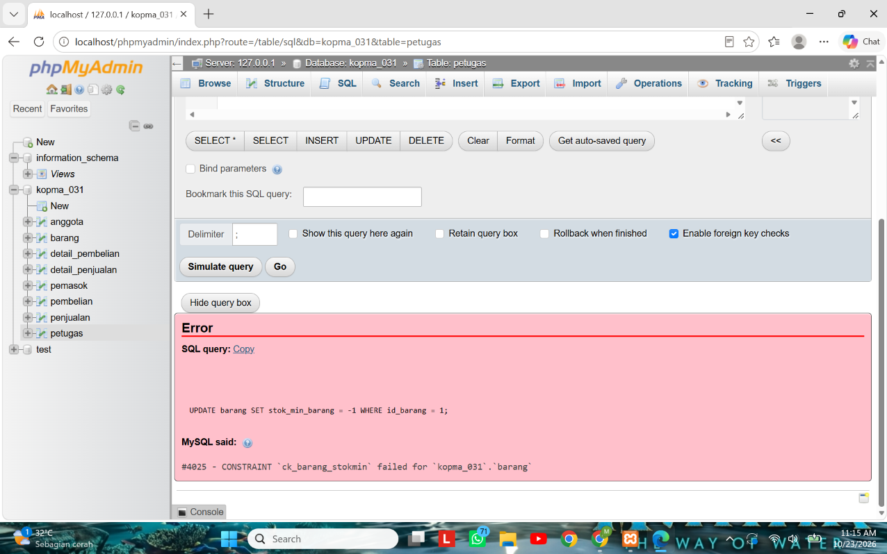

*Keterangan: galat #4025 pada `ck_barang_stokmin`.*

**E.2 ON DELETE SET NULL pada anggota.** Kunci tamu `fk_penjualan_anggota` saya buat ulang dengan `ON DELETE SET NULL`. Lalu saya membuat satu anggota dan satu nota milik anggota itu, kemudian menghapus anggotanya.

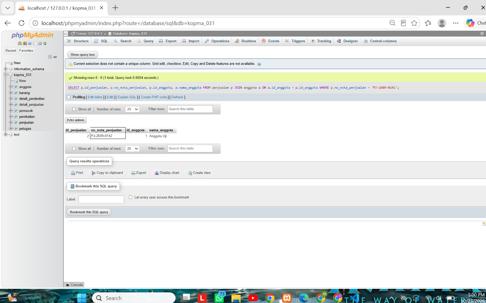

*Keterangan: nota `PJ-2609-0142` terhubung ke anggota nomor 1.*

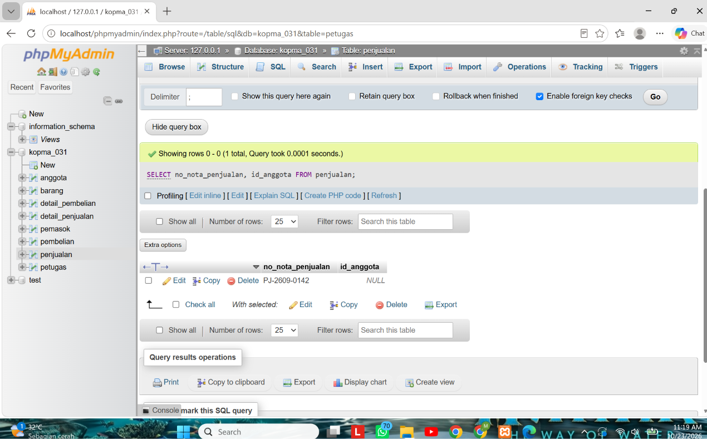

*Keterangan: nota tetap ada, tetapi `id_anggota` menjadi NULL.*

Perubahan ini sesuai AB-02 karena penjualan memang boleh tanpa anggota (pembeli umum), sehingga nota lama tetap sah dan omzet tidak berubah. Dari sisi pelindungan data pribadi, data anggota hilang dari tabel anggota sementara notanya bertahan tanpa identitas. Kekurangannya, riwayat belanja anggota tidak bisa dilacak lagi, termasuk bukti diskon yang pernah diberikan. Untuk anggota yang berhenti, mengubah statusnya menjadi `nonaktif` lebih aman daripada menghapus barisnya.

## 6. Tugas Mandiri: Milestone Proyek 05

Proyek: Perpustakaan Happy Reading, basis data `perpus_031`, dikerjakan dengan akun `dev_031`. Berkas: `p05_ddl_25430031.sql`, `p05_erd_fisik_25430031.png`, dan `p05_erd_fisik_25430031.drawio`.

**Pemetaan tipe data dan alasannya.**

| Kolom | Tipe | Alasan |
|---|---|---|
| no_anggota, id_petugas, kode_buku, no_peminjaman, no_pengembalian, id_denda | CHAR(5) | format kode tetap (misalnya AG001), jadi panjangnya selalu 5 |
| nim_anggota | CHAR(8) | NIM 8 digit; bukan angka hitung dan bisa berawalan 0 |
| no_hp_anggota | VARCHAR(15) | berisi angka tetapi bukan bilangan (berawalan 0), panjang bervariasi |
| nama_anggota, nama_petugas | VARCHAR(100) | teks dengan panjang bervariasi |
| judul_buku, pengarang | VARCHAR(150), VARCHAR(100) | teks dengan panjang bervariasi |
| tahun_terbit | YEAR | khusus menyimpan tahun 4 digit |
| stok_buku | INT | bilangan bulat, dijaga CHECK tidak negatif |
| status_anggota, kondisi_keluar, status_bayar | ENUM | nilainya terbatas dan sudah ditetapkan kamus data |
| tgl_daftar, tgl_peminjaman, tgl_jatuh_tempo, tgl_pengembalian | DATE | hanya tanggal, tanpa jam |
| tarif_denda_harian | DECIMAL(10,2) | uang harus tepat, tidak boleh pembulatan seperti FLOAT |

**Kaitan constraint dengan aturan bisnis.**

| Aturan | Constraint di skrip | Dapat dijaga struktur? |
|---|---|---|
| AB-01 nomor anggota unik | `pk_anggota`, `ck_anggota_no` (format AG + 3 digit) | Ya |
| AB-02 anggota terdaftar satu kali | `uq_anggota_nim` | Ya |
| AB-03 hanya anggota aktif boleh meminjam | - | Tidak, lintas tabel (Modul 14) |
| AB-04 peminjaman oleh anggota terdaftar | `fk_peminjaman_anggota` | Ya |
| AB-05 peminjaman minimal satu buku | - | Tidak, melibatkan banyak baris (Modul 14) |
| AB-06 buku dipinjam jika stok lebih dari 0 | `ck_buku_stok` (stok tidak negatif) | Sebagian; pengecekan stok saat meminjam di Modul 14 |
| AB-07 pengembalian mengacu pada peminjaman | `fk_pengembalian_peminjaman`, `uq_pengembalian_pinjam` | Ya |
| AB-08 denda Rp5.000 per hari | `DEFAULT 5000`, `ck_denda_tarif` | Ya |
| AB-09 dicatat oleh petugas | `fk_peminjaman_petugas`, `fk_pengembalian_petugas` | Ya |
| AB-10 kode buku jelas | `pk_buku`, `ck_buku_kode` | Ya |
| AB-11 maksimal 7 buku per peminjaman | - | Tidak, menyangkut jumlah baris per transaksi (Modul 14) |
| AB-12 lama peminjaman maksimal 7 hari | `ck_peminjaman_tempo` | Ya |
| AB-13 kondisi buku Baik atau Rusak ringan | ENUM `kondisi_keluar` | Ya |

Semua kunci tamu memakai `ON DELETE RESTRICT` (bawaan) supaya riwayat transaksi tetap tersimpan (NFR-02 dan NFR-04). Skrip saya uji dua kali dari basis data kosong dan tidak ada galat.

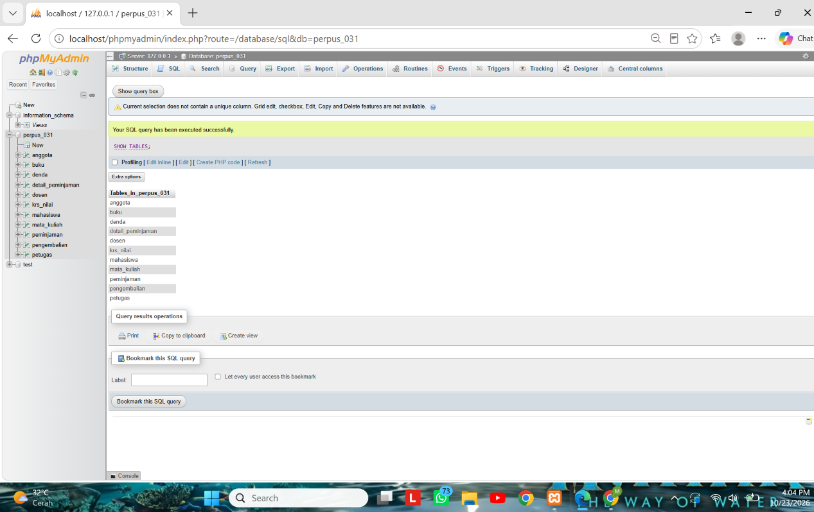

*Keterangan: `SHOW TABLES` di `perpus_031` memuat tujuh tabel perpustakaan (ditambah empat tabel lama dari Modul 1).*

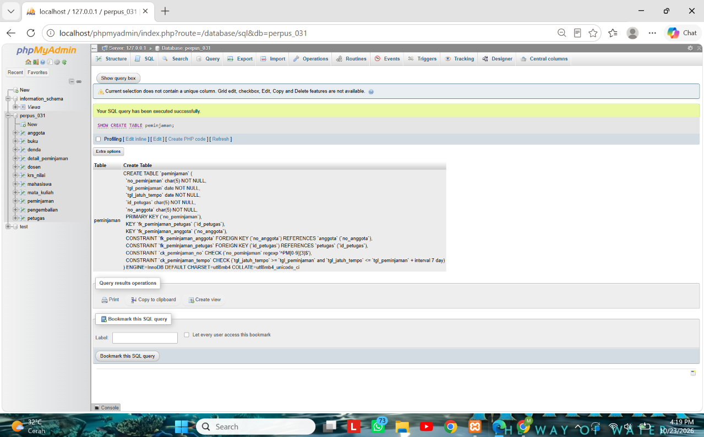

*Keterangan: struktur tabel `peminjaman` lengkap dengan `ck_peminjaman_tempo` dan dua kunci tamu.*

**Bukti constraint proyek menolak data salah.**

| Perintah yang salah | Kode galat | Constraint | Aturan |
|---|---|---|---|
| Anggota dengan petugas pendaftar PT999 | #1452 | `fk_anggota_petugas` | relasi anggota dan petugas |
| Peminjaman dengan jatuh tempo 10 hari | #4025 | `ck_peminjaman_tempo` | AB-12 |
| Anggota dengan NIM yang sudah dipakai | #1062 | `uq_anggota_nim` | AB-02 |

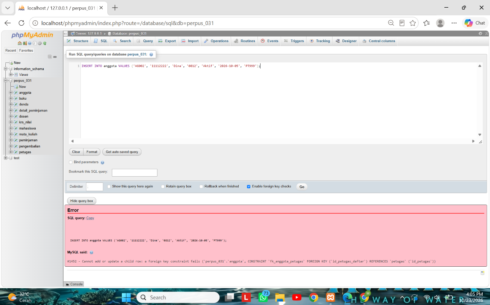

*Keterangan: galat #1452, petugas PT999 tidak ada.*

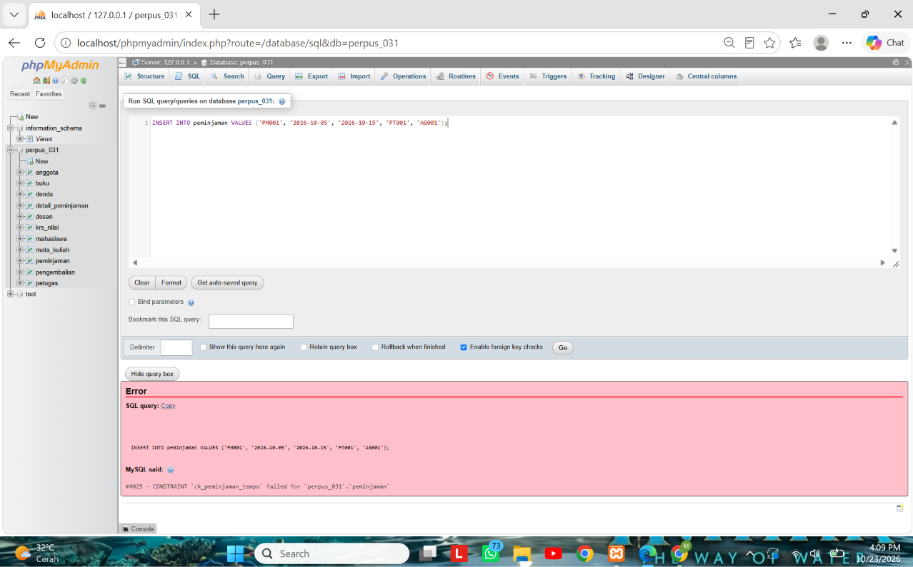

*Keterangan: galat #4025, jatuh tempo melebihi 7 hari.*

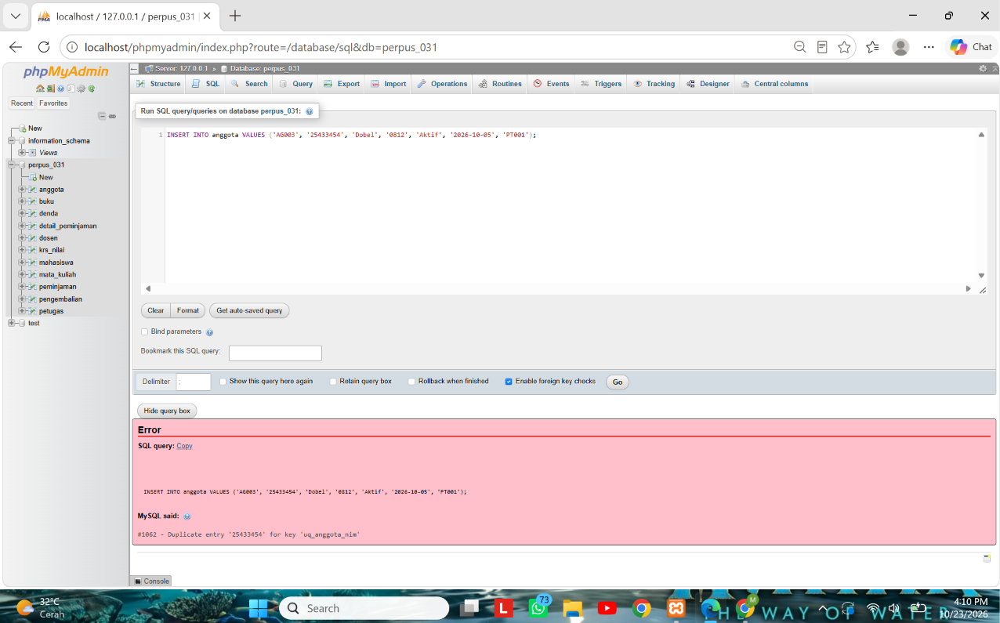

*Keterangan: galat #1062, NIM kembar.*

**ERD fisik dan Designer.**

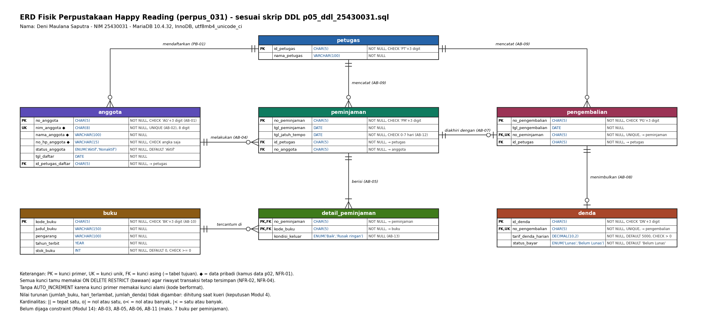

*Keterangan: ERD fisik lengkap dengan tipe data, constraint, kunci tamu, dan tanda data pribadi.*

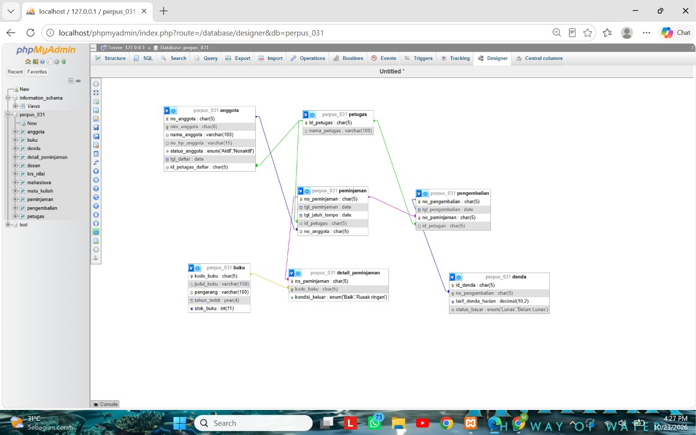

*Keterangan: Designer `perpus_031` menampilkan tujuh tabel perpustakaan dan delapan garis kunci tamu. Perbedaannya dengan ERD sama seperti tabel perbandingan di bagian 3: Designer tidak menampilkan kardinalitas dan constraint.*

## 7. Pembahasan dan Kendala

| Kendala | Penyebab | Cara mengatasi |
|---|---|---|
| Database `kopma_031` tidak terlihat di phpMyAdmin | Login memakai akun `dev_031`, yang hanya berhak atas `perpus_031` | Login memakai `mhs_031` untuk Kopma |
| Lupa password `mhs_031` | Password dibuat di Modul 1 dan tidak dicatat | Login sebagai `root`, lalu `ALTER USER 'mhs_031'@'localhost' IDENTIFIED BY '...'` |
| Collation tabel `utf8mb4_general_ci`, bukan `utf8mb4_unicode_ci` | Database `kopma_031` dibuat dengan collation lama | `ALTER DATABASE ... COLLATE utf8mb4_unicode_ci`, lalu import ulang skrip DDL |
| Jumlah baris `petugas` dan `barang` menjadi 0 setelah import ulang | `DROP TABLE IF EXISTS` di awal skrip ikut menghapus isi tabel | Mengisi ulang data uji setelah import |

Pelajaran terpentingnya: constraint baru dianggap bekerja kalau sudah terbukti menolak data yang salah. Aturan yang melibatkan banyak baris atau tabel lain (AB-03, AB-05, AB-06, AB-11) tidak bisa dijaga struktur tabel dan harus diselesaikan dengan transaksi di Modul 14.

## 8. Kesimpulan

Skrip DDL mengubah rancangan 3NF menjadi tabel sungguhan, dan constraint menjaga aturan bisnis langsung di server. Tipe data dipilih menurut sifat datanya (kode tetap memakai CHAR, uang memakai DECIMAL, nilai terbatas memakai ENUM). Skrip dibuat dapat dijalankan ulang dengan `DROP TABLE IF EXISTS` dari anak ke induk. Constraint tidak cukup hanya ditulis, tetapi harus dibuktikan menolak data yang salah. Tabel perpustakaan yang sudah jadi ini siap diisi data sampel di Pertemuan 6.

## 9. Pernyataan Penggunaan AI

| Hal | Keterangan |
|---|---|
| Alat yang dipakai | Claude (Anthropic) |
| Dipakai untuk | Memahami konsep DDL dan constraint, menyusun skrip DDL Kopma dan proyek, membuat gambar ERD fisik, menjelaskan pesan galat, dan menyusun kerangka laporan |
| Bagian yang terbantu: Kopma (Langkah D dan Latihan E) | Skrip dan perintah uji disusun dengan bantuan AI berdasarkan isi Modul 5, lalu saya jalankan sendiri di phpMyAdmin dan saya ambil tangkapan layarnya |
| Bagian yang terbantu: Milestone Proyek 5 | Draf skrip DDL, ERD fisik, dan tabel pemetaan dibuat dengan bantuan AI dari `p02_kebutuhan_data_25430031.md` dan skema 3NF `p04_normalisasi_25430031.md` milik saya, lalu saya jalankan dan buktikan sendiri di `perpus_031` |
| Dasar penggunaan | Sesuai arahan dosen pengampu: AI boleh dipakai dengan syarat disertai pernyataan ini |

## 10. Bukti Git

| Hal | Isi |
|---|---|
| Repositori | https://github.com/denimaulanasaputra037-sketch/basisdata-25430031 |
| Commit DDL Kopma | `d9af9b3` (pesan: `p05: ddl kopma`) |
| Commit DDL proyek | `108edb5` (pesan: `p05: ddl proyek perpustakaan`) |
   | Commit laporan | `01468cc` (pesan: `p05: laporan pertemuan 5`) |

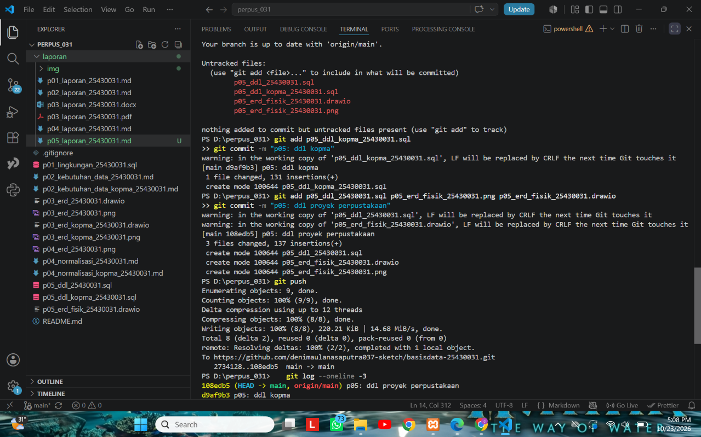

*Keterangan: hasil `git push` yang berhasil.*

## Checklist

**Checklist khusus Pertemuan 5**

| | Jenis | Yang harus ada |
|---|---|---|
| ☑ | Berkas wajib | `p05_ddl_25430031.sql` (dapat dijalankan ulang dari basis data kosong) dan ERD fisik `p05_erd_fisik_25430031` |
| ☑ | Bukti tangkapan layar | `SHOW CREATE TABLE` tabel utama; galat saat constraint dilanggar (FK, UNIQUE, CHECK) |
| ☑ | Analisis wajib | Alasan pemilihan tipe data dan constraint; kaitan constraint dengan AB-xx |

**Checklist umum**

| | Butir | Status |
|---|---|---|
| ☑ | Identitas lengkap | Sudah |
| ☑ | Tujuan dengan bahasa sendiri | Sudah |
| ☑ | Ringkasan teori | Sudah |
| ☑ | Tangkapan layar langkah percobaan dengan keterangan | Sudah |
| ☑ | Titik Analisis dijawab dengan alasan | Sudah |
| ☑ | Latihan E | Sudah |
| ☑ | Tugas Mandiri (F) | Sudah |
| ☑ | Pembahasan dan kendala | Sudah |
| ☑ | Kesimpulan | Sudah |
| ☑ | Pernyataan Penggunaan AI | Sudah |
| ☑ | Bukti Git (hash commit) | Sudah |
| ☑ | Keaslian: tangkapan layar memperlihatkan akun ber-NIM dan jam sistem | Sudah |