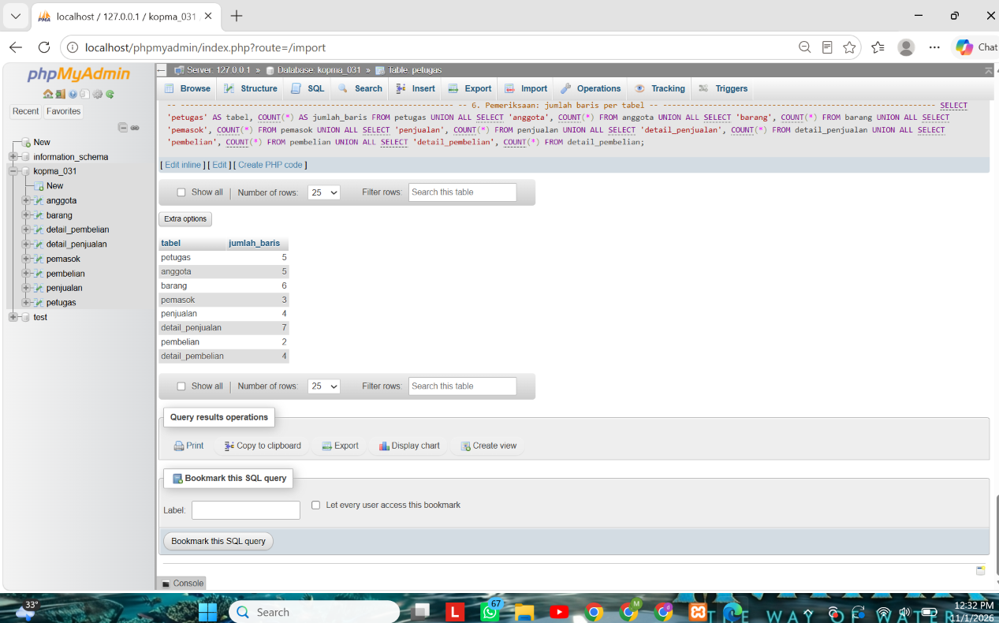
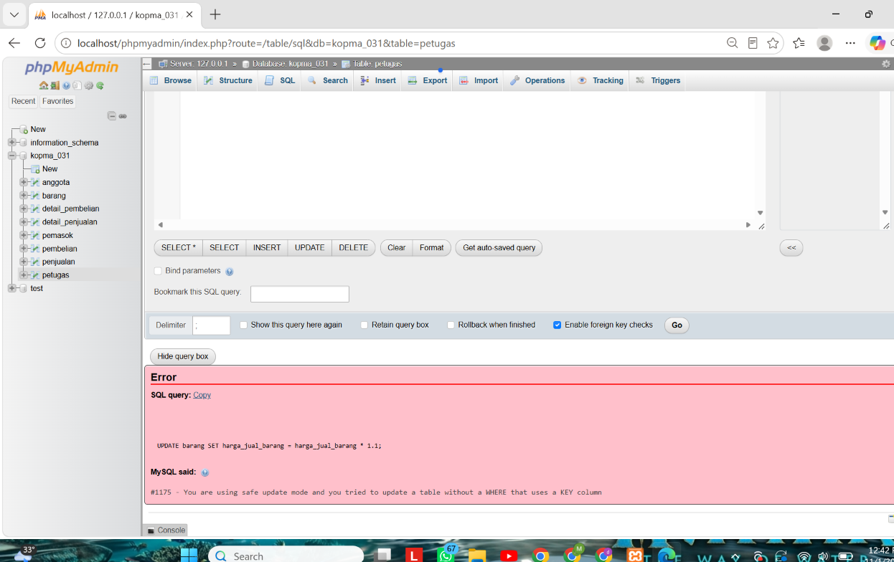
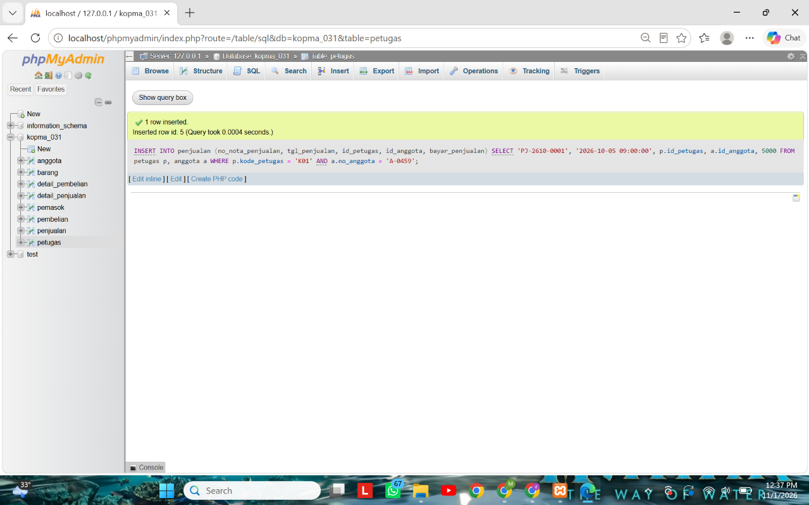
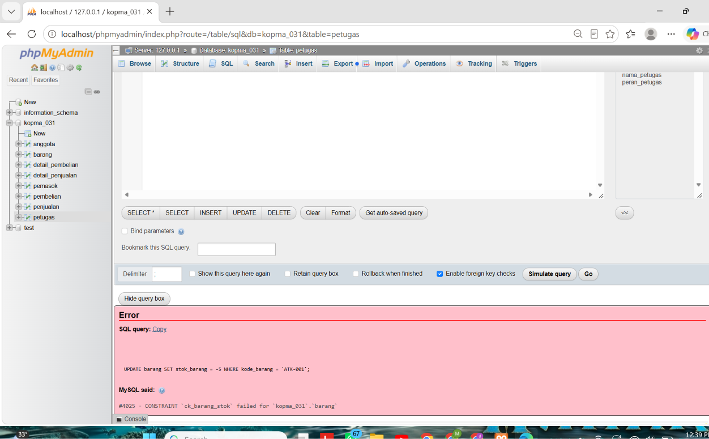
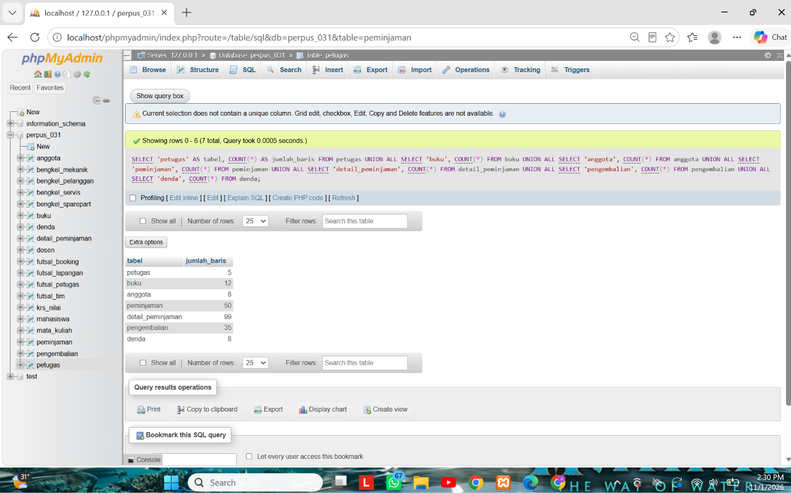
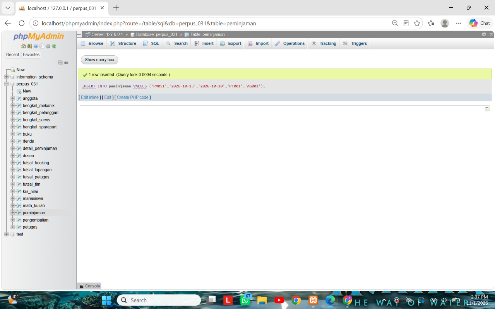
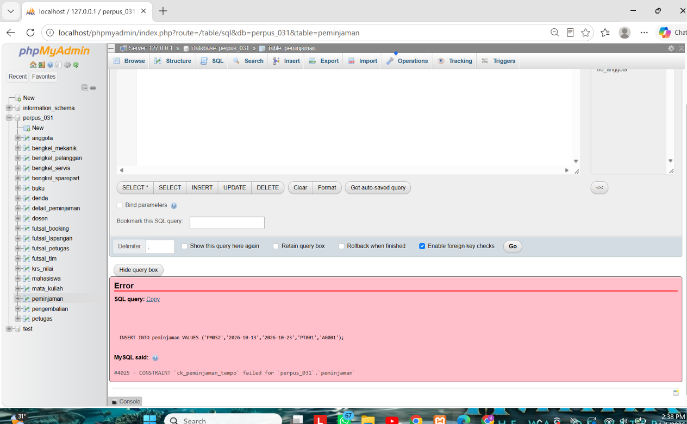
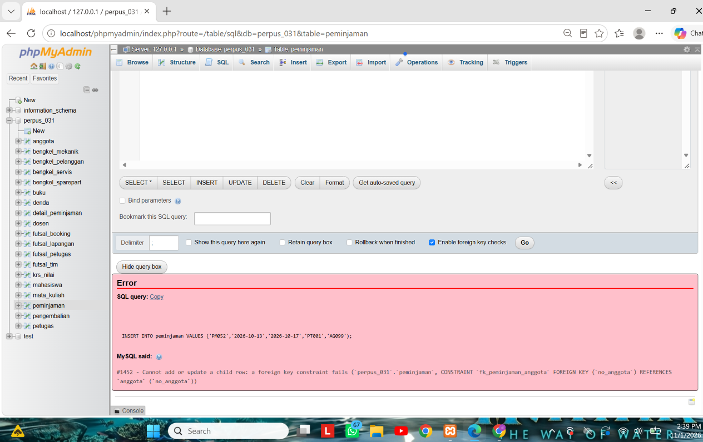
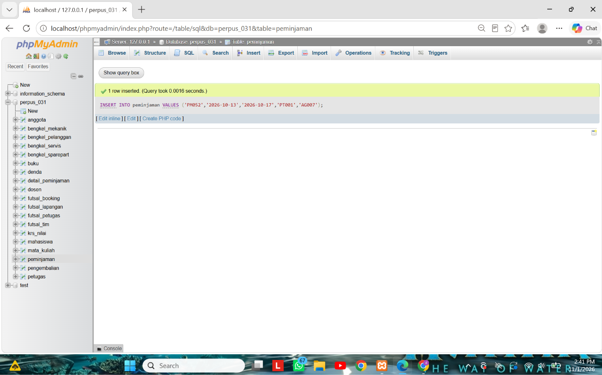
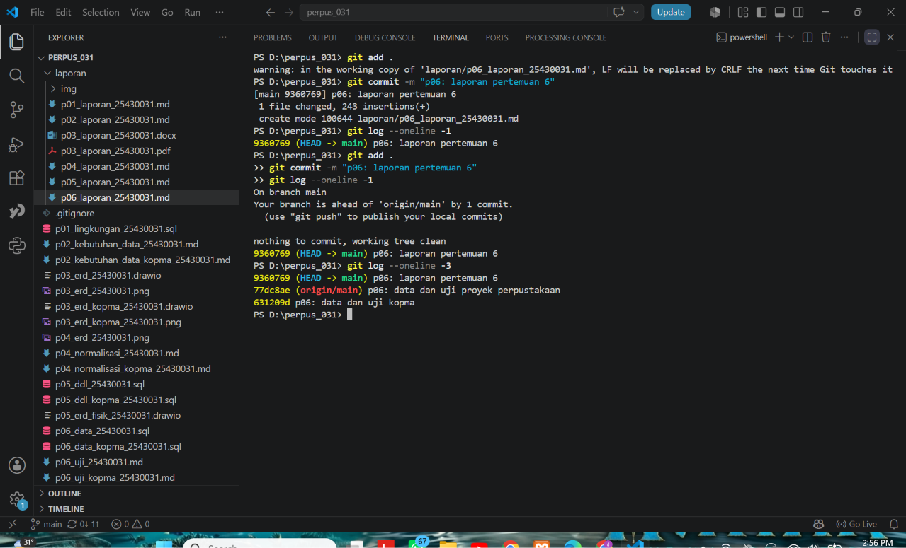

# Laporan Praktikum Basis Data - Pertemuan 06

| Data | Isi |
|---|---|
| Nama | Deni Maulana Saputra |
| NIM | 25430031 |
| Kelas | B |
| Pertemuan | 6 (Mengisi, Mengubah, dan Menguji Data dengan DML) |
| Tanggal pelaksanaan | 29-10-2026 |
| Asisten/Dosen | Dedi Irawan, S.Kom., M.T.I. |

## 1. Tujuan Praktikum

Di pertemuan ini saya belajar mengisi tabel yang sudah dibuat di Pertemuan 5 dengan perintah `INSERT`, mengubah dan menghapus data secara aman dengan `UPDATE` dan `DELETE`, lalu menguji bahwa data yang salah memang ditolak. Hasil ujinya saya tulis dalam tabel skenario uji supaya bisa diulang orang lain.

| No | Yang dipelajari | Hasil yang ditunjukkan di laporan |
|---|---|---|
| 1 | `INSERT` satu baris, banyak baris, dan `INSERT ... SELECT` | Bagian 3 dan 6 |
| 2 | `UPDATE` dan `DELETE` aman dengan `sql_safe_updates` | Bagian 3 dan 5 |
| 3 | Menyusun skenario uji positif dan negatif | Bagian 3 dan 6 |
| 4 | Menyiapkan data sampel yang dapat dibangun ulang dari skrip | Bagian 6 |

## 2. Ringkasan Dasar Teori

DML (Data Manipulation Language) terdiri atas `INSERT`, `UPDATE`, `DELETE`, dan `SELECT`. Karena ada kunci tamu, tabel induk harus diisi lebih dulu, baru tabel anak. Urutan menghapus kebalikannya: anak dulu, baru induk, kecuali relasi yang memakai `ON DELETE CASCADE`.

`UPDATE` atau `DELETE` tanpa `WHERE` mengenai semua baris dan tidak menimbulkan galat, jadi sangat berbahaya. Dengan `SET SESSION sql_safe_updates = 1`, server menolak perintah seperti itu (galat 1175) kecuali `WHERE`-nya memakai kolom kunci.

Pengujian basis data memakai dua jenis uji. Uji positif memastikan data benar diterima. Uji negatif memastikan data salah ditolak dengan galat yang tepat. Setiap uji dicatat dengan masukan, hasil yang diharapkan, hasil nyata, dan status.

## 3. Hasil Langkah Percobaan

Langkah ini saya kerjakan di basis data `kopma_031` dengan data dari `p06_data_kopma_25430031.sql`.

**D.1 dan D.2 Mengisi data induk dan mencatat nota.** Data induk (petugas, barang, anggota, pemasok) diisi lebih dulu dengan `INSERT` banyak baris. Nota contoh `PJ-2609-0142` dicatat dengan `INSERT ... SELECT` yang mengambil harga dari tabel `barang`, sehingga saya tidak mengetik harga secara manual.



*Keterangan: jumlah baris setiap tabel `kopma_031` setelah semua uji selesai dan data uji dibersihkan.*

**D.3 Mengubah dan menghapus dengan aman.** Dengan mode aman menyala, `UPDATE` harga tanpa `WHERE` ditolak. `UPDATE` yang memakai `WHERE kategori_barang = 'ATK' AND id_barang > 0` diterima karena `WHERE` memakai kolom kunci. Perubahan harga itu saya batalkan dengan `ROLLBACK`, dan harga ATK kembali ke 4000.00 dan 6500.00.



*Keterangan: UJ-08, `UPDATE` tanpa `WHERE` ditolak dengan galat 1175 di mode aman.*

Saya juga membuktikan dua perilaku kunci tamu. Menghapus nota membuat rincian barangnya ikut terhapus (rincian 1 baris menjadi 0 baris) karena `ON DELETE CASCADE`. Menghapus petugas K03 yang pernah melayani nota ditolak dengan galat 1451.

**D.4 Menjalankan skenario uji.** Delapan skenario uji pertama (UJ-01 sampai UJ-08) saya jalankan satu per satu. Hasil lengkapnya ada di `p06_uji_kopma_25430031.md`.



*Keterangan: UJ-01, nota untuk anggota aktif diterima server.*



*Keterangan: UJ-03, stok -5 ditolak dengan galat 4025 oleh `ck_barang_stok`.*

| Uji | Masukan | Hasil nyata | Status |
|---|---|---|---|
| UJ-01 | Nota baru dengan anggota aktif | Diterima | LULUS |
| UJ-02 | Nota tanpa anggota (pembeli umum) | Diterima, `id_anggota` NULL | LULUS |
| UJ-03 | Stok diubah menjadi -5 | Ditolak, galat 4025 | LULUS |
| UJ-04 | Nomor nota kembar | Ditolak, galat 1062 | LULUS |
| UJ-05 | Detail dengan qty 0 | Ditolak, galat 4025 | LULUS |
| UJ-06 | NIM anggota kembar | Ditolak, galat 1062 | LULUS |
| UJ-07 | Penjualan oleh petugas tidak dikenal | Ditolak, galat 1452 | LULUS |
| UJ-08 | `UPDATE` tanpa `WHERE` di mode aman | Ditolak, galat 1175 | LULUS |

## 4. Jawaban Titik Analisis

**Titik Analisis 1: `INSERT ... SELECT` mengambil harga dari tabel `barang`.**
Cara ini lebih aman daripada mengetik angka 4000 secara manual karena angkanya selalu sama dengan harga di tabel `barang`, sehingga tidak ada salah ketik. Ketika harga pulpen naik menjadi Rp4.500 minggu depan, nota `PJ-2609-0142` **tidak ikut berubah**. Harga disalin ke kolom `harga_satuan_detail_penjualan` pada saat nota dibuat, jadi nota lama tetap memakai harga lamanya. Ini sesuai aturan AB-04: harga di nota adalah harga saat transaksi, bukan harga hari ini.

**Titik Analisis 2: hapus nota dan hapus petugas.**
Menghapus nota membuat detailnya ikut terhapus karena kunci tamu detail ke nota didefinisikan dengan `ON DELETE CASCADE`. Rincian itu tidak ada artinya tanpa notanya. Menghapus petugas ditolak karena kunci tamu nota ke petugas memakai `ON DELETE RESTRICT` (bawaan). Petugas yang pernah melayani nota adalah bagian dari riwayat transaksi, jadi tidak boleh hilang. Jika seorang kasir berhenti bekerja, barisnya jangan dihapus. Cara yang benar adalah menandainya tidak aktif, misalnya dengan kolom status, sehingga riwayat nota lama tetap utuh.

**Titik Analisis 3: uji yang saya perkirakan gagal.**
Uji yang gagal adalah penjualan yang qty-nya melebihi stok (AB-03 di Kopma). Saya mencatat 500 pulpen pada nota `PJ-2610-0002` padahal stok `ATK-001` hanya 116, dan server menerimanya. Constraint `CHECK` di tabel `barang` tidak dapat mencegahnya karena `CHECK` hanya melihat kolom dalam satu baris pada satu tabel (`stok_barang >= 0`). Jumlah beli ada di `detail_penjualan`, sedangkan stok ada di `barang`, jadi membandingkan keduanya butuh logika lintas tabel. Aturan ini dikerjakan di Modul 14 dengan transaksi atau pemicu.

## 5. Hasil Latihan dan Modifikasi

**Latihan E.1: arsipkan anggota nonaktif lama.** Anggota berstatus nonaktif yang mendaftar sebelum 2025 dipindahkan ke tabel `anggota_arsip`, kecuali yang masih punya penjualan.

```sql
SET SESSION sql_safe_updates = 1;
DROP TABLE IF EXISTS anggota_arsip;
CREATE TABLE anggota_arsip LIKE anggota;
INSERT INTO anggota_arsip
  SELECT * FROM anggota a
  WHERE a.status_anggota = 'nonaktif' AND a.tgl_daftar_anggota < '2025-01-01'
    AND NOT EXISTS (SELECT 1 FROM penjualan p WHERE p.id_anggota = a.id_anggota);
DELETE FROM anggota
  WHERE id_anggota > 0 AND status_anggota = 'nonaktif' AND tgl_daftar_anggota < '2025-01-01'
    AND NOT EXISTS (SELECT 1 FROM penjualan p WHERE p.id_anggota = anggota.id_anggota);
```

Hasilnya, `anggota_arsip` berisi A-0312. Tabel `anggota` masih berisi A-0313, A-0457, A-0458, dan A-0459. A-0313 tetap tinggal karena masih punya nota `PJ-2503-0007`.

**Latihan E.2: harga makanan naik 5%, dibulatkan ratusan.** Dijalankan di dalam transaksi lalu di-`ROLLBACK`, supaya harga asli tidak berubah.

```sql
SET SESSION sql_safe_updates = 1;
START TRANSACTION;
UPDATE barang SET harga_jual_barang = ROUND(harga_jual_barang * 1.05, -2)
WHERE kategori_barang = 'makanan' AND id_barang > 0;
SELECT kode_barang, harga_jual_barang FROM barang WHERE kategori_barang = 'makanan';
ROLLBACK;
```

| Barang | Harga awal | Di dalam transaksi | Setelah `ROLLBACK` |
|---|---|---|---|
| MKN-001 | 5000.00 | 5300.00 | 5000.00 |
| MKN-002 | 3500.00 | 3700.00 | 3500.00 |

## 6. Tugas Mandiri: Milestone Proyek 06

Untuk proyek perpustakaan Happy Reading, saya membuat dua berkas di basis data `perpus_031`: `p06_data_25430031.sql` (data sampel) dan `p06_uji_25430031.md` (skenario uji).

**Data sampel.** Parameter P saya adalah 5, jadi tabel transaksi utama `peminjaman` minimal 10 × 5 = 50 baris.

| Tabel | Jumlah baris | Keterangan |
|---|---|---|
| `petugas` | 5 | tabel induk |
| `buku` | 12 | tabel induk |
| `anggota` | 8 | tabel induk, 6 Aktif dan 2 Nonaktif |
| `peminjaman` | 50 | transaksi utama, 6 tanggal berbeda |
| `detail_peminjaman` | 99 | 1 sampai 3 buku per peminjaman |
| `pengembalian` | 35 | 15 peminjaman masih dipinjam |
| `denda` | 8 | hanya untuk pengembalian terlambat |

Peminjaman tersebar pada 5, 6, 7, 8, 9, dan 12 Oktober 2026. Data diisi dari tabel induk ke tabel anak, dan stok buku disesuaikan di akhir skrip. Skrip dijalankan setelah `p05_ddl_25430031.sql`, dan hasilnya selalu sama.



*Keterangan: jumlah baris tujuh tabel perpustakaan setelah semua uji selesai dan data uji dibersihkan.*

**Skenario uji.** Ada 13 skenario: 12 LULUS dan 1 GAGAL. Sembilan di antaranya uji negatif. Daftar lengkapnya ada di `p06_uji_25430031.md`.

| Uji | Masukan | Hasil nyata | Status | Aturan atau constraint |
|---|---|---|---|---|
| UJ-01 | Peminjaman 7 hari, anggota Aktif | Diterima | LULUS | AB-12 |
| UJ-02 | Detail buku pada peminjaman | Diterima | LULUS | `pk_detail_peminjaman` |
| UJ-03 | Pengembalian untuk peminjaman | Diterima | LULUS | AB-07 |
| UJ-04 | Nomor peminjaman `PMX01` | Galat 4025 | LULUS | `ck_peminjaman_no` |
| UJ-05 | Jatuh tempo 10 hari | Galat 4025 | LULUS | `ck_peminjaman_tempo` (AB-12) |
| UJ-06 | NIM anggota kembar | Galat 1062 | LULUS | `uq_anggota_nim` (AB-02) |
| UJ-07 | Anggota tidak ada | Galat 1452 | LULUS | `fk_peminjaman_anggota` (AB-04) |
| UJ-08 | Buku kembar dalam satu nota | Galat 1062 | LULUS | `pk_detail_peminjaman` |
| UJ-09 | Stok buku -1 | Galat 4025 | LULUS | `ck_buku_stok` |
| UJ-10 | Pengembalian kedua untuk satu peminjaman | Galat 1062 | LULUS | `uq_pengembalian_pinjam` (AB-07) |
| UJ-11 | Hapus petugas yang pernah melayani | Galat 1451 | LULUS | kunci tamu ke `petugas` (RESTRICT) |
| UJ-12 | Tarif denda 0 | Galat 4025 | LULUS | `ck_denda_tarif` (AB-08) |
| UJ-13 | Anggota Nonaktif meminjam | **Diterima** | **GAGAL** | AB-03 |



*Keterangan: UJ-01, peminjaman `PM051` untuk anggota Aktif diterima server.*



*Keterangan: UJ-05, jatuh tempo 10 hari ditolak dengan galat 4025 oleh `ck_peminjaman_tempo`.*



*Keterangan: UJ-07, anggota `AG099` tidak ada sehingga ditolak dengan galat 1452.*

**Uji yang gagal dan utang desain.**



*Keterangan: UJ-13, anggota Nonaktif berhasil meminjam. Ini uji yang gagal.*

Aturan AB-03 (hanya anggota Aktif yang boleh meminjam) belum dapat dijaga constraint. Status anggota ada di tabel `anggota`, sedangkan peminjaman ada di tabel `peminjaman`. `CHECK` hanya melihat satu baris dalam satu tabel, dan kunci tamu hanya memastikan nilainya ada di tabel induk, bukan memeriksa kolom lain di tabel induk itu. Utang desain ini dikerjakan di Modul 14 dengan transaksi atau pemicu. Aturan lain yang juga belum dapat dijaga constraint: AB-05 (satu peminjaman minimal satu buku), AB-06 (stok harus lebih dari 0 dan dikurangi saat dipinjam), dan AB-11 (maksimal 7 buku per peminjaman).

## 7. Pembahasan dan Kendala

| Galat | Arti dalam bahasa mudah | Penyebab di praktikum ini | Cara mengatasi |
|---|---|---|---|
| 1175 | Mode aman menolak `UPDATE` atau `DELETE` tanpa `WHERE` pada kolom kunci | `UPDATE` harga tanpa syarat | Tambahkan syarat yang memakai kolom kunci, misalnya `id_barang > 0`. Mode aman jangan dimatikan |
| 1062 | Nilai kembar pada kolom `UNIQUE` atau kunci primer | Nomor nota, NIM, dan buku yang sama | Pakai nilai baru yang belum ada |
| 1452 | Nilai kunci tamu belum ada di tabel induk | Petugas 99 dan anggota `AG099` | Isi tabel induk lebih dulu atau pakai nilai yang ada |
| 1451 | Baris induk masih dipakai tabel anak | Hapus petugas yang pernah melayani nota | Jangan hapus, tandai tidak aktif |
| 4025 | Aturan `CHECK` dilanggar | Stok negatif, qty 0, tarif 0, nomor salah format | Perbaiki nilai sesuai aturan |

Beberapa hal yang saya pelajari:
- Karena `AUTO_INCREMENT` tidak kembali ke 1 setelah `DELETE`, untuk mengulang dari awal saya membangun ulang tabel dari DDL, bukan menghapus isi tabel satu per satu.
- Saat membersihkan data uji, urutannya harus dari tabel anak ke tabel induk (pengembalian, lalu detail, lalu peminjaman). Kalau terbalik, server menolak dengan galat 1451.
- Untuk data anak yang bergantung pada induk, saya memakai `INSERT ... SELECT` dengan kode alami (misalnya `kode_barang`) supaya tidak menebak nilai `id`.

## 8. Kesimpulan

Pertemuan ini menunjukkan bahwa basis data tidak cukup dibuat, tetapi harus diisi dan diuji. Perintah `INSERT ... SELECT` membuat harga nota tersalin dari tabel barang, dan mode aman mencegah `UPDATE` tanpa `WHERE`. Dari 13 skenario uji proyek, 12 lulus dan 1 gagal, yaitu aturan AB-03 yang belum dapat dijaga constraint. Uji yang gagal itu saya catat sebagai utang desain untuk Modul 14.

## 9. Pernyataan Penggunaan AI

| Hal | Keterangan |
|---|---|
| Alat yang dipakai | Claude (Anthropic) |
| Dipakai untuk | Memahami konsep DML dan mode aman, menyusun perintah uji dan data sampel, menjelaskan pesan galat, dan menyusun kerangka laporan |
| Bagian yang terbantu: Kopma (Langkah D dan Latihan E) | Perintah uji dan latihan disusun dengan bantuan AI berdasarkan isi Modul 6, lalu saya jalankan sendiri di phpMyAdmin dan saya ambil tangkapan layarnya |
| Bagian yang terbantu: Milestone Proyek 6 | Draf `p06_data_25430031.sql` dan daftar skenario uji dibuat dengan bantuan AI dari `p05_ddl_25430031.sql` milik saya, lalu saya jalankan dan buktikan sendiri di `perpus_031` |
| Dasar penggunaan | Sesuai arahan dosen pengampu: AI boleh dipakai dengan syarat disertai pernyataan ini |

## 10. Bukti Git

| Hal | Isi |
|---|---|
| Repositori | https://github.com/denimaulanasaputra037-sketch/basisdata-25430031 |
| Commit data dan uji Kopma | `631209d` (pesan: `p06: data dan uji kopma`) |
| Commit data dan uji proyek | `77dc8ae` (pesan: `p06: data dan uji proyek perpustakaan`) |
| Commit laporan | `9360769` (pesan: `p06: laporan pertemuan 6`) |


*Keterangan: riwayat tiga commit Pertemuan 6 (`git log --oneline -3`).*
## Checklist

**Checklist khusus Pertemuan 6**

| | Jenis | Yang harus ada |
|---|---|---|
| ☑ | Berkas wajib | `p06_data_25430031.sql` (data sampel berbasis parameter P) dan `p06_uji_25430031.md` (skenario uji) |
| ☑ | Bukti tangkapan layar | Hasil skenario uji positif dan negatif; jumlah baris per tabel |
| ☑ | Analisis wajib | Tabel skenario uji: masukan, hasil yang diharapkan, hasil nyata, status |

**Checklist umum**

| | Butir | Status |
|---|---|---|
| ☑ | Identitas lengkap | Sudah |
| ☑ | Tujuan dengan bahasa sendiri | Sudah |
| ☑ | Ringkasan teori | Sudah |
| ☑ | Tangkapan layar langkah percobaan dengan keterangan | Sudah |
| ☑ | Titik Analisis dijawab dengan alasan | Sudah |
| ☑ | Latihan E | Sudah |
| ☑ | Tugas Mandiri (F) | Sudah |
| ☑ | Pembahasan dan kendala | Sudah |
| ☑ | Kesimpulan | Sudah |
| ☑ | Pernyataan Penggunaan AI | Sudah |
| ☑ | Bukti Git (hash commit) | Sudah |
| ☑ | Keaslian: tangkapan layar memperlihatkan akun ber-NIM dan jam sistem | Sudah |
