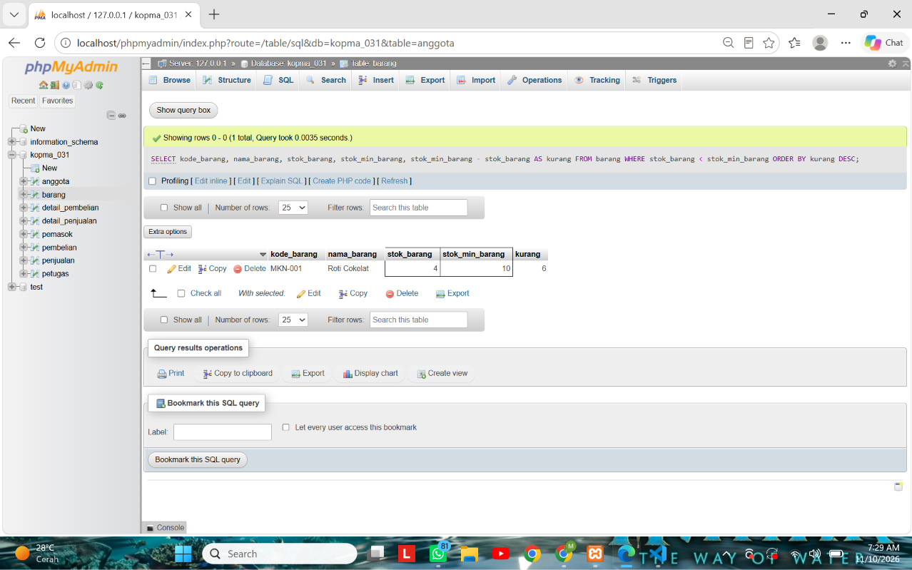
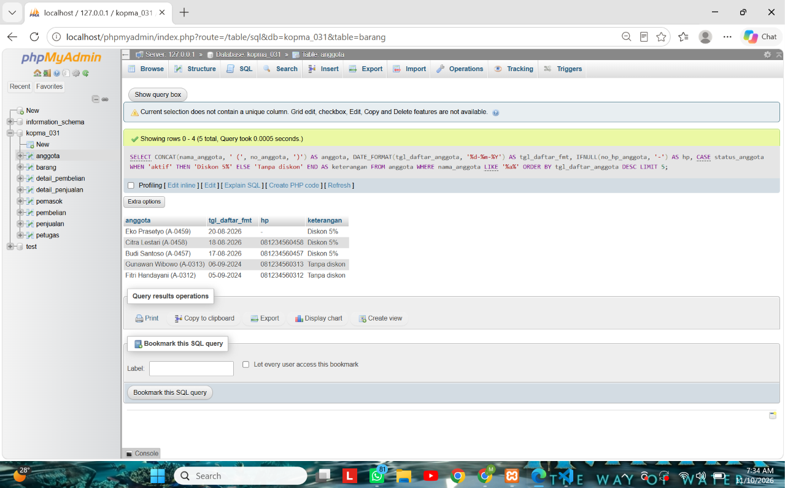
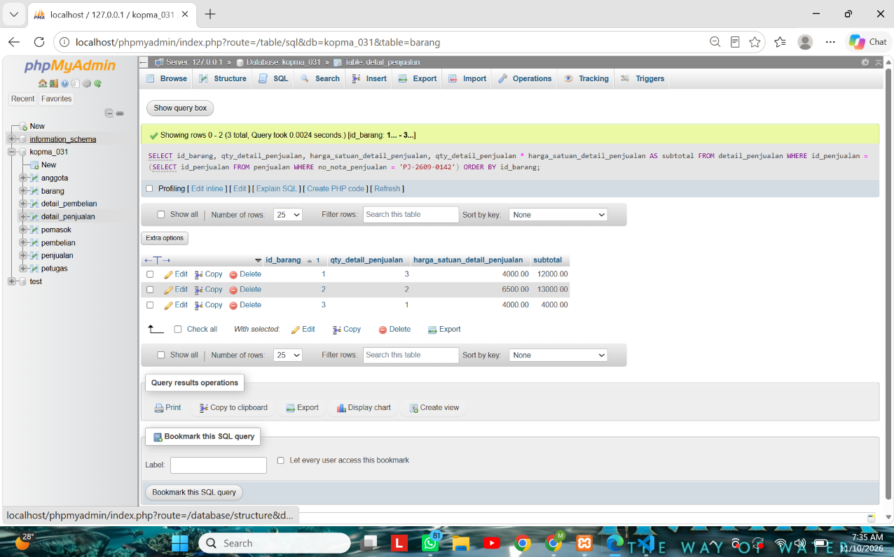
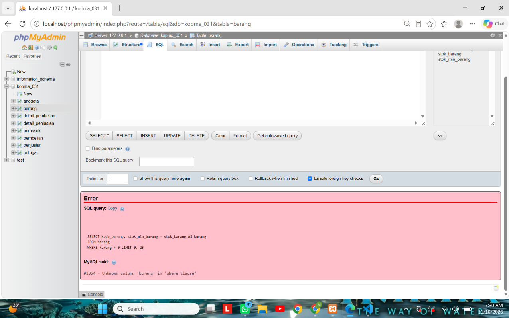
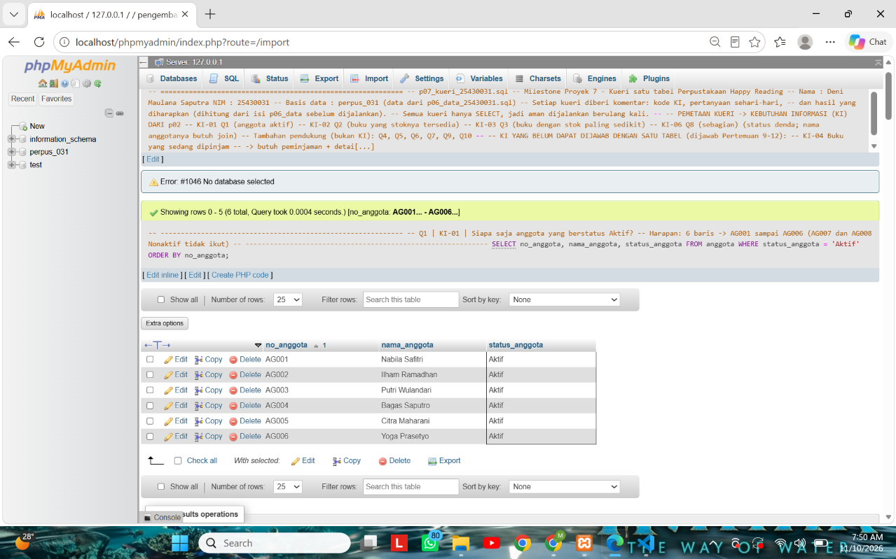
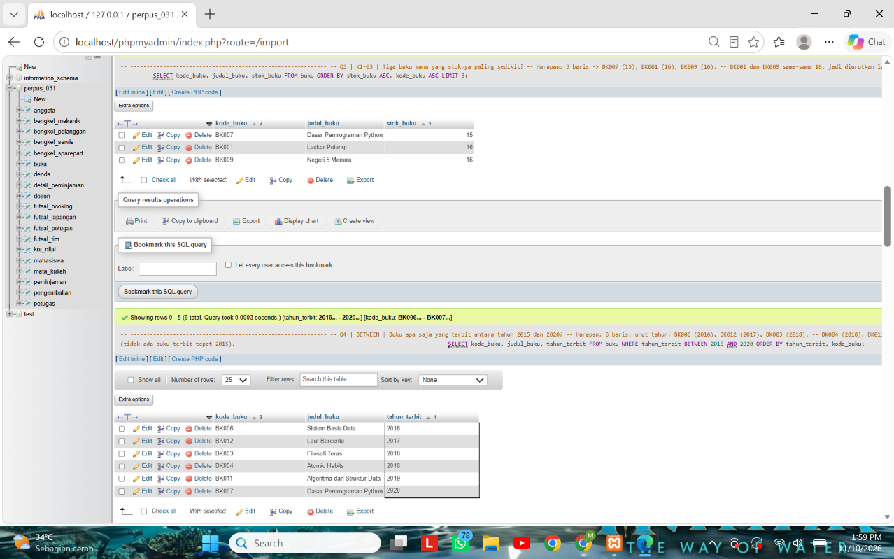
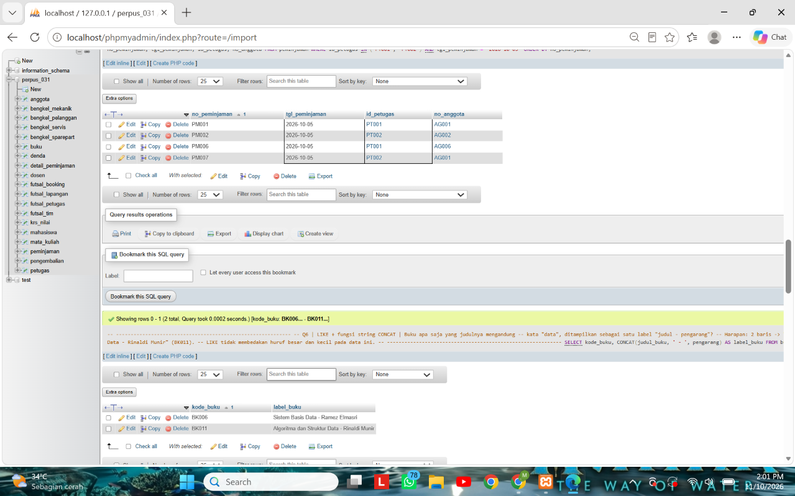
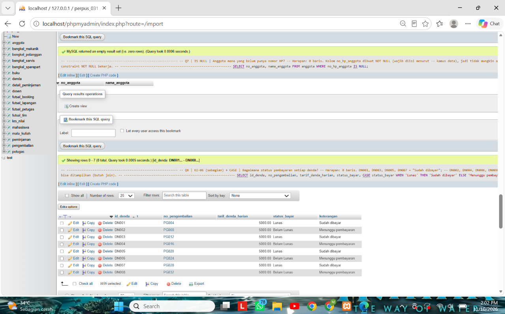
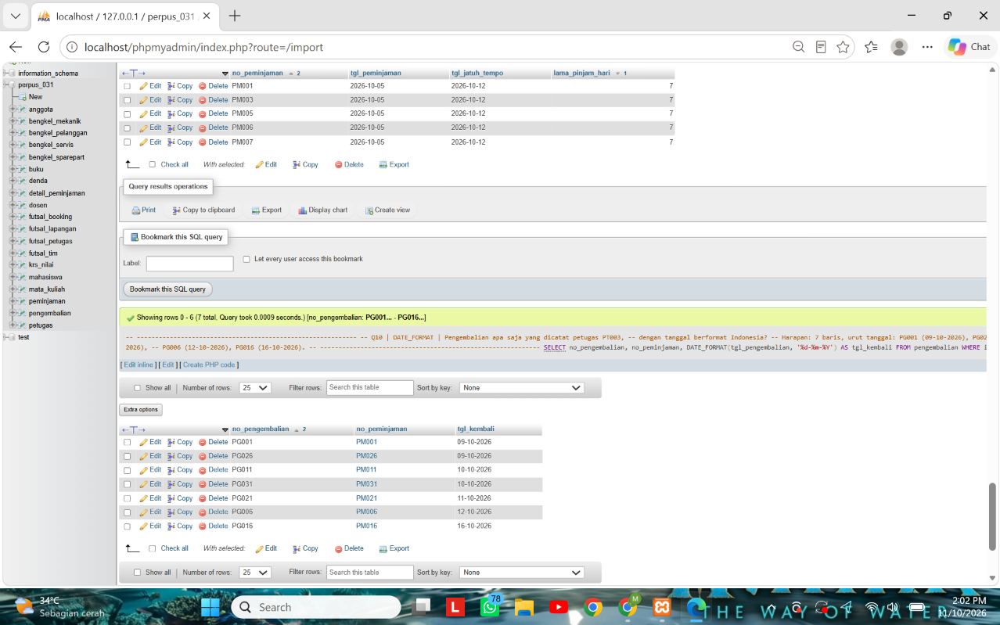
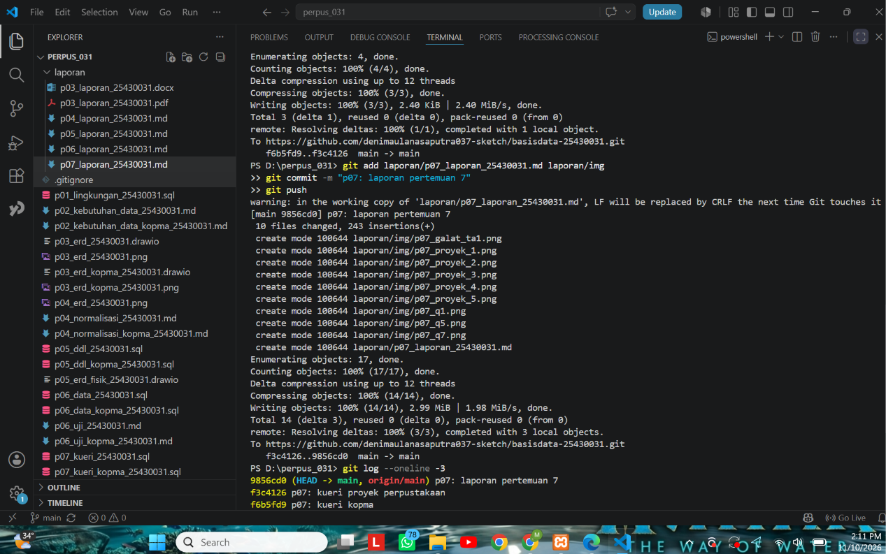

# Laporan Praktikum Basis Data - Pertemuan 07

| Data | Isi |
|---|---|
| Nama | Deni Maulana Saputra |
| NIM | 25430031 |
| Kelas | B |
| Pertemuan | 7 (Menjawab Pertanyaan dengan SELECT dan Fungsi Skalar) |
| Tanggal pelaksanaan | 10-11-2026 |
| Asisten/Dosen | Dedi Irawan, S.Kom., M.T.I. |

## 1. Tujuan Praktikum

Di pertemuan ini saya belajar bertanya ke data memakai `SELECT`. Saya mencoba menyaring baris dengan `WHERE`, mengurutkan dengan `ORDER BY`, membatasi jumlah baris dengan `LIMIT`, dan mengolah nilai per baris dengan fungsi skalar. Setiap pertanyaan saya hubungkan ke kebutuhan informasi (KI) dan hasilnya saya cocokkan dengan perkiraan.

| No | Yang dipelajari | Hasil yang ditunjukkan di laporan |
|---|---|---|
| 1 | Penyaringan: `IN`, `BETWEEN`, `LIKE`, `IS NULL` | Bagian 3 dan 6 |
| 2 | Fungsi skalar: string, tanggal, dan kondisional | Bagian 3 dan 6 |
| 3 | Urutan evaluasi SQL dan jebakan alias | Bagian 4 |
| 4 | Menghubungkan kueri dengan KI proyek | Bagian 6 |

## 2. Ringkasan Dasar Teori

`SELECT` dievaluasi tidak sesuai urutan penulisannya. Untuk kueri satu tabel, urutannya `FROM`, lalu `WHERE`, lalu `SELECT`, lalu `ORDER BY`, lalu `LIMIT`. Karena `WHERE` dijalankan sebelum `SELECT`, nama alias yang dibuat di `SELECT` belum ada saat `WHERE` bekerja. Tetapi `ORDER BY` berjalan setelah `SELECT`, jadi alias boleh dipakai di sana.

| Alat | Kegunaan | Contoh |
|---|---|---|
| `IN` | cocok dengan salah satu dari beberapa nilai | `kategori_barang IN ('ATK', 'minuman')` |
| `BETWEEN` | rentang nilai, batas ikut dihitung | `tahun_terbit BETWEEN 2015 AND 2020` |
| `LIKE` | pencocokan pola teks | `judul_buku LIKE '%data%'` |
| `IS NULL` | memeriksa nilai kosong | `no_hp_anggota IS NULL` |
| `CONCAT`, `UPPER`, `FORMAT` | mengolah teks | label "nama (kode)" |
| `DATEDIFF`, `DATE_FORMAT`, `CURDATE` | mengolah tanggal | selisih hari, format `dd-mm-yyyy` |
| `CASE`, `IF`, `IFNULL` | pilihan atau nilai pengganti | label "Diskon 5%" |

NULL berarti "tidak diketahui", bukan nol dan bukan teks kosong. Karena itu NULL tidak bisa dibandingkan dengan `=`, harus memakai `IS NULL`.

## 3. Hasil Langkah Percobaan

Langkah percobaan saya kerjakan di basis data `kopma_031` dengan akun `mhs_031`. Skripnya ada di `p07_kueri_kopma_25430031.sql`.

**D.1 Kueri KI-03: barang yang perlu dipesan ulang.** Barang yang stoknya di bawah stok minimum ditampilkan beserta kekurangannya.



*Keterangan: hanya Roti Cokelat (`MKN-001`) yang stoknya 4, di bawah minimum 10, kurang 6.*

Tiga kueri penyaringan lain saya jalankan, dan semuanya sesuai perkiraan.

| Kueri | Pertanyaan | Hasil nyata |
|---|---|---|
| `IN` | Barang kategori ATK atau minuman | 4 baris: ATK-001, ATK-002, MNM-001, MNM-002 |
| `BETWEEN` | Nota pada 24 dan 25 September 2026 | 3 baris: PJ-2609-0142, PJ-2609-0143, PJ-2609-0150 |
| `IS NULL` | Anggota tanpa nomor HP | 1 baris: A-0459 Eko Prasetyo |

Untuk `BETWEEN`, kolom `tgl_penjualan` bertipe `DATETIME`, jadi batas akhir saya tulis `'2026-09-25 23:59:59'`. Kalau hanya `'2026-09-25'`, nota sore hari tanggal 25 terpotong karena dibaca pukul 00.00.

**D.2 Pola teks dan nilai kosong.** Anggota yang namanya mengandung huruf "a" ditampilkan dengan label yang mudah dibaca.



*Keterangan: lima anggota dengan label nama dan kode, tanggal berformat `dd-mm-yyyy`, nomor HP diganti "-" bila kosong, dan keterangan diskon.*

Pada kueri contoh di buku, alias tanggal dibuat sama dengan nama kolomnya (`tgl_daftar_anggota`). Akibatnya `ORDER BY tgl_daftar_anggota` mengurutkan **teks** `dd-mm-yyyy`, bukan tanggal aslinya, sehingga urutannya bisa salah. Karena itu alias saya ganti menjadi `tgl_daftar_fmt`.

**D.3 Tanggal dan perhitungan per baris.**

| Kueri | Hasil nyata |
|---|---|
| Lama keanggotaan dengan kategori | 5 baris. Tiga anggota 2026 berstatus "baru" dan dua anggota 2024 berstatus "lama". Jumlah hari bergantung tanggal hari ini |
| Subtotal nota `PJ-2609-0142` | 3 baris dengan subtotal 12000, 13000, dan 4000 |



*Keterangan: tiga baris detail nota dengan subtotal 12000, 13000, dan 4000. Jumlah manualnya 29000, cocok dengan nota di Modul 2 (dibayar 30000).*

## 4. Jawaban Titik Analisis

**Titik Analisis 1: alias di `WHERE`.**



*Keterangan: galat 1054 `Unknown column 'kurang' in 'where clause'`.*

Kueri `WHERE kurang > 0` menghasilkan galat **1054** karena `WHERE` dievaluasi sebelum `SELECT`, sehingga nama `kurang` yang dibuat di `SELECT` belum ada. Syarat yang setara tanpa alias adalah menulis ekspresinya langsung: `WHERE stok_min_barang - stok_barang > 0`. Hasilnya sama dengan kueri KI-03.

**Titik Analisis 2: `= NULL`.** Kueri `WHERE no_hp_anggota = NULL` tidak pernah mengembalikan baris karena membandingkan apa pun dengan NULL menghasilkan NULL (tidak diketahui), bukan benar. Saya mencobanya dan hasilnya 0 baris, padahal A-0459 ada. Kueri yang benar adalah `WHERE no_hp_anggota IS NULL`. Perbedaannya, NULL berarti tidak ada nilai sama sekali, sedangkan string kosong `''` adalah teks yang panjangnya nol. Pada pengujian, `NULL IS NULL` bernilai benar, `'' IS NULL` salah, dan `NULL = ''` menghasilkan NULL.

**Titik Analisis 3: total nota.** Subtotal per baris bisa dihitung karena hanya memakai nilai dalam satu baris (`qty * harga`). Total nota menjumlahkan banyak baris menjadi satu nilai, dan itu tidak bisa dilakukan oleh `WHERE` atau fungsi skalar. Dibutuhkan fungsi agregat `SUM` bersama `GROUP BY`, yang dipelajari di Pertemuan 9.

## 5. Hasil Latihan dan Modifikasi

**Latihan E.1: nama huruf kapital dan harga format Rupiah.**

```sql
SELECT UPPER(nama_barang) AS nama_barang,
       CONCAT('Rp', FORMAT(harga_jual_barang, 0, 'id_ID')) AS harga
FROM barang
ORDER BY kode_barang;
```

Hasilnya 6 baris, contoh `PULPEN GEL 0.5` dengan `Rp4.000` dan `BUKU TULIS 58` dengan `Rp6.500`.

**Latihan E.2: kueri yang salah secara semantik tetapi tetap berjalan.** Maksudnya, barang kategori ATK atau minuman yang stoknya di bawah 40, yang seharusnya hanya 1 baris.

| Versi | Syarat | Hasil |
|---|---|---|
| Salah | `kategori_barang = 'ATK' OR kategori_barang = 'minuman' AND stok_barang < 40` | 3 baris (ATK-001, ATK-002, MNM-002), tanpa galat |
| Benar | `(kategori_barang = 'ATK' OR kategori_barang = 'minuman') AND stok_barang < 40` | 1 baris (MNM-002 Teh Botol 350, stok 36) |

Versi salah menampilkan semua barang ATK walaupun stoknya jauh di atas 40, karena `AND` dievaluasi lebih dulu daripada `OR`. Tanda kurung memaksa `OR` dihitung lebih dulu.

## 6. Tugas Mandiri: Milestone Proyek 07

Untuk proyek Perpustakaan Happy Reading saya membuat `p07_kueri_25430031.sql`, berisi 10 kueri satu tabel di basis data `perpus_031` dengan akun `dev_031`. Setiap kueri punya komentar berisi kode KI, pertanyaan sehari-hari, dan hasil yang diharapkan.

**Daftar kueri dan hasilnya.**

| Kueri | KI | Pertanyaan sehari-hari | Operator atau fungsi | Hasil nyata |
|---|---|---|---|---|
| Q1 | KI-01 | Siapa saja anggota yang Aktif? | `WHERE =` | 6 baris (AG001 sampai AG006) |
| Q2 | KI-02 | Buku apa yang stoknya masih tersedia? | `WHERE >` | 12 baris |
| Q3 | KI-03 | Tiga buku apa yang stoknya paling sedikit? | `ORDER BY`, `LIMIT` | 3 baris (BK007, BK001, BK009) |
| Q4 | tambahan | Buku apa yang terbit 2015 sampai 2020? | `BETWEEN` | 6 baris |
| Q5 | tambahan | Peminjaman 5 Oktober oleh PT001 atau PT002? | `IN` | 4 baris |
| Q6 | tambahan | Buku apa yang judulnya mengandung "data"? | `LIKE`, `CONCAT` | 2 baris |
| Q7 | tambahan | Anggota mana yang belum punya nomor HP? | `IS NULL` | 0 baris |
| Q8 | KI-06 sebagian | Bagaimana status tiap denda? | `CASE` | 8 baris (4 sudah dibayar, 4 menunggu) |
| Q9 | tambahan | Berapa hari lama pinjam tiap peminjaman? | `DATEDIFF` | 5 baris, semuanya 7 hari |
| Q10 | tambahan | Pengembalian apa yang dicatat PT003? | `DATE_FORMAT` | 7 baris |

Q7 sengaja menghasilkan 0 baris. Kolom `no_hp_anggota` di proyek saya `NOT NULL` (wajib diisi menurut kamus data), jadi tidak mungkin ada anggota tanpa nomor HP. Hasil kosong itu justru membuktikan constraint `NOT NULL` bekerja.

**Pemetaan ke kebutuhan informasi.**

| KI | Kebutuhan informasi | Status |
|---|---|---|
| KI-01 | Daftar anggota Aktif | Terjawab oleh Q1 |
| KI-02 | Daftar buku yang stoknya tersedia | Terjawab oleh Q2 |
| KI-03 | Daftar buku dengan stok paling sedikit | Terjawab oleh Q3 |
| KI-04 | Daftar buku yang sedang dipinjam | Belum bisa dengan satu tabel: butuh `peminjaman`, `detail_peminjaman`, `buku`, dan `pengembalian`. Dijawab Pertemuan 9 sampai 12 |
| KI-05 | Daftar anggota yang terlambat mengembalikan buku | Belum bisa dengan satu tabel: tanggal jatuh tempo ada di `peminjaman`, tanggal kembali di `pengembalian`, nama di `anggota`. Dijawab Pertemuan 9 sampai 12 |
| KI-06 | Daftar denda anggota yang belum dibayar | Sebagian oleh Q8 (status denda). Nama anggotanya butuh gabungan empat tabel, dijawab Pertemuan 9 sampai 12 |

**Alasan memilih fungsi skalar.**

| Fungsi | Dipakai di | Alasan |
|---|---|---|
| `CONCAT` | Q6 | menggabungkan judul dan pengarang menjadi satu label yang mudah dibaca |
| `DATEDIFF` | Q9 | menghitung lama pinjam langsung dari dua tanggal, tidak perlu menyimpan kolom turunan (sesuai keputusan Modul 4) |
| `DATE_FORMAT` | Q10 | menampilkan tanggal dalam format Indonesia `dd-mm-yyyy` yang lazim dibaca petugas |
| `CASE` | Q8 | mengubah nilai `Lunas` dan `Belum Lunas` menjadi kalimat yang jelas bagi pembaca laporan |

**Bukti hasil setiap kueri.** Seluruh kueri dijalankan sekaligus lewat Import, dan hasilnya terlihat pada lima tangkapan layar berikut.



*Keterangan: Q1 (6 anggota Aktif) dan Q2 (12 buku dengan stok tersedia).*



*Keterangan: Q3 (3 buku dengan stok paling sedikit) dan Q4 (6 buku terbit 2015 sampai 2020).*



*Keterangan: Q5 (4 peminjaman oleh PT001 atau PT002) dan Q6 (2 buku berjudul "data").*



*Keterangan: Q7 (hasil kosong karena kolom NOT NULL) dan Q8 (8 denda dengan keterangan).*



*Keterangan: Q9 (5 peminjaman dengan lama 7 hari) dan Q10 (7 pengembalian oleh PT003).*

## 7. Pembahasan dan Kendala

| Kendala | Penyebab | Cara mengatasi |
|---|---|---|
| Database `kopma_031` tidak terlihat oleh `mhs_031`, dan `GRANT` ditolak dengan galat 1034 | Tabel hak akses `mysql.db` rusak, kemungkinan karena XAMPP ditutup tanpa menghentikan MySQL | Login sebagai `root`, jalankan `REPAIR TABLE mysql.db;`, lalu ulangi `GRANT` untuk `mhs_031` dan `dev_031` |
| Galat 1044 saat Import berkas kueri | Berkas kueri Kopma (`USE kopma_031`) diimpor memakai akun `dev_031` yang hanya berhak atas `perpus_031` | Impor berkas yang sesuai dengan akunnya: berkas Kopma dengan `mhs_031`, berkas proyek dengan `dev_031` |
| Hitungan anggota tanpa nomor HP bernilai 0 | Database masih memakai data lama sebelum A-0459 diubah menjadi NULL | `UPDATE anggota SET no_hp_anggota = NULL WHERE no_anggota = 'A-0459';` |
| Peringatan `#1046 No database selected` saat Import | Komentar di awal berkas dibaca sebagai satu perintah sebelum `USE` dijalankan | Diabaikan, karena semua kueri sesudahnya berjalan normal |

Beberapa hal yang saya pelajari:
- Hasil kosong bisa berarti benar (Q7) atau berarti kueri salah (`= NULL`), jadi hasil harus selalu dibandingkan dengan perkiraan.
- Tanpa `ORDER BY`, urutan baris tidak dijamin, jadi semua kueri yang urutannya penting saya beri `ORDER BY`.
- Kueri yang salah secara semantik tidak menimbulkan galat, sehingga lebih berbahaya daripada kueri yang menimbulkan galat.

## 8. Kesimpulan

`SELECT` dengan `WHERE`, `ORDER BY`, dan `LIMIT` cukup untuk menjawab pertanyaan yang hanya butuh satu tabel, dan fungsi skalar membuat hasilnya lebih mudah dibaca tanpa menyimpan kolom tambahan. Urutan evaluasi SQL menjelaskan kenapa alias tidak bisa dipakai di `WHERE`, dan NULL harus diperiksa dengan `IS NULL`. Dari enam KI proyek, tiga terjawab penuh dan satu sebagian dengan satu tabel, sedangkan KI-04, KI-05, dan bagian lengkap KI-06 membutuhkan gabungan beberapa tabel di Pertemuan 9 sampai 12.

## 9. Pernyataan Penggunaan AI

| Hal | Keterangan |
|---|---|
| Alat yang dipakai | Claude (Anthropic) |
| Dipakai untuk | Memahami urutan evaluasi SQL dan fungsi skalar, menyusun kueri Kopma dan proyek, menghitung hasil yang diharapkan, menjelaskan galat, dan menyusun kerangka laporan |
| Bagian yang terbantu: Kopma (Langkah D dan Latihan E) | Kueri disusun dengan bantuan AI berdasarkan isi Modul 7, lalu saya jalankan sendiri di phpMyAdmin dan saya ambil tangkapan layarnya |
| Bagian yang terbantu: Milestone Proyek 7 | Draf 10 kueri dan komentar hasil yang diharapkan disusun dengan bantuan AI dari `p06_data_25430031.sql` milik saya, lalu saya jalankan sendiri di `perpus_031` dan hasilnya saya cocokkan |
| Dasar penggunaan | Sesuai arahan dosen pengampu: AI boleh dipakai dengan syarat disertai pernyataan ini |

## 10. Bukti Git

| Hal | Isi |
|---|---|
| Repositori | https://github.com/denimaulanasaputra037-sketch/basisdata-25430031 |
| Commit kueri Kopma | `f6b5fd9` (pesan: `p07: kueri kopma`) |
| Commit kueri proyek | `f3c4126` (pesan: `p07: kueri proyek perpustakaan`) |
| Commit laporan | `9856cd0` (pesan: `p07: laporan pertemuan 7`) |
| Commit isi hash dan bukti Git | `51bccc2` (pesan: `p07: isi hash dan bukti git`) |



*Keterangan: riwayat commit Pertemuan 7 (`git log --oneline -3`).*

## Checklist

**Checklist khusus Pertemuan 7**

| | Jenis | Yang harus ada |
|---|---|---|
| ☑ | Berkas wajib | `p07_kueri_25430031.sql` berisi 10 kueri satu tabel dengan komentar KI dan hasil yang diharapkan |
| ☑ | Bukti tangkapan layar | Hasil setiap kueri |
| ☑ | Analisis wajib | Pemetaan kueri ke KI; alasan pemilihan fungsi skalar |

**Checklist umum**

| | Butir | Status |
|---|---|---|
| ☑ | Identitas lengkap | Sudah |
| ☑ | Tujuan dengan bahasa sendiri | Sudah |
| ☑ | Ringkasan teori | Sudah |
| ☑ | Tangkapan layar langkah percobaan dengan keterangan | Sudah |
| ☑ | Titik Analisis dijawab dengan alasan | Sudah |
| ☑ | Latihan E | Sudah |
| ☑ | Tugas Mandiri (F) | Sudah |
| ☑ | Pembahasan dan kendala | Sudah |
| ☑ | Kesimpulan | Sudah |
| ☑ | Pernyataan Penggunaan AI | Sudah |
| ☑ | Bukti Git (hash commit) | Sudah |
| ☑ | Keaslian: tangkapan layar memperlihatkan akun ber-NIM dan jam sistem | Sudah |
