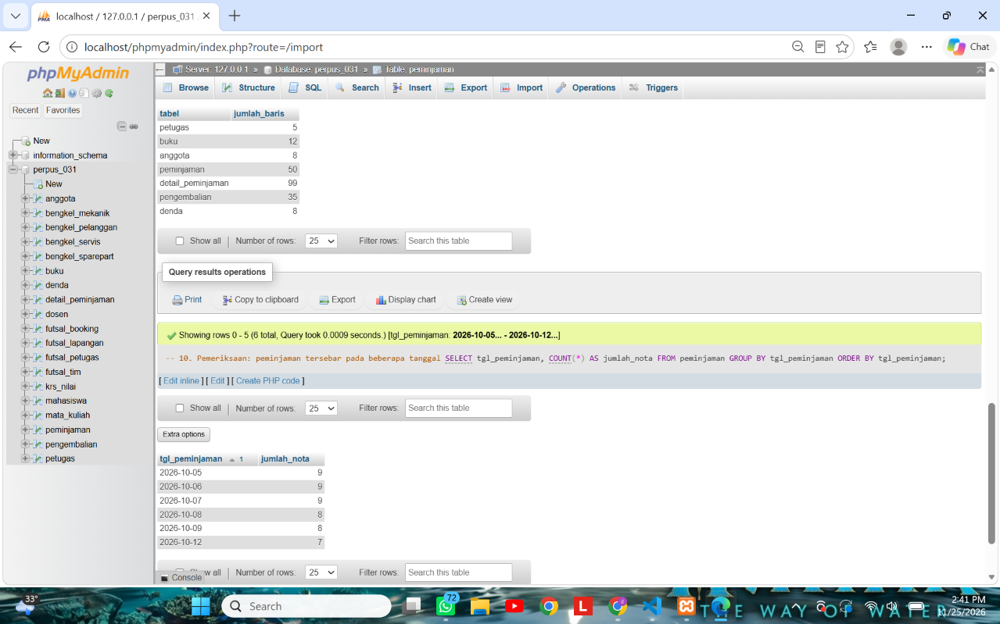
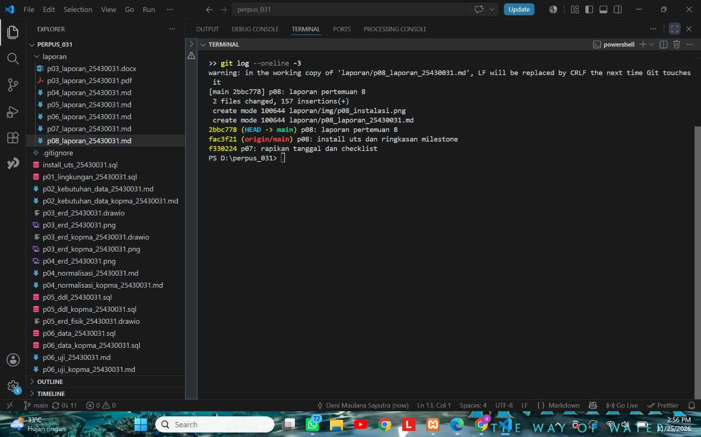

 # Laporan Praktikum Basis Data - Pertemuan 08

| Data | Isi |
|---|---|
| Nama | Deni Maulana Saputra |
| NIM | 25430031 |
| Kelas | B |
| Pertemuan | 8 (UTS Proyek Tahap 1) |
| Tanggal pelaksanaan | 20-11-2026 |
| Asisten/Dosen | Dedi Irawan, S.Kom., M.T.I. |

## 1. Tujuan Praktikum


UTS ini mengukur apakah milestone 1 sampai 7 sudah menjadi satu basis data proyek yang utuh, dapat dipasang ulang dari nol, dan dapat saya pertanggungjawabkan. Untuk itu saya menyiapkan skrip instalasi satu langkah, menguji pemasangan ulang, menyusun ringkasan milestone, dan merenungkan keputusan desain yang masih perlu diperbaiki.

| No | Yang dipelajari | Hasil yang ditunjukkan di laporan |
|---|---|---|
| 1 | Menyatukan DDL dan data dalam satu skrip instalasi | Bagian 3 |
| 2 | Menguji pemasangan ulang dari nol | Bagian 3 |
| 3 | Merangkum milestone 1 sampai 7 dan tautan berkasnya | Bagian 4 |
| 4 | Menyiapkan diri untuk modifikasi langsung | Bagian 5 |
| 5 | Menilai kelemahan desain sendiri | Bagian 6 |

## 2. Ringkasan Dasar Teori

Basis data yang baik dapat dibangun ulang dari skrip, bukan dari klik manual. Skrip DDL menghapus tabel lama dari anak ke induk, lalu membuat tabel dari induk ke anak. Skrip data mengisi tabel induk lebih dulu, baru tabel anak. Karena urutannya tetap, hasil pemasangan selalu sama.

Perintah `SOURCE` di klien `mysql` menjalankan isi berkas SQL lain. Dengan `SOURCE`, satu skrip instalasi cukup memanggil DDL lalu data. Perintah `SOURCE` hanya dikenal klien `mysql` di terminal. Di phpMyAdmin, hal yang sama dilakukan lewat tab Import untuk tiap berkas secara berurutan.

Pemasangan yang "bersih" berarti hasilnya tidak bergantung pada keadaan sebelumnya. Cara membuktikannya adalah memasang ulang dan memeriksa bahwa jumlah baris dan isi tabel sama persis dengan yang diharapkan.

## 3. Hasil Langkah Persiapan

**Skrip instalasi.** `install_uts_25430031.sql` hanya berisi dua baris yang dijalankan berurutan:

```sql
SOURCE p05_ddl_25430031.sql;
SOURCE p06_data_25430031.sql;
```

**Uji pemasangan ulang.** Saya mengimpor `p05_ddl_25430031.sql` lalu `p06_data_25430031.sql` pada basis data `perpus_031` dengan akun `dev_031`, urutan yang sama dengan skrip instalasi. Di akhir impor, pemeriksaan otomatis menampilkan jumlah baris tiap tabel dan jumlah nota per tanggal.



*Keterangan: jumlah baris hasil instalasi bersih di `perpus_031` sesuai harapan, dan 50 peminjaman tersebar pada 6 tanggal.*

| Tabel | Harapan | Hasil nyata |
|---|---|---|
| `petugas` | 5 | 5 |
| `buku` | 12 | 12 |
| `anggota` | 8 | 8 |
| `peminjaman` | 50 | 50 |
| `detail_peminjaman` | 99 | 99 |
| `pengembalian` | 35 | 35 |
| `denda` | 8 | 8 |

Nota per tanggal (5, 6, 7, 8, 9, dan 12 Oktober 2026) menghasilkan 9, 9, 9, 8, 8, dan 7 nota, sesuai harapan.

**Kendala saat menguji.**

| Kendala | Penyebab | Cara mengatasi |
|---|---|---|
| Basis data `perpus_031` tidak terlihat oleh akun `dev_031`, yang hanya melihat `information_schema` | Hak akses akun hilang setelah XAMPP dijalankan ulang | Login sebagai `root`, lalu memulihkan hak akses `dev_031` dengan `GRANT` |
| `mysql.exe` tidak dikenali di `C:\xampp` | XAMPP di komputer saya terpasang di `D:\xampp` | Memakai alamat `D:\xampp\mysql\bin\mysql.exe` |

## 4. Ringkasan Milestone 1 sampai 7

Rincian lengkap dan tautan setiap berkas ada di [`p08_uts_25430031.md`](../p08_uts_25430031.md).

| Milestone | Isi singkat | Berkas utama |
|---|---|---|
| 1 Lingkungan | Basis data dan akun proyek, repositori Git, README, `.gitignore` | `p01_lingkungan_25430031.sql` |
| 2 Kebutuhan data | Aturan bisnis (AB-xx), kebutuhan informasi (KI-01 sampai KI-06), kamus data, parameter P = 5 | `p02_kebutuhan_data_25430031.md` |
| 3 ERD | ERD konseptual proyek | `p03_erd_25430031.png` |
| 4 Normalisasi | Skema 3NF dengan 7 tabel | `p04_normalisasi_25430031.md` |
| 5 DDL | Tabel, kunci primer dan tamu, `UNIQUE`, `CHECK`; ERD fisik | `p05_ddl_25430031.sql` |
| 6 Data dan uji | 50 peminjaman, 13 skenario uji, 1 uji gagal (AB-03) | `p06_data_25430031.sql`, `p06_uji_25430031.md` |
| 7 Kueri | 10 kueri satu tabel dengan komentar KI dan hasil yang diharapkan | `p07_kueri_25430031.sql` |

## 5. Catatan Modifikasi Langsung

UTS dilaksanakan pada Jumat, 20 November 2026. Tidak ada sesi viva terpisah. Dalam demo, dosen memilih satu permintaan perubahan dari bank modifikasi, dan permintaan itu harus selesai dalam lima menit.

**Permintaan dari dosen:** <tulis satu kalimat permintaan modifikasi yang diberikan dosen>

**Kesiapan saya untuk enam jenis modifikasi.** Untuk berjaga-jaga, saya menyiapkan cara mengerjakan tiap jenis permintaan pada proyek saya. Perintah di bawah adalah rencana kerja, bukan hasil yang sudah saya jalankan semuanya.

| Jenis permintaan | Cara saya mengerjakannya |
|---|---|
| Kolom baru wajib dengan nilai bawaan | `ALTER TABLE buku ADD COLUMN rak_buku VARCHAR(10) NOT NULL DEFAULT 'UMUM';` lalu `SELECT` untuk memastikan semua baris lama terisi `UMUM` |
| `CHECK` baru lalu buktikan penolakan | `ALTER TABLE buku ADD CONSTRAINT ck_buku_stok_maks CHECK (stok_buku <= 100);` lalu `UPDATE buku SET stok_buku = 150 WHERE kode_buku = 'BK001';` harus galat 4025 |
| Ubah kueri milestone 7 | Q3 menjadi `ORDER BY stok_buku DESC, kode_buku ASC LIMIT 5` |
| Kueri baru untuk pertanyaan sederhana | Misalnya buku terbitan sebelum 2010: `SELECT kode_buku, judul_buku, tahun_terbit FROM buku WHERE tahun_terbit < 2010 ORDER BY tahun_terbit;` |
| Data yang melanggar aturan lalu perbaiki | `INSERT` peminjaman untuk anggota `AG099` galat 1452 (anggota belum ada); perbaikannya memakai anggota yang ada, misalnya `AG001` |
| Ubah aksi `ON DELETE` | Hapus kunci tamu `fk_detail_peminjaman`, buat ulang dengan `ON DELETE CASCADE`. Dampaknya, menghapus peminjaman ikut menghapus rincian bukunya |

## 6. Refleksi Keputusan Desain yang Akan Diperbaiki

| Hal yang saya nilai kurang | Alasan | Rencana perbaikan |
|---|---|---|
| Aturan AB-03, AB-05, AB-06, AB-11, dan sebagian AB-07 belum dijaga server | `CHECK` dan kunci tamu hanya melihat satu baris atau memastikan nilai ada di tabel induk | Transaksi dan pemicu di Modul 14 |
| KI-04, KI-05, dan KI-06 (lengkap) belum terjawab | Butuh gabungan beberapa tabel | `JOIN` dan subkueri di Pertemuan 10 dan 11 |
| Tabel `petugas` tidak punya kolom status | Petugas yang berhenti tidak bisa dihapus (kunci tamu `RESTRICT`) dan tidak bisa ditandai tidak aktif | Tambah kolom status petugas, mirip status anggota |
| DDL memuat `USE perpus_031` | Skrip tidak bisa dipasang ke basis data lain, misalnya `perpus_031_uji`, tanpa mengubah isinya | Hapus `USE` dari skrip dan pilih basis data saat memasang |
| `perpus_031` berisi tabel dari latihan lain | Instalasi tidak benar-benar di basis data kosong | Pakai basis data terpisah untuk uji instalasi bersih |

## 7. Kesimpulan

UTS menunjukkan bahwa proyek saya dapat dipasang ulang dari skrip dengan hasil yang sama: tujuh tabel dan jumlah baris yang cocok dengan rencana. Skrip instalasi satu langkah membuat pemasangan ulang cepat dan tidak bergantung pada klik manual. Refleksi saya menemukan beberapa hal yang masih perlu diperbaiki, terutama aturan bisnis yang belum dapat dijaga server dan skrip yang terikat pada satu nama basis data. Semuanya masuk daftar perbaikan untuk pertemuan berikutnya.

## 8. Pernyataan Penggunaan AI

| Hal | Keterangan |
|---|---|
| Alat yang dipakai | Claude (Anthropic) |
| Dipakai untuk | Menjelaskan isi dan aturan UTS, menyusun skrip instalasi dan ringkasan milestone, memandu pengujian pemasangan ulang, dan menyusun kerangka laporan |
| Bagian yang terbantu: instalasi dan ringkasan | `install_uts_25430031.sql` dan `p08_uts_25430031.md` disusun dengan bantuan AI dari berkas milestone saya, lalu saya jalankan sendiri dan saya ambil tangkapan layarnya |
| Bagian yang terbantu: refleksi | Daftar kelemahan desain disusun dengan bantuan AI dari isi DDL dan skenario uji saya, lalu saya periksa kebenarannya |
| Dasar penggunaan | Sesuai arahan dosen pengampu: AI boleh dipakai dengan syarat disertai pernyataan ini |

## 9. Bukti Git

| Hal | Isi |
|---|---|
| Repositori | https://github.com/denimaulanasaputra037-sketch/basisdata-25430031 |
| Commit skrip instalasi dan ringkasan | `fac3f21` (pesan: `p08: install uts dan ringkasan milestone`) |
| Commit laporan | `<ISI HASH>` (pesan: `p08: laporan pertemuan 8`) |



*Keterangan: riwayat commit Pertemuan 8 (`git log --oneline -3`).*

## Checklist

**Checklist khusus Pertemuan 8**

| | Jenis | Yang harus ada |
|---|---|---|
| ☑ | Berkas wajib | `p08_uts_25430031.md` dan `install_uts_25430031.sql` |
| ☑ | Bukti tangkapan layar | Basis data berjalan dari skrip DDL dan data (instalasi bersih) |
| ☑ | Analisis wajib | Catatan modifikasi langsung saat demo; refleksi keputusan desain yang akan diperbaiki |

**Checklist umum**

| | Butir | Status |
|---|---|---|
| ☑ | Identitas lengkap | Sudah |
| ☑ | Tujuan dengan bahasa sendiri | Sudah |
| ☑ | Ringkasan teori | Sudah |
| ☑ | Tangkapan layar langkah percobaan dengan keterangan | Sudah |
| ☑ | Titik Analisis dijawab dengan alasan | Refleksi desain (Bagian 6) |
| ☑ | Pembahasan dan kendala | Sudah |
| ☑ | Kesimpulan | Sudah |
| ☑ | Pernyataan Penggunaan AI | Sudah |
| ☐ | Bukti Git (hash commit) | isi hash setelah commit |
| ☑ | Keaslian: tangkapan layar memperlihatkan akun ber-NIM dan jam sistem | Sudah |
