# Laporan Praktikum Basis Data - Pertemuan 09

| Data | Isi |
|---|---|
| Nama | Deni Maulana Saputra |
| NIM | 25430031 |
| Kelas | B |
| Pertemuan | 9 (Meringkas Data dengan Fungsi Agregat dan GROUP BY) |
| Tanggal pelaksanaan | 27-11-2026 |
| Asisten/Dosen | Dedi Irawan, S.Kom., M.T.I. |

## 1. Tujuan Praktikum

Di pertemuan ini saya belajar meringkas banyak baris menjadi satu angka yang bermakna. Saya memakai fungsi agregat `COUNT`, `SUM`, `AVG`, `MIN`, dan `MAX`, mengelompokkan data dengan `GROUP BY`, menyaring kelompok dengan `HAVING`, membuat baris subtotal dan total dengan `WITH ROLLUP`, dan menyalakan mode `ONLY_FULL_GROUP_BY` supaya kueri agregasi yang menyesatkan ditolak server.

| No | Yang dipelajari | Hasil yang ditunjukkan di laporan |
|---|---|---|
| 1 | Fungsi agregat dan perilakunya terhadap NULL | Bagian 2 dan 3 |
| 2 | `GROUP BY` dan `HAVING` | Bagian 3, 4, dan 6 |
| 3 | `WITH ROLLUP` untuk baris total | Bagian 3, 5, dan 6 |
| 4 | Mode `ONLY_FULL_GROUP_BY` dan galat 1055 | Bagian 4 |
| 5 | Laporan ringkasan proyek yang dipetakan ke KI | Bagian 6 |

## 2. Ringkasan Dasar Teori

Fungsi agregat menghitung satu nilai dari banyak baris. Tanpa `GROUP BY`, seluruh baris menjadi satu kelompok. Dengan `GROUP BY`, baris dikelompokkan menurut nilai kolom tertentu, lalu setiap kelompok diringkas.

| Fungsi | Hasil | Terhadap NULL |
|---|---|---|
| `COUNT(*)` | jumlah baris | menghitung semua baris |
| `COUNT(kolom)` | jumlah nilai bukan NULL | NULL diabaikan |
| `COUNT(DISTINCT kolom)` | jumlah nilai berbeda | NULL diabaikan |
| `SUM`, `AVG` | jumlah dan rata-rata | NULL diabaikan, `AVG` membagi dengan jumlah nilai bukan NULL |
| `MIN`, `MAX` | nilai terkecil dan terbesar | NULL diabaikan |

`WHERE` menyaring **baris** sebelum dikelompokkan, sedangkan `HAVING` menyaring **kelompok** sesudah dihitung. `WITH ROLLUP` menambah baris subtotal dan total, yang ditandai nilai NULL pada kolom pengelompokan.

Secara bawaan, MariaDB mengizinkan kolom yang tidak diagregasi dan tidak ada di `GROUP BY` muncul di `SELECT`. Nilainya diambil dari salah satu baris dalam kelompok, tanpa jaminan baris mana, jadi hasilnya bisa menyesatkan tanpa galat. Mode `ONLY_FULL_GROUP_BY` membuat server menolak kueri seperti itu dengan galat 1055.

## 3. Hasil Langkah Percobaan

Langkah percobaan saya kerjakan di basis data `kopma_031` dengan akun `mhs_031`. Skripnya ada di `p09_agregasi_kopma_25430031.sql`.

**D.1 Menyiapkan data dan mode ketat.** Berkas `kopma_data_lanjutan.sql` dari dosen tidak tersedia pada saya. Karena itu saya membuat sendiri `kopma_data_lanjutan_25430031.sql` dengan bantuan AI, dirancang agar angka kuncinya sama dengan contoh di buku: 75 nota, September 39 nota (Rp691.000), dan Oktober 36 nota (Rp507.500). Angka detail di luar yang disebut buku bisa berbeda dari data milik teman yang memakai berkas dosen.

Setelah diimpor, pemeriksaan menunjukkan 75 nota dari 2 September sampai 31 Oktober 2026, dan jumlah baris tabel 5, 12, 12, 3, 75, 161, 4, dan 14 (petugas, barang, anggota, pemasok, penjualan, detail penjualan, pembelian, detail pembelian).

Mode ketat saya nyalakan di awal setiap berkas kueri dengan `SET SESSION sql_mode = CONCAT(@@sql_mode, ',ONLY_FULL_GROUP_BY');`.

**D.2 Total satu nota.** Pertanyaan yang tertunda dari Pertemuan 7 terjawab: total nota `PJ-2609-0001` adalah **18.500** (1 × 4000 + 1 × 6500 + 2 × 4000). Nota itu dibayar 20.000, jadi kembaliannya 1.500.

**D.3 Laporan omzet harian dan bulanan (KI-01).** Omzet harian untuk minggu pertama September dengan baris total dari `WITH ROLLUP`:

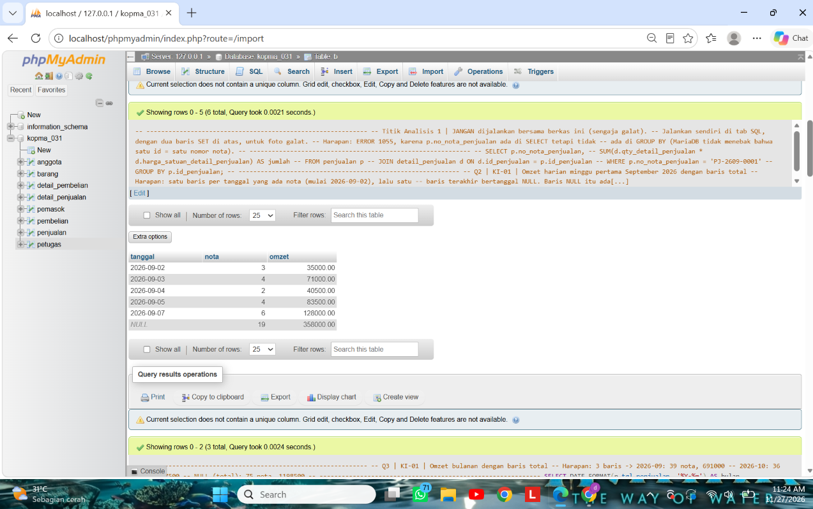

*Keterangan: omzet harian 2 sampai 7 September dengan baris total (tanggal NULL). Di bagian atas layar terlihat total nota PJ-2609-0001 senilai 18500.*

| Tanggal | Nota | Omzet |
|---|---|---|
| 2026-09-02 | 3 | 35.000 |
| 2026-09-03 | 4 | 71.000 |
| 2026-09-04 | 2 | 40.500 |
| 2026-09-05 | 4 | 83.500 |
| 2026-09-07 | 6 | 128.000 |
| NULL (total) | 19 | 358.000 |

Baris total cocok dengan penjumlahan manual baris di atasnya (3 + 4 + 2 + 4 + 6 = 19 nota, dan 35.000 + 71.000 + 40.500 + 83.500 + 128.000 = 358.000). Tanggal 6 September tidak muncul karena tidak ada nota pada hari itu.

Pengelompokan per bulan menghasilkan:

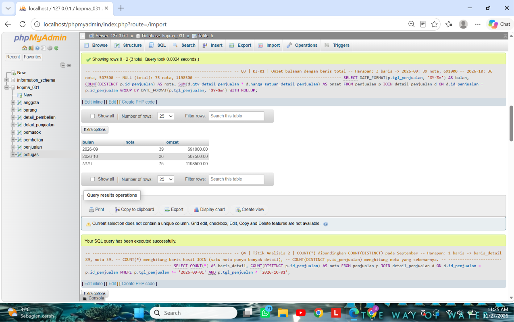

*Keterangan: omzet bulanan dengan baris total.*

| Bulan | Nota | Omzet |
|---|---|---|
| 2026-09 | 39 | 691.000 |
| 2026-10 | 36 | 507.500 |
| NULL (total) | 75 | 1.198.500 |

**D.4 Menyaring kelompok dengan `HAVING`.** Kasir yang melayani lebih dari 20 nota:

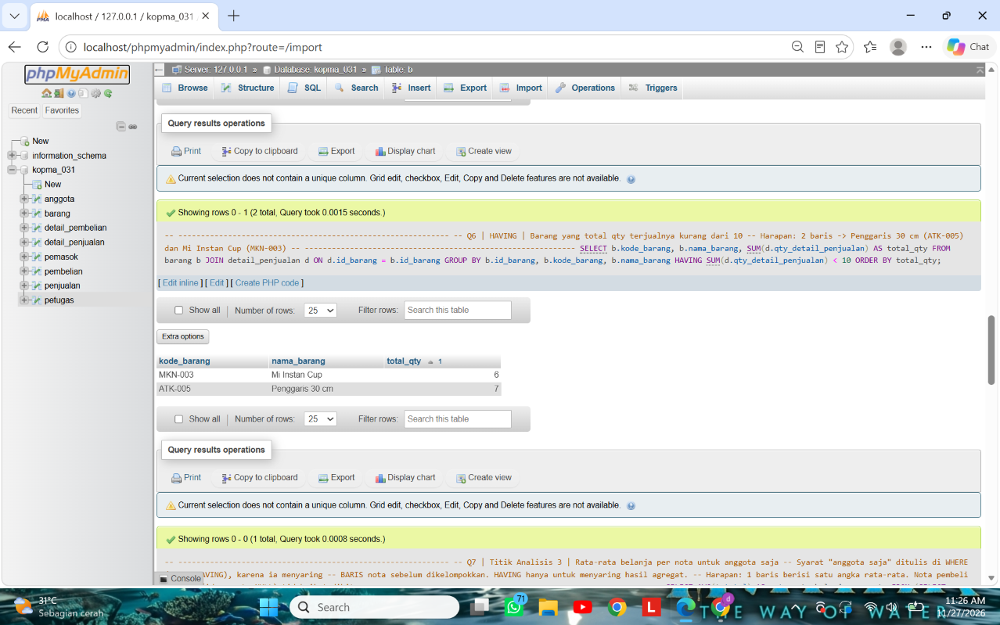

*Keterangan: hanya dua kasir yang lolos `HAVING COUNT(*) > 20`.*

Hasilnya Dimas (K01) dengan 24 nota dan Rina (K03) dengan 33 nota. Sari (K02) melayani 18 nota sehingga tersaring. Kueri barang yang total qty terjualnya kurang dari 10 menampilkan dua barang, yaitu Penggaris 30 cm dan Mi Instan Cup.

## 4. Jawaban Titik Analisis

**Titik Analisis 1: galat 1055.**

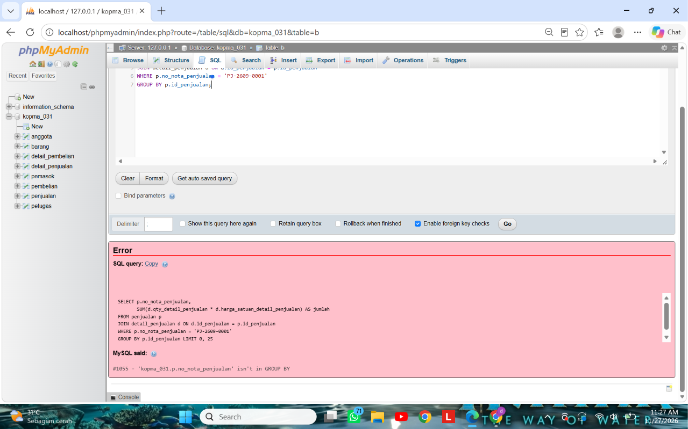

*Keterangan: galat 1055 muncul karena `p.no_nota_penjualan` ada di `SELECT` tetapi tidak ada di `GROUP BY`.*

Ketika `p.no_nota_penjualan` dihapus dari `GROUP BY` dan hanya `p.id_penjualan` yang tersisa, server menolak dengan galat **1055**. Secara logika satu `id_penjualan` hanya punya satu `no_nota_penjualan`, tetapi MariaDB tidak menebak hubungan itu dan hanya membaca isi `GROUP BY` apa adanya. Lebih aman menuliskan semua kolom non-agregat di `GROUP BY`, karena hasilnya tidak bergantung pada tebakan server, dan kalau ada kolom yang salah masuk ke `SELECT`, server langsung memberi tahu.

**Titik Analisis 2: `COUNT(DISTINCT p.id_penjualan)`, bukan `COUNT(*)`.**
Satu nota punya banyak baris detail. Setelah `JOIN`, nota dengan tiga barang muncul tiga kali. Pada data September, `COUNT(*)` menghitung baris hasil `JOIN` yaitu **89**, sedangkan `COUNT(DISTINCT p.id_penjualan)` menghitung nota sebenarnya yaitu **39**. Selisihnya adalah hubungan satu nota ke banyak detail. Kalau memakai `COUNT(*)`, laporan akan menyebut jumlah nota terlalu besar.

**Titik Analisis 3: rata-rata belanja per nota untuk anggota saja.**
Syarat "anggota saja" ditulis di **`WHERE`**. Urutan evaluasinya `FROM`, lalu `WHERE`, lalu `GROUP BY`, lalu `HAVING`. Syarat ini menyaring baris nota (`id_anggota IS NOT NULL`) sebelum dikelompokkan, sehingga nota pembeli umum tidak ikut dihitung. `HAVING` tidak cocok karena hanya untuk menyaring hasil agregat. Karena rata-rata per nota membutuhkan total tiap nota lebih dulu, kuerinya memakai subkueri:

```sql
SELECT AVG(t.total) AS rata_rata_belanja_per_nota
FROM (SELECT p.id_penjualan,
             SUM(d.qty_detail_penjualan * d.harga_satuan_detail_penjualan) AS total
      FROM penjualan p
      JOIN detail_penjualan d ON d.id_penjualan = p.id_penjualan
      WHERE p.id_anggota IS NOT NULL
      GROUP BY p.id_penjualan) t;
```

## 5. Hasil Latihan dan Modifikasi

**Latihan E.1: nota dengan diskon 5% untuk anggota aktif (AB-02).** Total tiap nota dihitung dari detailnya. Untuk anggota aktif, totalnya dikalikan 0,95 dan dibulatkan. Total itu dibandingkan dengan `bayar_penjualan`, lalu hanya nota yang kembaliannya lebih dari Rp4.000 yang ditampilkan. Karena `JOIN` ke tabel anggota memakai `LEFT JOIN`, nota pembeli umum tetap terhitung tanpa diskon. Kueri lengkapnya ada di `p09_agregasi_kopma_25430031.sql`.

**Latihan E.2: omzet per kategori per bulan dengan `WITH ROLLUP`.** Pengelompokan dilakukan menurut bulan lalu kategori barang. Arti nilai NULL pada hasilnya:

| Baris | Arti |
|---|---|
| bulan terisi, kategori terisi | omzet satu kategori pada bulan itu |
| bulan terisi, kategori NULL | subtotal seluruh kategori pada bulan itu, yang harus sama dengan omzet bulanan (September 691.000, Oktober 507.500) |
| bulan NULL, kategori NULL | total keseluruhan semua bulan (1.198.500) |

## 6. Tugas Mandiri: Milestone Proyek 09

Untuk proyek Perpustakaan Happy Reading saya membuat `p09_agregasi_25430031.sql`, berisi 6 laporan ringkasan di `perpus_031` dengan akun `dev_031`. Semua dijalankan dengan `ONLY_FULL_GROUP_BY` aktif, tiap laporan punya komentar KI dan hasil yang diharapkan, dan tiap laporan punya minimal tiga kelompok.

| Laporan | KI | Pertanyaan sehari-hari | Teknik | Kelompok |
|---|---|---|---|---|
| R1 | KI-04 | Berapa eksemplar tiap judul yang sedang dipinjam? | `JOIN`, `LEFT JOIN` dengan `IS NULL` | 12 judul |
| R2 | KI-05 | Anggota mana yang terlambat sedikitnya dua kali? | `HAVING COUNT(*) >= 2` | 3 anggota |
| R3 | KI-06 | Berapa denda yang belum dibayar tiap anggota? | `WITH ROLLUP`, `DATEDIFF` | 3 anggota dan baris total |
| R4 | KI-02 dan KI-03 | Berapa judul dan stok buku pada tiap dasawarsa terbit? | `FLOOR` | 4 dasawarsa |
| R5 | KI-01 | Berapa kali tiap anggota Aktif meminjam? | `WHERE`, `COUNT` | 6 anggota |
| R6 | Pendukung | Berapa peminjaman setiap hari? | `WITH ROLLUP` | 6 tanggal dan baris total |

**R1 (KI-04): buku yang sedang dipinjam.** Peminjaman yang belum punya pengembalian dicari dengan `LEFT JOIN ... WHERE g.no_peminjaman IS NULL`. Total ada 30 eksemplar sedang dipinjam, terbanyak BK007 dengan 5. Tiap angka sama dengan 20 dikurangi stok buku, jadi laporan ini sekaligus memeriksa kebenaran stok.

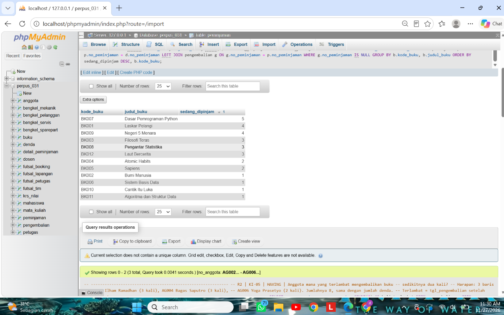

*Keterangan: R1, 12 judul dengan jumlah eksemplar yang sedang dipinjam.*

**R2 (KI-05): anggota yang terlambat, memakai `HAVING`.** Terlambat berarti tanggal pengembalian lebih besar daripada tanggal jatuh tempo. Hasilnya AG002 Ilham Ramadhan (3 kali), AG004 Bagas Saputro (3 kali), dan AG006 Yoga Prasetyo (2 kali), total 8 yang sama dengan jumlah denda. `HAVING` dipakai karena syarat "sedikitnya dua kali" berlaku pada hasil hitungan per anggota, bukan pada baris pengembalian satu per satu.

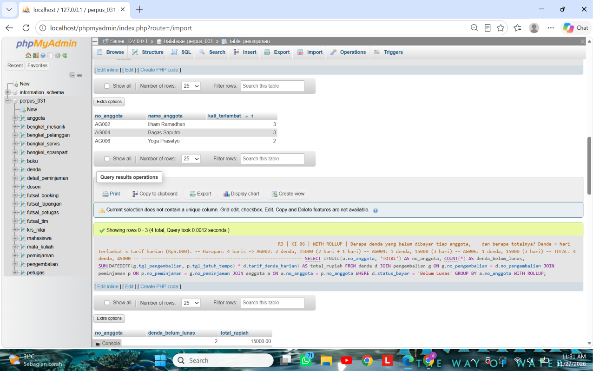

*Keterangan: R2, tiga anggota yang terlambat sedikitnya dua kali.*

**R3 (KI-06): denda belum lunas, memakai `WITH ROLLUP`.** Denda dihitung dari hari terlambat dikali tarif harian Rp5.000.

| Anggota | Denda belum lunas | Total (Rp) |
|---|---|---|
| AG002 | 2 | 15.000 |
| AG004 | 1 | 15.000 |
| AG006 | 1 | 15.000 |
| TOTAL | 4 | 45.000 |

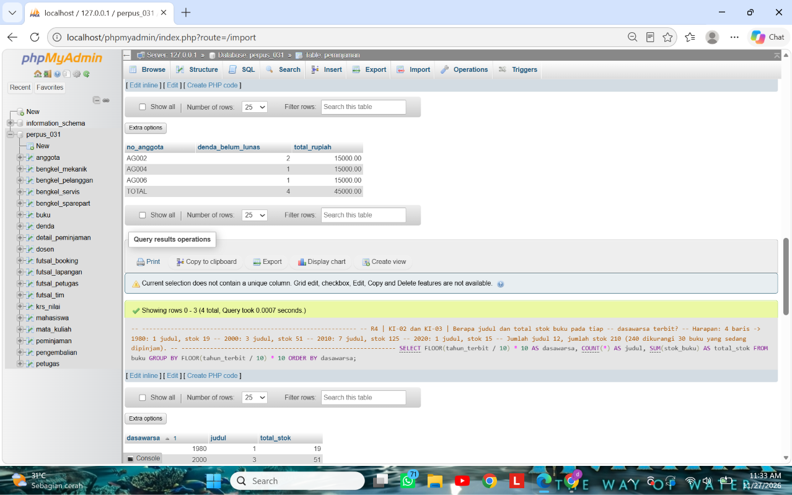

*Keterangan: R3, denda belum lunas per anggota dengan baris TOTAL dari `WITH ROLLUP`.*

**R4 (KI-02 dan KI-03): stok per dasawarsa.** Dasawarsa 1980 punya 1 judul (stok 19), 2000 punya 3 judul (stok 51), 2010 punya 7 judul (stok 125), dan 2020 punya 1 judul (stok 15). Jumlah stok 210 sama dengan 240 dikurangi 30 buku yang sedang dipinjam.

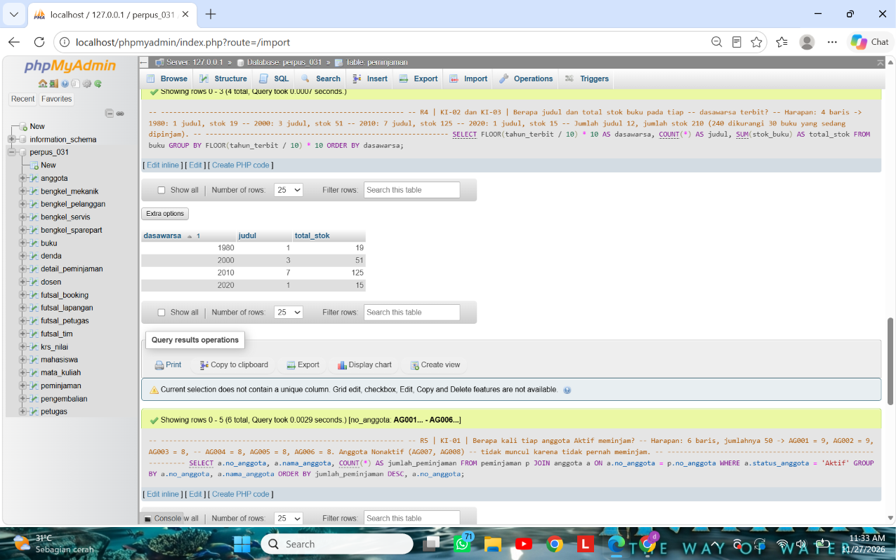

*Keterangan: R4, jumlah judul dan total stok buku per dasawarsa terbit.*

**R5 (KI-01): peminjaman per anggota aktif.** Enam anggota Aktif meminjam 9, 9, 8, 8, 8, dan 8 kali (total 50). Anggota Nonaktif (AG007 dan AG008) tidak muncul karena tidak pernah meminjam.

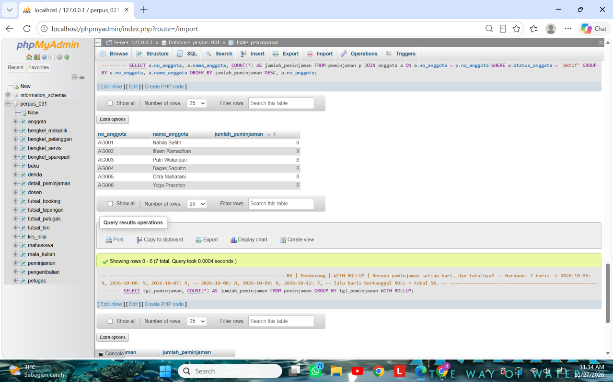

*Keterangan: R5, jumlah peminjaman tiap anggota Aktif.*

**R6 (pendukung): peminjaman per hari, memakai `WITH ROLLUP`.** Enam tanggal berisi 9, 9, 9, 8, 8, dan 7 peminjaman, dan baris total (tanggal NULL) berisi 50.

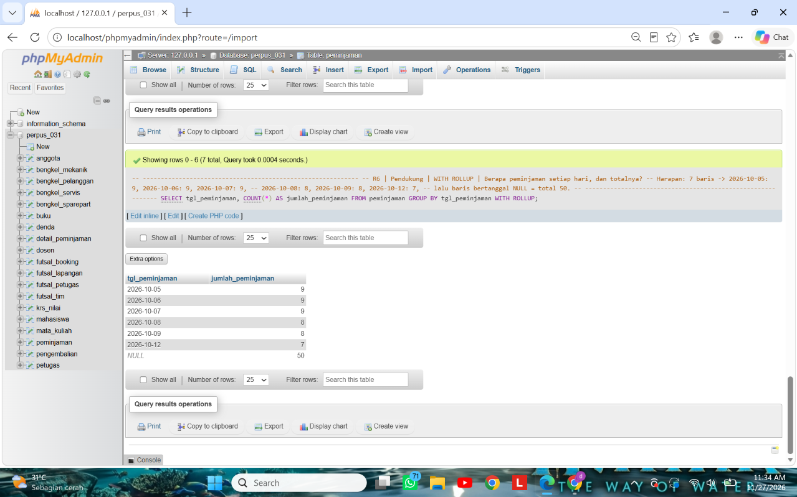

*Keterangan: R6, peminjaman per tanggal dengan baris total dari `WITH ROLLUP`.*

## 7. Pembahasan dan Kendala

| Kendala | Penyebab | Cara mengatasi |
|---|---|---|
| Basis data `kopma_031` tidak terlihat oleh akun `mhs_031` | Hak akses akun hilang setelah XAMPP dijalankan ulang | Login sebagai `root`, lalu memulihkan hak akses dengan `GRANT` |
| Galat 1701 saat mengimpor data lanjutan | Server menolak mengosongkan tabel yang dirujuk kunci tamu | Impor diulang dengan pemeriksaan kunci tamu dimatikan pada halaman Import |
| Galat 1044 saat mengimpor berkas proyek | Berkas `perpus_031` diimpor dengan akun `mhs_031` yang hanya berhak atas `kopma_031` | Login sebagai `dev_031`, lalu impor ulang |
| Berkas dosen `kopma_data_lanjutan.sql` tidak ada | Tidak diberikan kepada saya | Membuat data pengganti dengan angka kunci yang sama dengan buku, dan mencatatnya di laporan |

Beberapa hal yang saya pelajari:
- Di phpMyAdmin, pengaturan `SET SESSION sql_mode` hanya berlaku pada satu kali **Go**. Karena itu baris `SET` harus ada di atas setiap berkas atau kueri yang dijalankan.
- Angka omzet bisa berlipat kalau `JOIN` ke tabel lain yang juga banyak baris per nota. Karena itu jumlah baris perlu diperiksa sebelum dikelompokkan, dan `COUNT(DISTINCT ...)` dipakai untuk menghitung nota.
- Baris `NULL` pada hasil `WITH ROLLUP` bukan data kosong. Ia adalah baris subtotal atau total, dan artinya bergantung pada kolom mana yang bernilai NULL.
- Hasil yang cocok dengan hitungan manual (misalnya total 358.000 pada laporan harian) memberi keyakinan bahwa kueri agregasi benar.

## 8. Kesimpulan

Fungsi agregat dengan `GROUP BY` mengubah banyak baris transaksi menjadi angka yang bisa dibaca ketua dan petugas, seperti omzet harian, omzet bulanan, dan denda per anggota. `HAVING` menyaring kelompok, sedangkan `WHERE` menyaring baris, dan `WITH ROLLUP` menambah baris total tanpa kueri tambahan. Mode `ONLY_FULL_GROUP_BY` membuat kueri yang menyesatkan ditolak dengan galat 1055, jadi saya selalu menyalakannya. Di proyek perpustakaan, tiga KI yang belum terjawab di Pertemuan 7 (KI-04, KI-05, dan KI-06) kini terjawab dalam laporan R1, R2, dan R3.

## 9. Pernyataan Penggunaan AI

| Hal | Keterangan |
|---|---|
| Alat yang dipakai | Claude (Anthropic) |
| Dipakai untuk | Memahami fungsi agregat dan `GROUP BY`, menyusun kueri Kopma dan proyek, menghitung hasil yang diharapkan, menjelaskan galat, dan menyusun kerangka laporan |
| Bagian yang terbantu: data lanjutan | Karena berkas dosen tidak tersedia, `kopma_data_lanjutan_25430031.sql` dibuat dengan bantuan AI berdasarkan angka kunci di buku, lalu saya impor sendiri dan periksa jumlah barisnya |
| Bagian yang terbantu: Kopma (Langkah D dan Latihan E) | Kueri disusun dengan bantuan AI berdasarkan isi Modul 9, lalu saya jalankan sendiri di phpMyAdmin dan saya ambil tangkapan layarnya |
| Bagian yang terbantu: Milestone Proyek 9 | Draf enam laporan dan komentar hasil yang diharapkan disusun dengan bantuan AI dari `p06_data_25430031.sql` milik saya, lalu saya jalankan sendiri di `perpus_031` dan hasilnya saya cocokkan |
| Dasar penggunaan | Sesuai arahan dosen pengampu: AI boleh dipakai dengan syarat disertai pernyataan ini |

## 10. Bukti Git

| Hal | Isi |
|---|---|
| Repositori | https://github.com/denimaulanasaputra037-sketch/basisdata-25430031 |
| Commit agregasi Kopma dan proyek (dua berkas SQL) | `24f509d` (pesan: `p09: agregasi proyek perpustakaan`) |
| Commit laporan | `432fe2e` (pesan: `p09: laporan pertemuan 9`) |
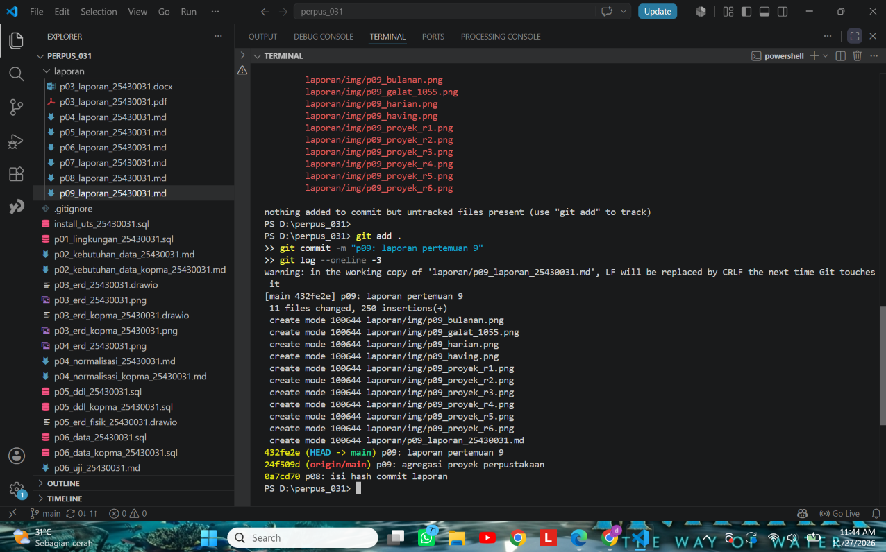

*Keterangan: riwayat commit Pertemuan 9 (`git log --oneline -3`).*

## Checklist

**Checklist khusus Pertemuan 9**

| | Jenis | Yang harus ada |
|---|---|---|
| ☑ | Berkas wajib | `p09_agregasi_25430031.sql` berisi kueri laporan ringkasan |
| ☑ | Bukti tangkapan layar | Hasil laporan ringkasan (omzet per hari dan per bulan) |
| ☑ | Analisis wajib | Kaitan setiap laporan dengan KI; penjelasan pemakaian `HAVING` |

**Checklist umum**

| | Butir | Status |
|---|---|---|
| ☑ | Identitas lengkap | Sudah |
| ☑ | Tujuan dengan bahasa sendiri | Sudah |
| ☑ | Ringkasan teori | Sudah |
| ☑ | Tangkapan layar langkah percobaan dengan keterangan | Sudah |
| ☑ | Titik Analisis dijawab dengan alasan | Sudah |
| ☑ | Latihan E | Sudah |
| ☑ | Tugas Mandiri (F) | Sudah |
| ☑ | Pembahasan dan kendala | Sudah |
| ☑ | Kesimpulan | Sudah |
| ☑ | Pernyataan Penggunaan AI | Sudah |
| ☑ | Bukti Git (hash commit) | Sudah |
| ☑ | Keaslian: tangkapan layar memperlihatkan akun ber-NIM dan jam sistem | Sudah |
