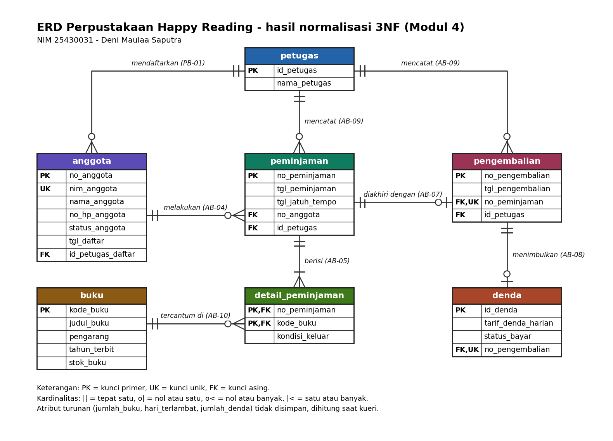

# P04 Normalisasi Proyek - Perpustakaan Happy Reading

- Nama : Deni Maulaa Saputra
- NIM  : 25430031
- Modul: 4 - Normalisasi dan Skema Relasional (Milestone Proyek 4)

## 1. Dokumen sumber (titik awal UNF)

Dokumen sumber adalah **slip peminjaman** (sumber entitas Peminjaman dan
Detail Peminjaman di p02 bagian 4). Satu slip memuat beberapa buku sehingga
terdapat grup berulang.

```
SLIP PEMINJAMAN
No. Peminjaman : PM001
Tanggal        : 05-10-2026
Jatuh Tempo    : 12-10-2026
Petugas        : PT001 / Agus
Anggota        : AG001 / Joni (Aktif)
Buku           : BK001 / Basis Data      / Baik
                 BK002 / Jaringan Komputer / Rusak ringan
Jumlah buku    : 2
```

## 2. UNF

```
PEMINJAMAN_UNF (no_peminjaman, tgl_peminjaman, tgl_jatuh_tempo,
  id_petugas, nama_petugas,
  no_anggota, nama_anggota, status_anggota,
  { kode_buku, judul_buku, kondisi_keluar },
  jumlah_buku)
```

Masalah: atribut di dalam `{ }` berulang untuk setiap buku dalam satu slip.

## 3. 1NF

Satu baris untuk setiap buku di setiap slip. Kunci primer komposit:
(no_peminjaman, kode_buku).

```
PEMINJAMAN_1NF (no_peminjaman, kode_buku, tgl_peminjaman, tgl_jatuh_tempo,
  id_petugas, nama_petugas, no_anggota, nama_anggota, status_anggota,
  judul_buku, kondisi_keluar, jumlah_buku)
```

Contoh data 1NF:

| no_peminjaman | kode_buku | judul_buku | kondisi_keluar | no_anggota | nama_anggota | id_petugas | nama_petugas |
|---|---|---|---|---|---|---|---|
| PM001 | BK001 | Basis Data | Baik | AG001 | Joni | PT001 | Agus |
| PM001 | BK002 | Jaringan Komputer | Rusak ringan | AG001 | Joni | PT001 | Agus |

Data anggota dan petugas tertulis berulang di setiap baris buku. Itu yang
diselesaikan pada tahap berikutnya.

## 4. Dependensi fungsional

Diturunkan dari aturan bisnis dan kamus data p02, bukan dari contoh data.

| Kode | Dependensi fungsional | Dasar |
|---|---|---|
| FD1 | no_peminjaman -> tgl_peminjaman, tgl_jatuh_tempo, no_anggota, id_petugas | AB-04, AB-09, AB-12 |
| FD2 | id_petugas -> nama_petugas | kamus data: id_petugas unik |
| FD3 | no_anggota -> nim_anggota, nama_anggota, no_hp_anggota, status_anggota, tgl_daftar | AB-01, AB-02 |
| FD4 | nim_anggota -> no_anggota | AB-02 (satu anggota terdaftar satu kali) |
| FD5 | no_anggota -> id_petugas_daftar | formulir pendaftaran (PB-01) |
| FD6 | kode_buku -> judul_buku, pengarang, tahun_terbit, stok_buku | AB-10 |
| FD7 | (no_peminjaman, kode_buku) -> kondisi_keluar | AB-13 |
| FD8 | no_pengembalian -> tgl_pengembalian, no_peminjaman, id_petugas | AB-07, AB-09 |
| FD9 | id_denda -> no_pengembalian, tarif_denda_harian, status_bayar | AB-08 |
| FD10 | tgl_pengembalian, tgl_jatuh_tempo -> hari_terlambat | turunan (AB-08) |
| FD11 | hari_terlambat, tarif_denda_harian -> jumlah_denda | turunan (AB-08) |
| FD12 | no_peminjaman -> jumlah_buku | turunan (AB-05, AB-11) |

Dependensi yang sengaja **tidak** ditulis: `tgl_peminjaman -> tgl_jatuh_tempo`.
AB-12 hanya menetapkan lama peminjaman **maksimal** 7 hari, bukan tepat 7
hari, sehingga tanggal jatuh tempo tidak ditentukan sepenuhnya oleh tanggal
peminjaman.

## 5. Menuju 2NF

Kunci komposit relasi 1NF adalah (no_peminjaman, kode_buku). Atribut yang
hanya bergantung pada sebagian kunci:

- FD1: tgl_peminjaman, tgl_jatuh_tempo, id_petugas, no_anggota (dan atribut
  turunannya) hanya bergantung pada no_peminjaman.
- FD6: judul_buku hanya bergantung pada kode_buku.

Hasil pemisahan:

```
PEMINJAMAN (no_peminjaman, tgl_peminjaman, tgl_jatuh_tempo, id_petugas,
  nama_petugas, no_anggota, nama_anggota, status_anggota)
BUKU (kode_buku, judul_buku, pengarang, tahun_terbit, stok_buku)
DETAIL_PEMINJAMAN (no_peminjaman*, kode_buku*, kondisi_keluar)
```

## 6. Menuju 3NF

Di relasi PEMINJAMAN terdapat rantai transitif:

- no_peminjaman -> id_petugas -> nama_petugas
- no_peminjaman -> no_anggota -> nama_anggota, status_anggota

Petugas dan anggota dipisah:

```
PEMINJAMAN (no_peminjaman, tgl_peminjaman, tgl_jatuh_tempo,
  id_petugas*, no_anggota*)
PETUGAS (id_petugas, nama_petugas)
ANGGOTA (no_anggota, nim_anggota, nama_anggota, no_hp_anggota,
  status_anggota, tgl_daftar, id_petugas_daftar*)
```

`id_petugas_daftar` berasal dari kolom Petugas pada formulir pendaftaran
(FD5).

## 7. Pengembalian dan denda

Slip pengembalian tidak punya grup berulang (asumsi: satu peminjaman
dikembalikan sekaligus, sehingga tidak ada detail pengembalian). Kunci primernya
tunggal, jadi relasi ini otomatis memenuhi 2NF. Pada pemeriksaan 3NF,
`tgl_jatuh_tempo` tidak dicatat di PENGEMBALIAN karena melalui
no_peminjaman sudah ada di PEMINJAMAN (rantai no_pengembalian ->
no_peminjaman -> tgl_jatuh_tempo).

```
PENGEMBALIAN (no_pengembalian, tgl_pengembalian, no_peminjaman*, id_petugas*)
DENDA (id_denda, no_pengembalian*, tarif_denda_harian, status_bayar)
```

Denda hanya dibuat bila pengembalian terlambat (PB-04, AB-08).

## 8. Skema akhir 3NF

```
ANGGOTA (no_anggota, nim_anggota, nama_anggota, no_hp_anggota,
  status_anggota, tgl_daftar, id_petugas_daftar*)
PETUGAS (id_petugas, nama_petugas)
BUKU (kode_buku, judul_buku, pengarang, tahun_terbit, stok_buku)
PEMINJAMAN (no_peminjaman, tgl_peminjaman, tgl_jatuh_tempo,
  id_petugas*, no_anggota*)
DETAIL_PEMINJAMAN (no_peminjaman*, kode_buku*, kondisi_keluar)
PENGEMBALIAN (no_pengembalian, tgl_pengembalian, no_peminjaman*, id_petugas*)
DENDA (id_denda, no_pengembalian*, tarif_denda_harian, status_bayar)
-- kunci primer = atribut pertama (atau pasangan pada DETAIL_PEMINJAMAN),
-- * = kunci tamu
```

Kunci unik: `nim_anggota` di ANGGOTA (AB-02), `no_peminjaman` di
PENGEMBALIAN, dan `no_pengembalian` di DENDA (masing-masing paling banyak satu).

## 9. Ringkasan tahapan

| Tahap | Masalah yang dihilangkan | Hasil |
|---|---|---|
| UNF -> 1NF | grup berulang buku per slip | satu baris per buku per slip |
| 1NF -> 2NF | FD1 dan FD6 bergantung pada sebagian kunci | peminjaman, buku, detail_peminjaman |
| 2NF -> 3NF | no_peminjaman -> id_petugas -> nama_petugas; no_peminjaman -> no_anggota -> nama_anggota | petugas dan anggota dipisah |
| Pengembalian dan denda | tidak ada grup berulang atau ketergantungan transitif | pengembalian dan denda |
| Nilai turunan | jumlah_buku, hari_terlambat, jumlah_denda | tidak disimpan |

## 10. Pemeriksaan BCNF

| Tabel | Penentu (determinan) | Kunci kandidat? | Hasil |
|---|---|---|---|
| anggota | no_anggota, nim_anggota | ya | BCNF |
| petugas | id_petugas | ya | BCNF |
| buku | kode_buku | ya | BCNF |
| peminjaman | no_peminjaman | ya | BCNF |
| detail_peminjaman | (no_peminjaman, kode_buku) | ya | BCNF |
| pengembalian | no_pengembalian, no_peminjaman | ya | BCNF |
| denda | id_denda, no_pengembalian | ya | BCNF |

Tidak ada penentu yang bukan kunci kandidat, sehingga seluruh tabel memenuhi
BCNF.

## 11. Keputusan nilai turunan

| Nilai | Keputusan | Alasan |
|---|---|---|
| jumlah_buku | dihitung | sama dengan jumlah baris detail_peminjaman per no_peminjaman; batas maksimal 7 (AB-11) dijaga saat transaksi |
| hari_terlambat | dihitung | selisih tgl_pengembalian dan tgl_jatuh_tempo, tidak kurang dari 0; bila disimpan bisa tidak cocok dengan tanggalnya (isu kualitas data no. 5) |
| jumlah_denda | dihitung | hari_terlambat x tarif_denda_harian (AB-08); bila disimpan bisa tidak cocok dengan keterlambatan (isu kualitas data no. 4) |
| tarif_denda_harian | disimpan per denda | potret tarif saat denda terjadi; bila tarif kelak berubah, denda lama tidak ikut berubah (NFR-02: riwayat harus tetap) |
| tgl_jatuh_tempo | disimpan | AB-12 hanya membatasi maksimal 7 hari, sehingga tidak dapat dihitung pasti dari tgl_peminjaman |
| stok_buku | disimpan, dengan batas minimum 0 | bukan turunan murni dari data yang ada; harus dijaga tidak kurang dari 0 (AB-06) |

## 12. Perubahan ERD

ERD p03 (`p03_erd_25430031`) dibandingkan dengan skema 3NF. Struktur tabel,
kunci, dan kardinalitas sudah sesuai. Perubahan yang dilakukan:

- Atribut turunan jumlah_buku (peminjaman), hari_terlambat dan jumlah_denda
  (denda) dihapus karena keputusan Modul 4 adalah menghitungnya, bukan
  menyimpannya.
- Kolom id_petugas pada anggota dinamai id_petugas_daftar agar tidak tertukar
  dengan id_petugas pada peminjaman dan pengembalian.

ERD hasil perubahan ada di `p04_erd_25430031.png` (bagian 13). Skema ini menjadi
dasar skrip DDL pada Pertemuan 5.

## 13. ERD hasil normalisasi


