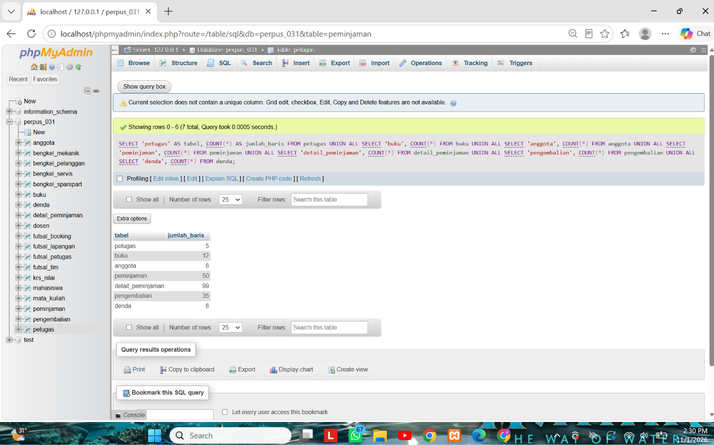
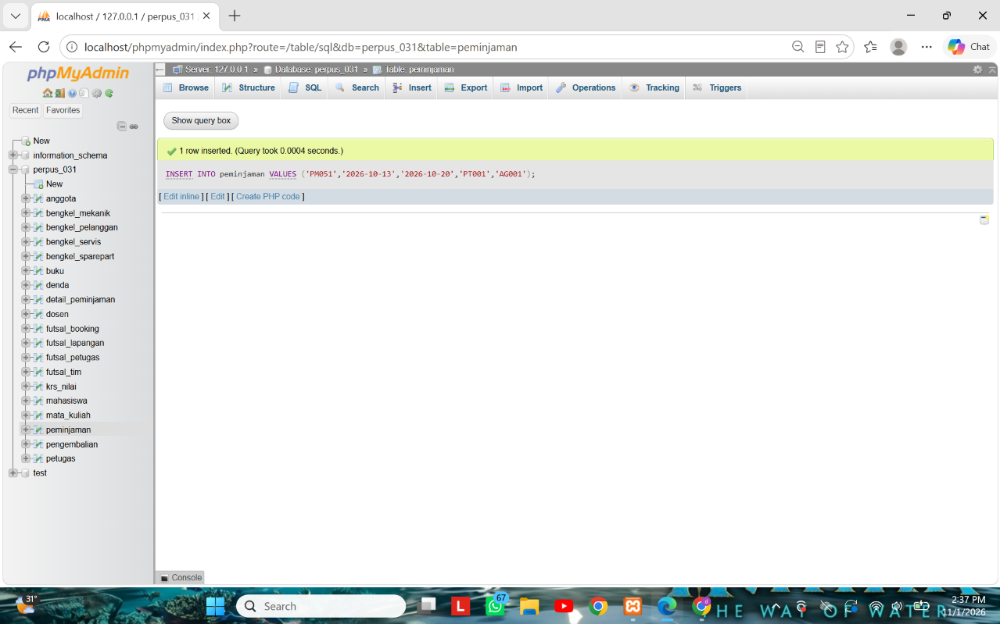
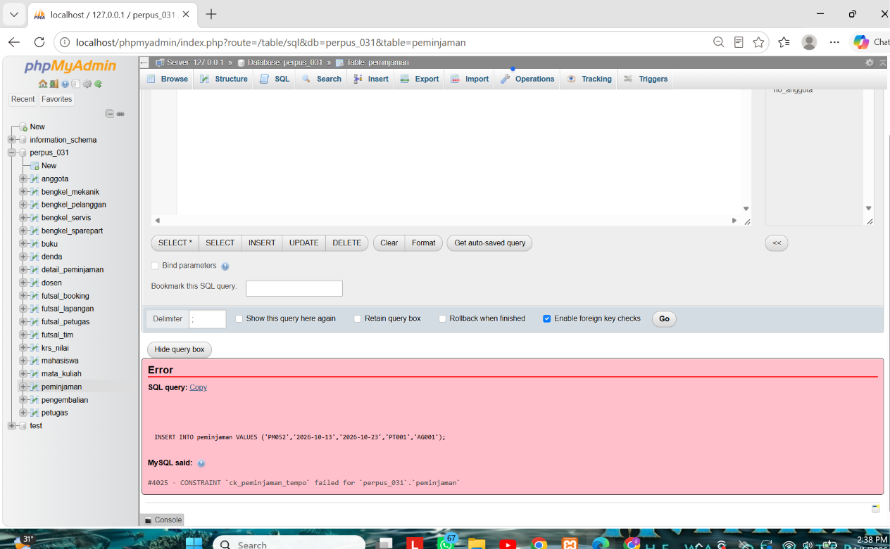
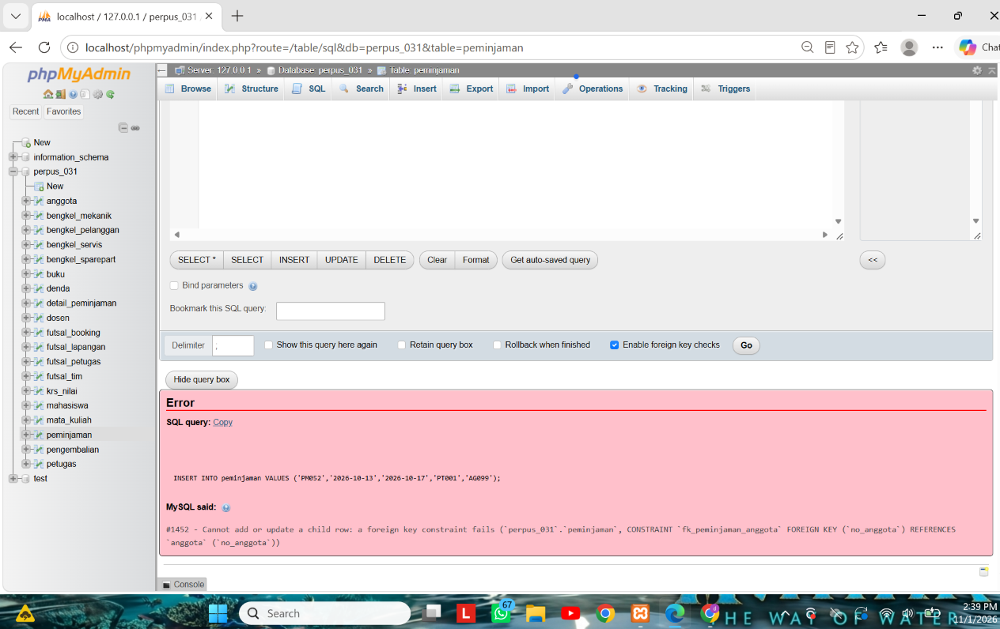
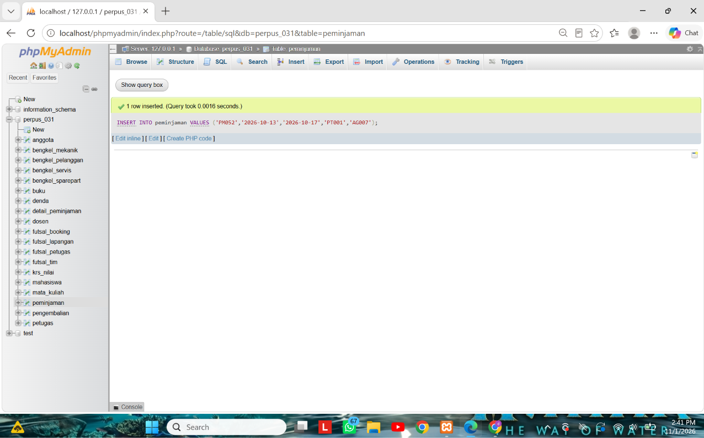

# Skenario Uji Proyek Perpustakaan Happy Reading: Pertemuan 6

| Hal | Isi |
|---|---|
| Nama | Deni Maulana Saputra |
| NIM | 25430031 |
| Basis data | `perpus_031` |
| Parameter P | 5 (transaksi utama minimal 10 × P = 50 baris) |
| Berkas terkait | `p05_ddl_25430031.sql`, `p06_data_25430031.sql` |

Setiap uji dijalankan di phpMyAdmin pada `perpus_031` setelah DDL Modul 5 dan data Modul 6 diimpor. Kolom "Hasil nyata" disalin dari layar. Data uji dibersihkan di akhir, sehingga jumlah baris kembali seperti semula.

## 1. Data sampel

| Tabel | Jumlah baris | Keterangan |
|---|---|---|
| `petugas` | 5 | tabel induk |
| `buku` | 12 | tabel induk |
| `anggota` | 8 | tabel induk, 6 Aktif dan 2 Nonaktif |
| `peminjaman` | 50 | transaksi utama (10 × P), 6 tanggal berbeda |
| `detail_peminjaman` | 99 | 1 sampai 3 buku per peminjaman |
| `pengembalian` | 35 | 15 peminjaman masih dipinjam |
| `denda` | 8 | hanya untuk pengembalian terlambat |

Peminjaman tersebar pada 5, 6, 7, 8, 9, dan 12 Oktober 2026 (9, 9, 9, 8, 8, dan 7 nota).

*Keterangan: jumlah baris tujuh tabel perpustakaan setelah semua uji selesai dan data uji dibersihkan.*

## 2. Tabel skenario uji

| Kode | Masukan | Harapan | Hasil nyata | Status | Aturan atau constraint |
|---|---|---|---|---|---|
| UJ-01 | Peminjaman `PM051`, 7 hari, anggota Aktif AG001 | Diterima | Diterima (1 row inserted) | LULUS | AB-12, AB-04 |
| UJ-02 | Detail `PM051` dengan buku `BK001`, kondisi Baik | Diterima | Diterima | LULUS | `pk_detail_peminjaman`, AB-13 |
| UJ-03 | Pengembalian `PG036` untuk `PM051` | Diterima | Diterima | LULUS | AB-07 |
| UJ-04 | Peminjaman dengan nomor `PMX01` | Ditolak, galat 4025 | Ditolak, galat #4025 | LULUS | `ck_peminjaman_no` (NFR-03) |
| UJ-05 | Peminjaman dengan jatuh tempo 10 hari | Ditolak, galat 4025 | Ditolak, galat #4025 | LULUS | `ck_peminjaman_tempo` (AB-12) |
| UJ-06 | Anggota baru dengan NIM kembar `25421007` | Ditolak, galat 1062 | Ditolak, galat #1062 | LULUS | `uq_anggota_nim` (AB-02) |
| UJ-07 | Peminjaman untuk anggota `AG099` (tidak ada) | Ditolak, galat 1452 | Ditolak, galat #1452 | LULUS | `fk_peminjaman_anggota` (AB-04) |
| UJ-08 | Buku `BK001` dicatat dua kali pada `PM051` | Ditolak, galat 1062 | Ditolak, galat #1062 | LULUS | `pk_detail_peminjaman` |
| UJ-09 | Stok buku diubah menjadi -1 | Ditolak, galat 4025 | Ditolak, galat #4025 | LULUS | `ck_buku_stok` |
| UJ-10 | Pengembalian kedua untuk `PM051` | Ditolak, galat 1062 | Ditolak, galat #1062 | LULUS | `uq_pengembalian_pinjam` (AB-07) |
| UJ-11 | Hapus petugas `PT001` yang pernah melayani | Ditolak, galat 1451 | Ditolak, galat #1451 | LULUS | kunci tamu ke `petugas` (RESTRICT, NFR-02) |
| UJ-12 | Denda dengan tarif harian 0 | Ditolak, galat 4025 | Ditolak, galat #4025 | LULUS | `ck_denda_tarif` (AB-08) |
| UJ-13 | Peminjaman oleh anggota Nonaktif `AG007` | Seharusnya ditolak | **Diterima** | **GAGAL** | AB-03 |

Ringkasan: 13 skenario, 12 LULUS, 1 GAGAL. Skenario negatif ada 9 (UJ-04 sampai UJ-12), lebih dari minimal 5.

## 3. Bukti tangkapan layar

*Keterangan: UJ-01, peminjaman `PM051` untuk anggota Aktif diterima server.*

*Keterangan: UJ-05, jatuh tempo 10 hari ditolak dengan galat 4025 oleh `ck_peminjaman_tempo`.*

*Keterangan: UJ-07, anggota `AG099` tidak ada sehingga ditolak dengan galat 1452.*

*Keterangan: UJ-13, anggota Nonaktif berhasil meminjam. Ini uji yang gagal.*

## 4. Uji yang gagal: utang desain untuk Modul 14

UJ-13 menunjukkan aturan **AB-03** (hanya anggota Aktif yang boleh meminjam) belum dijaga. Peminjaman `PM052` untuk anggota Nonaktif `AG007` diterima. Setelah dicatat, baris uji dibersihkan.

Penyebab: status anggota ada di tabel `anggota`, sedangkan peminjaman ada di tabel `peminjaman`. `CHECK` hanya dapat melihat kolom dalam satu baris pada satu tabel, dan kunci tamu hanya memeriksa bahwa nilainya ada di tabel induk, bukan nilai kolom lain di tabel induk itu.

Utang desain: aturan ini dikerjakan di Modul 14 dengan transaksi atau pemicu. Aturan lain di bagian 4 skrip DDL yang juga belum dapat dijaga constraint: AB-05 (satu peminjaman minimal satu buku), AB-06 (stok harus lebih dari 0 dan dikurangi saat dipinjam), AB-11 (maksimal 7 buku per peminjaman), dan AB-07 bagian tanggal pengembalian tidak boleh sebelum tanggal peminjaman.

## 5. Dapat dijalankan ulang

DDL Modul 5 dijalankan lebih dulu (membangun ulang tabel kosong), lalu `p06_data_25430031.sql`. Hasilnya sama: jumlah baris 5, 12, 8, 50, 99, 35, dan 8, dengan 6 tanggal peminjaman.
