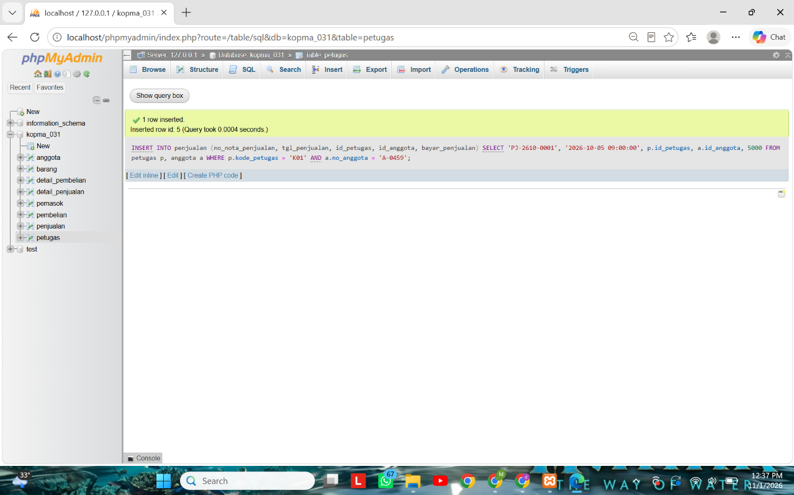
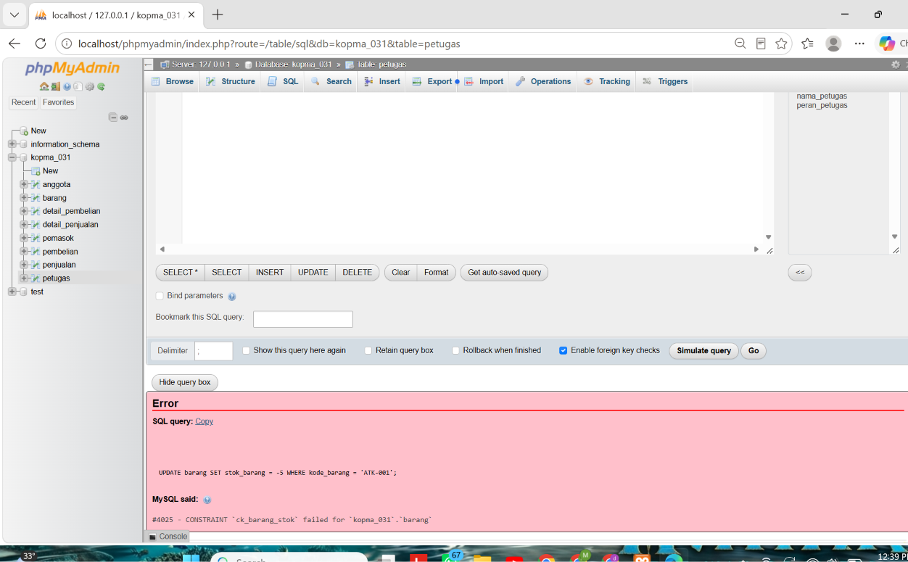
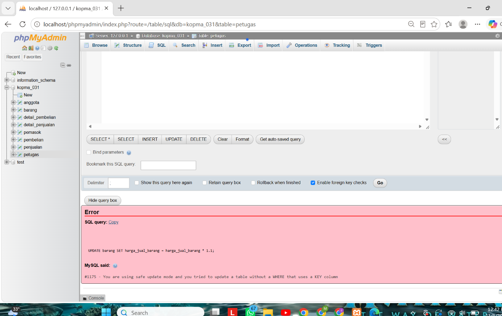
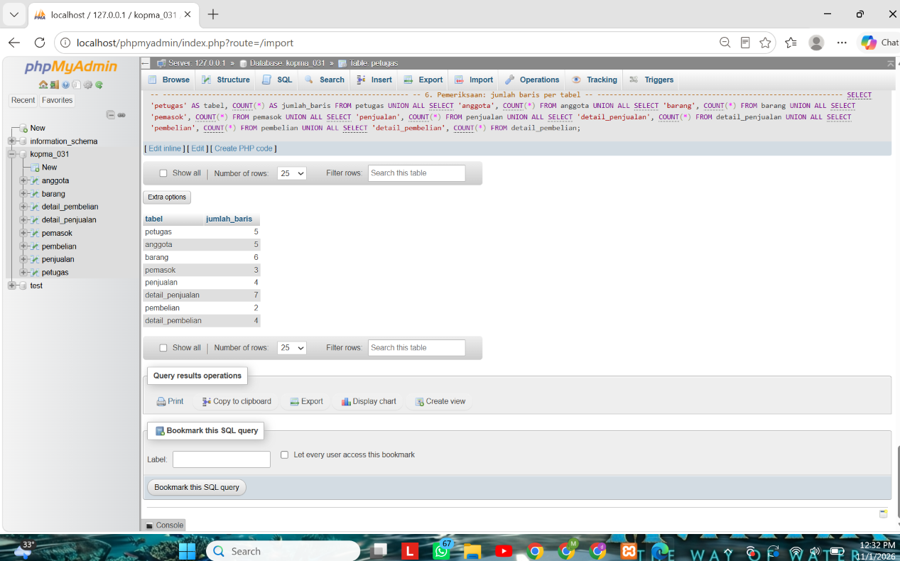

# Skenario Uji Kopma: Pertemuan 6

| Hal | Isi |
|---|---|
| Nama | Deni Maulana Saputra |
| NIM | 25430031 |
| Basis data | `kopma_031` |
| Berkas terkait | `p05_ddl_kopma_25430031.sql`, `p06_data_kopma_25430031.sql` |

Setiap uji dijalankan di phpMyAdmin pada `kopma_031`. Kolom "Hasil nyata" disalin dari layar, bukan dari perkiraan.

## 1. Tabel skenario uji

| Kode | Masukan | Harapan | Hasil nyata | Status | Aturan |
|---|---|---|---|---|---|
| UJ-01 | Nota `PJ-2610-0001` untuk anggota aktif A-0459, petugas K01 | Diterima | Diterima (1 row inserted) | LULUS | AB-02 |
| UJ-02 | Nota `PJ-2610-0002` tanpa anggota (pembeli umum) | Diterima, `id_anggota` NULL | Diterima, `id_anggota` NULL | LULUS | AB-02 |
| UJ-03 | `UPDATE barang SET stok_barang = -5` untuk `ATK-001` | Ditolak, galat 4025 | Ditolak, galat #4025 | LULUS | AB-03 (`ck_barang_stok`) |
| UJ-04 | Nota dengan nomor `PJ-2609-0142` yang sudah ada | Ditolak, galat 1062 | Ditolak, galat #1062 | LULUS | AB-01 (`uq_penjualan_nota`) |
| UJ-05 | Detail penjualan dengan qty 0 | Ditolak, galat 4025 | Ditolak, galat #4025 | LULUS | `ck_detail_qty` |
| UJ-06 | Anggota baru dengan NIM kembar `2543004571` | Ditolak, galat 1062 | Ditolak, galat #1062 | LULUS | AB-05 (UNIQUE NIM) |
| UJ-07 | Nota dengan `id_petugas` 99 (tidak ada) | Ditolak, galat 1452 | Ditolak, galat #1452 | LULUS | `fk_penjualan_petugas` |
| UJ-08 | `UPDATE` tanpa `WHERE` saat `sql_safe_updates = 1` | Ditolak, galat 1175 | Ditolak, galat #1175 | LULUS | Kebijakan lab |
| UJ-09 | Hapus nota `PJ-2610-0001` yang punya 1 baris detail | Detail ikut terhapus | Detail sebelum 1, sesudah 0 | LULUS | `ON DELETE CASCADE` |
| UJ-10 | Hapus petugas K03 (Rina) yang pernah melayani nota | Ditolak, galat 1451 | Ditolak, galat #1451 | LULUS | `fk_penjualan_petugas` |
| UJ-11 | Catat 500 pulpen pada nota `PJ-2610-0002` padahal stok 116 | Seharusnya ditolak | **Diterima** (qty 500, stok 116) | **GAGAL** | Belum ada aturan |

Ringkasan: 11 skenario, 10 LULUS, 1 GAGAL. Skenario negatif ada 7 (UJ-03 sampai UJ-08 dan UJ-10).

Catatan UJ-08: perintah yang sama dengan `WHERE kategori_barang = 'ATK' AND id_barang > 0` diterima (2 rows affected), karena `WHERE` memakai kolom kunci. Perubahan harga itu dibatalkan dengan `ROLLBACK`, dan harga ATK kembali ke 4000.00 dan 6500.00.

## 2. Bukti tangkapan layar

*Keterangan: UJ-01, nota untuk anggota aktif diterima server.*

*Keterangan: UJ-03, stok -5 ditolak dengan galat 4025 oleh `ck_barang_stok`.*

*Keterangan: UJ-08, `UPDATE` tanpa `WHERE` ditolak dengan galat 1175 di mode aman.*

*Keterangan: jumlah baris setiap tabel `kopma_031` setelah semua uji selesai dan data uji dibersihkan.*

## 3. Uji yang gagal: utang desain untuk Modul 14

UJ-11 sengaja dijalankan untuk menunjukkan aturan yang belum dapat dijaga. Nota `PJ-2610-0002` berhasil mencatat 500 pulpen walaupun stok `ATK-001` hanya 116. Setelah dicatat, baris uji dibersihkan dengan `DELETE FROM penjualan WHERE no_nota_penjualan = 'PJ-2610-0002'`.

Penyebab: `CHECK` hanya dapat membandingkan kolom di satu baris pada satu tabel (`stok_barang >= 0` di `barang`). Jumlah beli ada di `detail_penjualan` dan stok ada di `barang`, jadi membandingkan keduanya memerlukan logika lintas tabel.

Utang desain: aturan "jumlah beli tidak boleh melebihi stok" dikerjakan di Modul 14 dengan transaksi atau pemicu.

## 4. Latihan E

**E.1 Arsip anggota nonaktif lama.** Anggota nonaktif yang mendaftar sebelum 2025 dan tidak punya nota dipindahkan ke `anggota_arsip`. Hasil: `anggota_arsip` berisi A-0312. Tabel `anggota` masih berisi A-0313, A-0457, A-0458, dan A-0459. A-0313 tetap tinggal karena masih punya nota `PJ-2503-0007`.

**E.2 Harga makanan naik 5%, dibulatkan ratusan.** Dijalankan di dalam transaksi lalu di-`ROLLBACK`.

| Barang | Harga awal | Di dalam transaksi | Setelah `ROLLBACK` |
|---|---|---|---|
| MKN-001 | 5000.00 | 5300.00 | 5000.00 |
| MKN-002 | 3500.00 | 3700.00 | 3500.00 |

## 5. Dapat dijalankan ulang

DDL Modul 5 lalu data Modul 6 dijalankan ulang dari awal, dan hasilnya sama.
